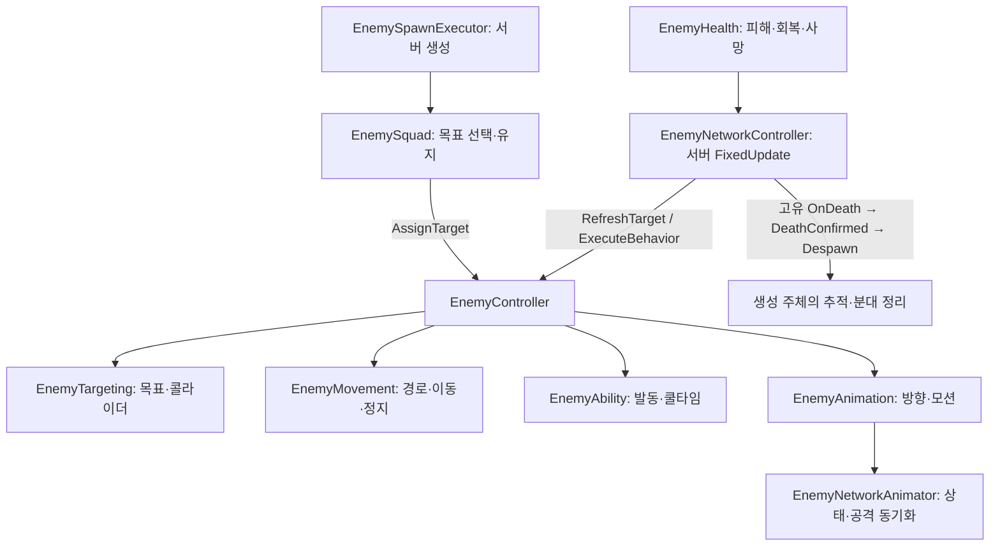
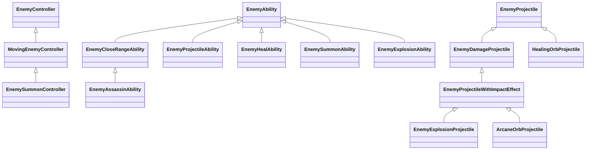

# Enemy 시스템 가이드

수정일: 2026-11-10
상태: #540 통합 브랜치 구현 기준. 밸런스 확정·전체 네트워크 인수 완료를 의미하지 않는다.

[문서 목차](../README.md) · [Stage 1 콘텐츠와 등록](stage1-enemy-content-guide.md) · [Encounter 편성·예산](encounter-planning-guide.md)

이전 설명은 [#540 갱신 전 보관본](../archive/2026-11-08/enemy-system-guide-before-540.md)에 고정 커밋과 함께 보존했다.

## 스크립트 폴더

```text
Features/Enemy/
├─ Contracts/             # 다른 Feature와 공유하는 계약
├─ Effects/               # Enemy 효과 전용 어셈블리
├─ Runtime/
│  ├─ Abilities/           # 근접·원거리·회복·소환 능력
│  ├─ Controllers/        # 몬스터 행동 조율
│  ├─ Health/              # 체력·피격 규칙
│  ├─ Movement/            # 이동 및 경로 탐색
│  ├─ Networking/          # 네트워크 권한·상태·생성
│  ├─ Presentation/        # 애니메이션·깊이 정렬
│  ├─ Projectiles/         # 공격·회복 투사체와 충돌 효과
│  └─ Targeting/           # 타깃·감지·분대
├─ Encounter/
│  ├─ Data/                # Definition·Catalog·편성 데이터
│  ├─ Planning/            # 편성 선택·공간 분배·예산
│  ├─ Spawning/             # 스폰 실행·지점 등록·배치
│  └─ EncounterRuntime.cs  # Encounter 진입점
├─ Editor/
│  ├─ Authoring/           # Scene 및 SpawnPoint 제작 도구
│  └─ Tests/               # EditMode 테스트
├─ Legacy/Targeting/       # 현재 사용하지 않는 점수 기반 타깃 코드
└─ Testing/                # PlayMode·씬에 붙이는 테스트 드라이버
```

스크립트 이동은 클래스 이름·네임스페이스를 바꾸지 않았으며 `.meta` GUID를 보존했다. `Contracts`와 `Effects`의 asmdef 위치도 유지한다.

## 책임과 실행 흐름

`EnemyAIBrain`을 거치지 않고 컨트롤러가 행동을 조율한다. 공통 참조는 `EnemyController`, 이동형 조율은 `MovingEnemyController`, 실제 기능은 Targeting·Movement·Ability·Animation·Health가 소유한다. 몬스터 이름마다 컨트롤러를 만들지 않고 행동이 달라지는 지점에 능력 또는 컨트롤러를 추가한다.



단일 플레이도 Host로 실행하는 현재 게임 흐름을 따른다. 로컬/네트워크 Driver와 운영 프리팹을 별도로 완성한 구조가 아니다. Core 연결은 여전히 `EnemyNetworkTestLauncher`가 기존 계약을 구현해 담당한다. 운영용 연결 컴포넌트 분리는 후속 작업이다.

## 스크립트와 프리팹 상속



스크립트 상속과 Prefab Variant 상속은 각각 관리한다. `Base/EnemyRoot.prefab → MovingEnemy.prefab → MeleeEnemy.prefab 또는 RangedEnemy.prefab`이 공통 제작 계층이다. 지원·특수·암살자도 필요한 컴포넌트를 조합하고, 소환형처럼 이동 이후 상태 전이가 다를 때 컨트롤러를 분리한다. 구체 에셋은 [콘텐츠 가이드](stage1-enemy-content-guide.md)를 따른다.

## 컴포넌트 책임

| 컴포넌트 | 현재 역할 |
| --- | --- |
| `EnemyController` | 공통 참조, `AssignTarget`, 분대 참여·갱신 요청, 능력 사용·애니메이션 연결, 고유 `OnDeath` 진입점 |
| `MovingEnemyController` | 실행 중 능력은 정지 대기. 발동 조건을 충족하면 능력을 시도하고, 아니면 목표로 이동 |
| `EnemySummonController` | 이동 → 변태 → 위치 고정 상태 전이. 변태 완료 후 소환 능력 실행 |
| `EnemyTargeting` | 목표 Transform과 대상 Collider 목록·유효성 관리 |
| `EnemyMovement` | NavMesh 경로 요청, waypoint 방향, Rigidbody2D 이동·정지 |
| `EnemyAbility` | `CheckCondition`, `Activate`, 쿨타임, 실행 권한, 공통 Collider 거리 검사·기즈모 |
| `EnemyAnimation` | 네 방향 선택, 이동 속도 파라미터, 능력 모션 재생 |
| `EnemyNetworkController` | 서버 행동 실행, Match 시간·수명 연결, 체력 사망 및 폭발 제거 처리 |
| `EnemyNetworkAnimator` | 이동 상태를 NetworkVariable로 전달, 공격 Trigger를 서버 실행 및 RPC로 전달 |
| `EnemyHealth` | 체력 초기화, 피해·회복, 중복 사망 방지, `Died` 알림 |
| `EnemyDamageRule` | 공격자 종류에 따른 피격 허용 정책. Health의 특정 몬스터 분기를 피한다 |
| `EnemyDepthSorting` | 발 BoxCollider2D의 월드 중심 Y를 현재 씬 지면 bounds에 정규화. 기본 Z 범위 65~70 |

`EnemyRoot`의 `footCollider`에는 발 충돌용 BoxCollider2D를 연결한다. Variant는 이 참조를 상속하며, 발 콜라이더를 교체한 경우 정렬 참조도 다시 연결한다. 각 몬스터의 발 중심을 같은 바닥 기준으로 맞춰 몸통 높이에 따라 앞뒤 순서가 달라지지 않게 한다.

## 타깃·분대·이동

목표 선택은 `EnemySquad`가 담당한다. 유효한 목표는 유지하고, 없거나 공격 불가능해졌을 때 분대 중심에서 가장 가까운 유효 후보를 찾는다. 검색 간격은 현재 0.5초다. 일반 Executor가 등록한 분대는 Executor에서 갱신하고, `JoinSquad`로 등록된 소환 적·테스트 적은 대표 활성 구성원의 `RefreshTarget()` 요청으로 분대 단위 검색을 한다.

`EnemyDefinition.SquadMode`는 공동 분대/개별 분대, `TargetRule`은 PlayerOrTurret/PlayerOnly를 선택한다. 일반 스폰도 타깃 규칙이 다른 구성원은 같은 분대에 섞지 않는다. BlackWolf는 개별 PlayerOnly 분대다.

현재 분대 선택 경로는 최단거리 조회를 사용한다. `EnemyAIProfile`과 점수 평가용 옛 클래스 파일이 남아 있다는 사실을 현재 분대가 점수식을 사용한다는 뜻으로 해석하지 않는다.

재검색은 **타깃 교체**다. 움직이는 같은 플레이어의 위치를 주기적으로 다시 경로 계산하는 기능과 다르다. 현재 `AssignTarget()`에서 `SetDestination()`을 호출하며, 이동 타깃 지속 추적·경로 갱신 스케줄러는 후속 작업이다. 감지 반경에 들어온 플레이어 우선 전환·타깃별 공격인원 포화도도 이 분대 코드의 구현 완료 항목이 아니다.

이동은 XY NavMesh 경로를 구하고 Rigidbody2D의 `linearVelocity`를 지정한다. `Stop()`은 속도를 0으로 만든다. AddForce 전환은 별도 이슈다. `CheckCondition()`은 쿨타임과 독립적이므로, 사거리에 도착한 적은 쿨타임 중에도 정지한다.

## 능력·투사체·애니메이션

`CheckCondition()`은 효과를 쓸 상황인지 판단하고, `Activate()`는 실행 성공 여부를 반환한다. `TryUse()`가 성공했을 때 공통 쿨타임을 시작하며 컨트롤러가 능력 모션을 재생한다. `IsExecuting`은 진행 중인 공격·소환 등을 기다리는 데 사용한다. `FacingTarget`은 회복할 아군처럼 이동 목표와 다른 대상을 바라볼 때 사용한다.

공통 범위 필드는 `activationRange`다. 몸통과 대상의 활성 비트리거 Collider 사이 표면 거리를 비교한다. 몸통은 명시적으로 연결한 Trigger도 사용할 수 있으며 Bomber는 CapsuleCollider2D를 사용한다. 발동 거리와 폭발 피해 반경은 별개다.

`EnemyProjectileAbility`는 발사 위치·방향·피해량을 정하고 `EnemyProjectileGenerator`에 생성을 요청한다. 생성 후 이동·명중·수명은 투사체가 담당한다. 애니메이션 이벤트 발사를 사용하는 프리팹은 `OnProjectileFireAnimationEvent()`와 `OnProjectileAttackAnimationFinished()`를 연결한다.

`EnemyProjectile`은 공통 권한·수명·Match 시계·깊이 정렬을, `EnemyDamageProjectile`은 피해량·속도·방향 동기화·충돌을, `HealingOrbProjectile`은 아군 추적과 도착 회복을 담당한다. 공격 투사체 방향 파라미터는 `DirectionX`/`DirectionY`다. FX가 필요한 공격은 `EnemyProjectileWithImpactEffect`를 조합한다. FX 종료 이벤트와 비반복 클립을 확인한다.

본체 Animator는 `MoveX`, `MoveY`, `IsMoving`, `MoveAnimSpeed`, `Attack`을 사용한다. `EnemyAnimation`은 네트워크 애니메이터가 스폰돼 있으면 서버 경로로 재생하고, 로컬 테스트에서는 Animator Trigger를 직접 재생한다. 서로 완전히 독립된 컴포넌트라고 가정하지 않는다.

## 피격 계약과 사망

다른 파트가 적을 공격할 때는 [IAttackableEnemy](../../Assets/Scripts/Features/Enemy/Contracts/IAttackableEnemy.cs)의 `CanBeAttackedBy(AttackSourceType)`와 `TryTakeDamage()`를 사용한다. 공격자 종류를 잃는 기존 `TakeDamage(int)`는 Unknown으로 전달되므로, 암살자의 Player 전용 피격 정책을 통과하지 못한다. 새 호출자는 공격자 종류를 정확히 전달한다.

`EnemyHealth`는 공통 활성/사망 상태를 검사하고 `EnemyDamageRule`에 정책을 위임한다. 암살자 규칙은 `EnemyAssassinDamageRule`이 담당한다. 탐지자 등록은 `IDetectableTarget.RegisterDetector/UnregisterDetector`로 제공하고, 서버 결과는 `EnemyNetworkDetection`의 NetworkVariable로 전달한다. 플레이어 반경 검출과 터렛의 후보 제외는 해당 파트가 이 계약을 소비해야 한다. 은신 셰이더는 후속 작업이다.

적이 Player/Turret에 주는 피해는 `TargetableComponent.TryApplyDamage()` 또는 `IDamageableTarget` 공통 수신 계약으로 전달한다. 현재 근접 코드는 PlayerInfo 직접 호출 방식이 아니다. Mage 감속은 `ISlowEffectReceiver.ApplySlow()`를 호출하며, 실제 이동/공격속도 변경은 대상 수신자가 담당한다. Enemy에서 API를 호출한다는 사실을 모든 터렛 수신 구현 완료로 해석하지 않는다.

일반 사망은 `EnemyHealth.Died → EnemyNetworkController → controller.OnDeath → DeathConfirmed → Despawn` 순서다. 고유 사망 반응 또는 관측자의 예외가 나머지 제거를 막지 않도록 처리한다. `Despawned`는 사망 외 제거도 알린다. Bomber는 폭발 피해를 먼저 적용하고, 모션 종료 시 `RemovalRequested`로 제거하므로 일반 체력 사망과 구분한다.

## 실행 권한과 시간

일반 행동·피해·네트워크 생성은 서버 권한이다. 공통 능력 쿨타임과 투사체 수명은 연결된 `FieldSimulationTime`을 사용하고, 투사체는 생성자에게서 Match 시간·종료 수명을 전달받는다. 모든 새 능력이 공용 시간과 저장에 완전히 연결됐다고 주장하지 않는다. 예를 들어 `EnemyAssassinAbility`의 공격 준비 대기는 아직 `WaitForSeconds`를 사용한다.

체크포인트 병합에서는 기존 공격 투사체 저장을 `EnemyDamageProjectile`에 연결하고 분대 복원 시 Definition의 분대/타깃 규칙을 유지했다. 회복 구슬·소환사의 고유 진행 상태·탐지 상태·Runtime의 점진 예산 상태까지 전체 저장/복원을 완료한 것은 아니다. 이 부분은 새 지원 범위를 담당자와 따로 확인한다.

## 테스트 모드

- `EnemyNetworkController.runOffline`과 `testTarget`: 몬스터 하나를 배치해 이동·모션을 확인하는 임시 로컬 경로. 네트워크가 실행 중이면 서버 경로를 따른다.
- `EnemySquadTester`: 배치한 몬스터를 각각 1인 분대에 등록한다. `initialTarget`이 없으면 규칙에 맞는 타깃을 찾고, 목표 무효화 후 재검색도 확인할 수 있다.
- `EnemyTestDriver`: 기존 별도 로컬 행동 실행기. `runOffline` 실행과 중복 사용하지 않는다.
- `EnemyDetectionTester`: 탐지자 A/B 등록·해제로 여러 플레이어의 탐지 해제 조건을 확인한다.

Host/Client 검증에서는 로컬 실행 플래그를 끄고 실제 NetworkObject Spawn·Network Prefab 등록·효과 동기화를 확인한다. 상세 순서와 이번 브랜치 검증 기록은 [콘텐츠 가이드](stage1-enemy-content-guide.md#검증과-남은-작업)를 따른다.
