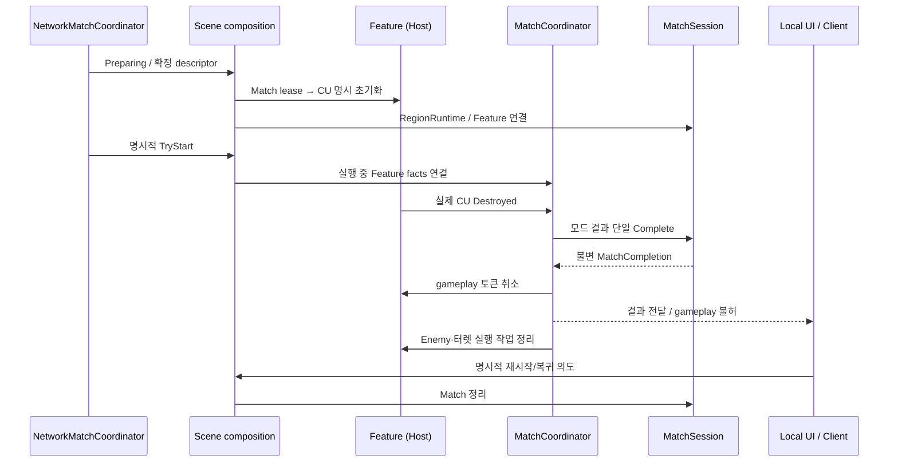

# Match 운영 책임과 수명 계약

기준일: 2026-10-26. 결정: 기존 Core/Feature를 유지하고 아래 책임을 분리한다. 이 문서의 **목표**가 코드 구현 완료를 뜻하지 않는다. 구현 증거는 해당 배치 기록으로 확인한다.

## 책임과 이름

| 구성 | 소유 수명 | 책임 | 다른 구성에 남기는 책임 |
| --- | --- | --- | --- |
| AppBootstrap / AppRoot | App | 의존성 생성·주입, App 종료, Match/Scene 조립 연결 | 승패·Enemy·터렛 규칙 |
| AppServices | App | 명시적으로 소유권을 넘겨받은 서비스/전송 해제 | Feature 전역 조회용 service locator |
| NetworkMatchCoordinator | 연결의 Match 준비 세대 | 참가자·Scene 준비·Host 시작/종료·SDK 발신자 대응 | 플레이어 이동 복제·HP·승패 판단 |
| MatchSession | 한 Match | 기존 상태/시뮬레이션·지역·사건·완료 자료 수명 | Scene 로딩·팝업 |
| **MatchCoordinator** | 한 권위 Match | Feature 사실을 받아 모드 판단·단일 완료·새 요청/시간 작업 차단. 실제 CU 파괴 연결 구현 | 두 번째 MatchState·Feature HP 원본 |
| **SceneFlowController** | App의 전환 작업 | 실제 Unity/단독 Host NGO 전환·Additive 취소/실패 복구, 입력 잠금 수명 | 승패·보상·Hub 콘텐츠·다중 참가자 이동 합의 |
| **ScreenManager** | 로컬 UI | 실제 Menu/Loading/MatchResult stack·focus/back·Presenter 해제·입력 잠금 | Host 게임 시간·전투 권위·기존 Combat HUD |
| InitialStageCompositionRoot | Scene | CU/Grid/Feature 참조 검사, 순서 있는 연결과 rollback | 진행 규칙·전역 서비스 보관 |

`Coordinator`는 여러 기능을 조율하는 Application 객체, `Controller`는 흐름 제어, `Manager`는 이 UI 화면 집합의 수명 관리라는 기존 명명 관례를 따른다. 새 God GameManager나 Singleton을 추가하지 않는다.

## 상태 원본: 하나의 writer

| 자료 | 권위 writer | Core/UI가 받는 것 |
| --- | --- | --- |
| Player HP·입력·NetworkBehaviour | 이영빈의 Player Feature / Host 정책 | 읽기 snapshot·실제 사건·등록된 권위 actor |
| CU HP | 황재동의 ControlUnitHealth | 현재 vitals·Destroyed 사실 |
| 터렛 HP·열·전력·강화·수리 | 황재동의 Turret Feature | 공용 요청 결과·표시 Frame·식별자 |
| Enemy·실제 생성·목표·사망 | 조수빈의 Enemy Feature | 요청/계획/실행 결과·현재 위치·사망/제거 사건 |
| 환경 표현·날씨 source | 김진태의 World Feature | Host가 확정한 날씨/시간대 context |
| 확정 점령 셀 | Match의 RegionRuntime | 같은 Grid/revision의 읽기 snapshot |
| 최종 Match 결과 | Host의 MatchSession 완료 경로 | actor 참조 없는 불변 결과 |

과거 `architecture-rebuild-notes`의 “HP 원본을 MatchState로 이동”은 당시 목표 제안이다. 현재 Feature의 실제 HP와 별도로 독립적인 Core HP writer를 만들지 않는다. MatchState의 기존 초기값을 실제 CU/Player 현재 HP로 간주해 승패를 판단하지 않는다. 새로운 모드 판단 입력은 Feature의 검증된 사실/읽기 자료다.

## 준비·실행·완료·연결 종료

연결 `Running`은 게임플레이 허용과 다르다. 완료 즉시 공용 gameplay gate가 닫혀야 하며 App의 네트워크 pump·결과 전송은 계속될 수 있다. 결과를 수신하기 전에 anchor/Session을 폐기해 Client가 결과를 잃으면 안 된다. 종료/다른 준비 세대의 늦은 사건·콜백·결과는 적용하지 않는다.

완료 도중 예외는 숨기지 않는다. 중복 파괴/요청/재진입은 완료·보상·생성을 중복 실행하지 않는다. 모든 정리 작업을 시도하고 오류를 모아 보고한다. 결과 확정과 Dispose/연결 Shutdown은 별개 단계다.

## Scene과 UI

- `ISceneFlow`는 실제 Unity 로더 adapter의 좁은 Port로 유지한다. 전환 취소가 Unity AsyncOperation 자체를 되감는다는 보장은 없으므로 로더의 실제 완료 후 소유한 Scene을 정리한다.
- 필수 Scene 참조/ID/PlayerStart 슬롯/CU/Grid/NGO 등록은 준비 전에 읽기 전용으로 검사한다. 자동 Scene 수정·기본값 덮어쓰기는 별도 Editor 명령이다.
- 입력 잠금은 소유자별 token/lease로 획득·해제한다. 화면 하나를 닫아 다른 화면·로딩·사망·완료 잠금을 해제하지 않는다. 기존 Player 입력 경계로 투영하고 새 static 전역 입력 상태를 만들지 않는다.
- 개인 메뉴·UI 입력 차단·Debugger TimeScale·Host의 게임 pause는 별개다. 임시 Additive Hub 이동을 항상 Match 종료로 바꾸지 않는다. 전장 시간/재입장 제품 정책은 미결이다.

## 시간·환경·추가 생성

- Match의 게임 시간 조회와 App의 unscaled 네트워크 pump/진단 시간을 분리한다. 새 전역 tick/scheduler를 만들지 않는다.
- 날씨와 시간대는 독립 축이며 Host가 확정한 MatchId/revision을 가진 읽기 context다. 변경 사건 자체가 반드시 Spawn 명령은 아니다.
- Encounter가 실제 계획에 사용한 환경/공간 revision과 원인을 결과에 남긴다. Seed만 기록해 결정론 replay를 보장하지 않는다.
- 포인트 밖 생성은 origin/source 계약으로 실제 Enemy 경로에 연결한다. Core가 별도 Instantiate/Spawner/길찾기를 만들거나 가짜 SpawnPoint ID를 사용하지 않는다.
- Grid 포함 여부와 지형·NavMesh·도달 가능성은 다르다. 후보 선택/실제 위치 검증/제한된 재시도는 Enemy/World 실행 경계가 담당한다.
- source 제거는 그 source의 pending을 취소한다. 이미 생성된 적의 수명과 동일시하지 않는다. Match 종료는 모든 origin의 실제 적을 공통 추적/정리 경로로 해제한다.

## 레거시 책임 대응과 이번 범위

| 예전 책임 | 현재/목표 대체 | 상태 |
| --- | --- | --- |
| 전역 부팅·영구 Manager | AppBootstrap / AppRoot / AppServices | 기존 기반 |
| 게임 시작·승패·종료 | MatchSession + MatchCoordinator + IModeRules | 실제 CU 파괴·단일 패배/요청 차단 구현. 승리·복귀 제품 정책 별도 |
| Scene 이동 | ISceneFlow + SceneFlowController + Unity/NGO adapter | 실제 재로드·Hub 복귀 구현. 다중 참가자 준비 합의 별도 |
| 화면/팝업·로딩·결과 | ScreenManager + Presenter/View | 실제 UGUI와 재시작/복귀 버튼 구현. 외형 수동 인수 별도 |
| Player/CU HP·터렛 전력 | 실제 Feature | 유지, 별도 Core writer 없음 |
| 프로필·재화·저장 | Profile/Backend/Local cache 경계 | Fake 존재, 이번 전체 구현 대상 아님 |
| Audio·옵션·커서 | 표현 서비스/로컬 UI | 누락을 명시, 이번 전체 구현 대상 아님 |

추적: #444 / #495 / #555 / #556 / #557 / #558 / #559 / #560. 실제 Player 네트워크 통합, OFF 터렛의 타깃 가능 상태와 최신 수리 정책, CU 연결성 기반 최종 제품 점유, 보스 게이트/복귀·저장은 담당자/제품 결정과 대조한다. 이 계획으로 자동 완료 처리하지 않는다.
