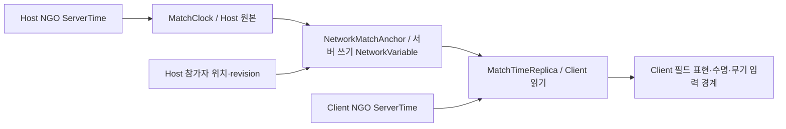

# Match 공용 시간·예약 API

> **현재 상태(2026-11-02): 타 파트 미승인 변경198경로는 제외했습니다. Core의 미연결 호출은 `CORE-FEATURE-HOLD` 표식과 원본을 남겨 임시 보류했고 Unity 컴파일은 통과했습니다. 해당 Feature 연결·통합/PlayMode는 완료 상태가 아닙니다.** [제외 범위·연결 공백](../planning/2026-11-02-feature-integration-hold.md)을 먼저 확인하세요. 아래 Feature 구현·검사 기록은 제외 전 실험 소스 기준입니다.

갱신: 2026-11-02. 공용 시계·예약, 권위 Scene/Weather, 참가자 필드 정지, Host/Client 시간 anchor와 Client 읽기 바인딩을 구현했다. 시간 복제/필드 집중 검사 16개와 별도의 Additive Enemy 검사 1개를 통과했다. 실제 낮밤 규칙과 원격 Player 출입/두 실행 파일 게임 사이클 인수는 별도다. [전체 배치](../planning/2026-11-02-core-sprint-scope.md)를 따른다.

## 역할과 호출 순서

| 타입 | 소유자·소비자 | 역할 |
| --- | --- | --- |
| `ITimestampSource` | Infrastructure가 구현, `MatchClock`이 소비 | 준비 여부와 원본 double 초 제공 |
| `NgoTimestampSource` | 조립부가 NGO 관리자를 주입 | 연결 중 SDK ServerTime을 읽음. SDK 시간을 정지하지 않음 |
| `UnityTimestampSource` | standalone/Editor 조립부 | Unity double 실시간. TimeScale을 게임 배속으로 직접 누적하지 않음 |
| `MatchClock` / `IMatchTime` | 권위 Match가 소유, Feature는 읽기 | 원본 timestamp와 anchor로 경과 초·정지·배속 계산 |
| `MatchTimeSnapshot` | 네트워크 표현/진단 읽기 자료 | Match·epoch·revision·원본/게임 anchor·배속·준비 상태. 제어 변경 사이에는 같은 anchor 유지 |
| `MatchScheduler` / `IMatchScheduler` | Match가 소유, Weather 등 Feature가 등록 | 게임 초 deadline의 단발/반복 실행·취소·처리 상한 |
| `MatchTimeService` | Scene 조립부가 소유 | 현재 Match의 clock/scheduler와 완료·폐기 시 예약 차단을 함께 관리 |
| `MatchTimeReplica` | Client Scene binding이 소유 | 검증된 Host anchor를 같은 SDK 서버 시각에서 추정. 제어/예약 쓰기 없음 |
| `NetworkMatchTimeState` / `NetworkMatchAnchor` | 서버 소유 NetworkVariable | Match·준비 세대·epoch·revision·시간 기준과 참가자 슬롯의 우주선 위치를 전송 |
| `MatchTimeSceneReplication` | 기존 Network Scene binding이 소유 | Host 기준 변경 게시, Client 초기 수신/읽기 시계/확정 위치 바인딩과 해제 |

```text
권위 Match 조립 → timestamp source 주입 → MatchClock 생성 → MatchScheduler 생성
매 프레임: clock.Pump() → scheduler.Pump() → Feature 진행/표현
해제: Feature 예약 lease/구독 해제 → scheduler.Dispose() → clock.Dispose()
```

Domain/Application은 Unity·NGO에 의존하지 않는다. SDK 어댑터만 원본 시각을 읽는다. `InitialStageCompositionRoot`는 권위 Match에 `MatchTimeService`를 만들고, 네트워크 Match에는 `NgoTimestampSource`, standalone에는 `UnityTimestampSource`를 주입한다. `MatchCoordinator`의 IMatchClock은 이를 전달한다. Scene Update는 `MatchTimeService.Pump(Time.timeScale)`을 호출하며 정식 경로에서 deltaTime을 다시 누적하지 않는다.

`InitialStageCompositionRoot.MatchTime` / `MatchTimers`는 조립부가 Feature에 주입할 읽기/예약 경계다. Feature가 Scene을 전역 검색하는 용도로 사용하지 않는다. Match 완료·폐기 시작에는 예약을 취소하고 추가 등록을 차단하며, 소비자 바인딩 해제 후 시간 서비스를 Dispose한다. 기존 `MatchCoordinator.Tick`은 시계를 주입하지 않은 독립 검사/호환 실행에서만 유효하다.

## 권위 시간과 준비·복원

권위 조율부가 `SetPaused(bool)`, `SetRate(double)`를 호출한다. 변경 전 시각을 먼저 확정하고 anchor를 교체한다. `ElapsedSeconds`는 마지막 Pump의 게임 시각이고, snapshot의 `GameSecondsAtAnchor`는 계산 기준이다. 표현에서 현재 원본 시각을 `EstimateElapsedSeconds`에 넣을 수 있다.

원본 미준비 상태는 0초와 구분한다. 미준비 중에는 게임 시각을 보존하고 준비가 돌아오면 그 시점에 다시 anchor를 잡는다. 미준비 구간을 게임 시간으로 따라잡지 않는다. 원본 역행·계산 범위 초과는 `RequiresReset=true`, `IsAvailable=false`로 동결한다. 권위 조율부는 원인을 표시하고 저장 시각 복원 또는 scope 재조립으로 처리한다.

`Restore(gameSeconds)`는 현재의 준비된 원본 시각을 기준으로 게임 초를 복원하고 새 epoch를 발행한다. scheduler는 이전 epoch 예약을 취소한다. Feature는 복원한 상태에 맞춰 다시 등록한다. 체크포인트에는 원본 NGO timestamp나 callback delegate를 저장하지 않는다.

개인 메뉴는 공유 Match 시간을 변경하지 않는다. 우주선 정지는 Host의 참가자 판정에 연결하며 필드 정지 중에도 네트워크·허브 UI/이동은 계속해야 한다. 권위 Scene의 위치 등록과 필드 Feature 연결은 [필드 정지 API](match-field-pause-api.md)를 따른다. Client 출입 요청은 별도 통합이며 시각 복제는 아래 현재 구현을 따른다.

현재 Weather는 `IMatchScheduledEnvironmentFeature.BindAuthority`로 공용 scheduler를 받고 CountTick이 제작 간격을 등록한다. 정식 바인딩 중에는 CountTick/WeatherManager의 polling 호환 경로가 동시에 진행하지 않는다. 기존 날씨 선택·seed·예고·셰이더 규칙은 유지했다. 실제 TimeOfDay source는 현재 없어 새 Feature가 같은 확장 계약을 사용할 수 있도록 제공한다.

## Feature 예약 예

아래 clock/scheduler는 조립부가 주입한 객체다. 전역 검색이나 별도 NetworkManager를 만들지 않는다.

```csharp
// Feature 바인딩 때 등록하고 해제 때 lease를 Dispose한다.
IDisposable weatherTimer = scheduler.ScheduleRepeating(intervalSeconds, tick =>
{
    // 긴 프레임의 밀린 회차는 tick.MissedIntervals로 받는다.
    // 현재 상태를 다시 평가하고 무제한 과거 사건을 생성하지 않는다.
    EvaluateWeather(tick.ExecutedAt);
}, gameplayCancellation);

weatherTimer.Dispose();
```

- 지연/간격 단위는 게임 초다. 반복 간격은 양수이며 첫 호출은 한 간격 뒤다. 등록 도중에는 callback을 실행하지 않는다.
- 긴 프레임의 반복은 한 번의 통지로 합치고 예정 시각·실행 시각·미실행 회차를 제공한다. 다음 기한은 원래 간격 위상을 유지한다.
- 기본 상한은 예약 4096개, Pump당 callback 64개이며 조립 시 조정할 수 있다. 이는 보존/처리 상한이며 게임 밸런스 값이 아니다.
- 같은 기한은 등록 순서대로 실행한다. callback 중 추가한 예약과 처리 상한을 넘는 예약은 다음 Pump부터 실행한다.
- lease 또는 토큰 취소는 실행을 차단한다. 등록/Pump/해제는 소유 스레드에서 수행하며 외부 스레드는 lease·토큰으로 취소할 수 있다.
- callback이 정지·복원·Dispose를 실행하면 뒤의 예약도 그 상태를 따른다. 한 callback의 예외가 다른 기한 작업을 누락시키지 않도록 처리한 뒤 AggregateException으로 보고한다.
- Feature의 이벤트 판단과 공용 예약 실행은 구분한다. 이 서비스를 추가하며 자동 저장·복원 이벤트를 선정하지 않는다.

## 검증 상태

`MatchTimeTests` 11개와 `MatchCoordinatorTests` 7개가 통과했다. 최초 결합 실행의 Scene fixture가 실패하여 수정한 뒤 `MatchTimeSceneTests` 1개만 별도 실행해 통과했다. 실제 Initial_Stage Host에서 시간 진행·예약 실행·완료 후 차단을 확인했으며 초기 실패 로그도 보존한다. 두 실행을 하나의 19/19 실행으로 표시하지 않는다. 이 결과는 초기 시계 바인딩 검증이다. 후속 필드 정지 검증은 별도 문서를 따른다. Weather 예약 이관은 이후 전용 검사 3개와 Scene 검사로 확인했으며 Client 시각 복제는 후속 16개 검사 구간에서 연결했다.


## Client 읽기와 네트워크 전송



매 프레임 경과 초를 보내지 않는다. Host는 정지·배속·복원·준비 상태가 바뀐 anchor나 참가자 위치 revision이 바뀔 때만 기존 anchor의 상태를 갱신한다. Client는 현재 Match/준비 세대와 증가하는 revision을 확인한다. 위치는 descriptor의 Player 슬롯 순서에 대한 우주선 bit mask이며 SDK ClientId를 영속 저장 자료로 사용하지 않는다.

`InitialStageCompositionRoot.MatchTime`은 Client의 첫 유효 수신 전 null이다. 이후 `MatchFieldReplicaScope`가 같은 읽기 시계를 필드 Feature와 로컬 Player에 전달한다. 로컬 Player는 보고권을 얻지 않으며 내부 위치에서도 필드 공격을 실행하지 않는다. `SpawnedEnemyRegistry`는 이후 NGO로 생성된 Client 적도 해당 NetworkManager/Scene의 시계에 연결한다. 이 등록은 적 생성 정책이나 전역 시간 조회를 소유하지 않는다.

처음 수신 전 0초를 정상 준비로 취급하지 않는다. anchor 소실·연결 준비 해제 시 마지막 값을 유지하고 IsAvailable을 닫는다. 같은 anchor에서 SDK 시각이 조금 뒤로 보정되면 표시 시간을 역행시키지 않으며, 새 권위 anchor는 정지/복원 보정을 위해 이전 표시보다 작은 게임 초를 확정할 수 있다. 체크포인트 복원은 새 epoch를 전달하며 옛 callback을 Client에 복원하지 않는다.

검증 `B2-TimeReplica/client-fields/results.xml`: **16/16**, 실제 localhost UTP Host/Client SDK 두 인스턴스의 NetworkVariable 전달·정지·위치·복원 epoch와 연결 유지 포함. 별도 `additive-enemy/results.xml` **1/1**로 활성 Scene이 달라도 적이 Executor Scene에 귀속되어 실제 탄환 피해를 받는 것을 확인했다. 실제 두 게임 실행 파일의 Player 생성/포털 출입을 완료했다는 증거는 아니다.


## 임시 정지 소유권과 준비 단계

체크포인트 Feature는 `ScheduleRepeating(firstDelaySeconds, intervalSeconds, callback, cancellation)`으로 남은 첫 대기와 이후 주기를 구분한다. 첫 대기 0도 등록 중 즉시 호출하지 않으며 다음 유효 Pump에서 실행한다. 복원 뒤 전체 간격부터 다시 기다리거나 과거 SDK 시각을 예약 기준으로 재사용하지 않는다. 해당 계약과 실제 Weather 연결 9개 집중 검사를 통과했다. [체크포인트 실행 API](checkpoint-execution-api.md)를 참고한다.

`MatchTimeService.AcquirePause(owner)`는 캡처·복원 조율부가 같은 메인 스레드에서 임대하고 해제하는 API다. 여러 lease와 참가자 정책의 정지는 OR로 합친다. 캡처 lease를 해제해도 전원 우주선 입장에 의한 정지나 다른 lease가 남아 있으면 계속 정지한다. 완료/폐기 뒤 늦게 해제한 lease가 Match를 재개하지 않는다. `PauseOwners`는 임시 소유자의 진단용 사본이며 참가자 정책과 별도다.

Preparing 단계의 시계는 자동 정지하고 scheduler를 실행하지 않는다. 준비 중 `Restore(gameSeconds)`도 가능하지만 준비/복원 lease가 끝나기 전 진행하지 않는다. Running으로 진입할 때 현재 원본 시각에 기준을 잡아 로딩 시간을 게임 시간에 포함하지 않는다. Clock 제어와 유효 lease의 해제는 소유 스레드에서 수행한다.

검증: `B4-PauseOwnership/results.xml`22/22 후 준비 시간 제외를 보강하고 `preparing-time/results.xml`6/6, 모두 Unity 종료0. 우주선 정책·중첩 lease·오래된 해제·잘못된 스레드, Preparing 복원, 실제 Initial_Stage 시간/필드 정지 경로를 포함한다. 저장 실행기 자체의 검증은 별도다.
