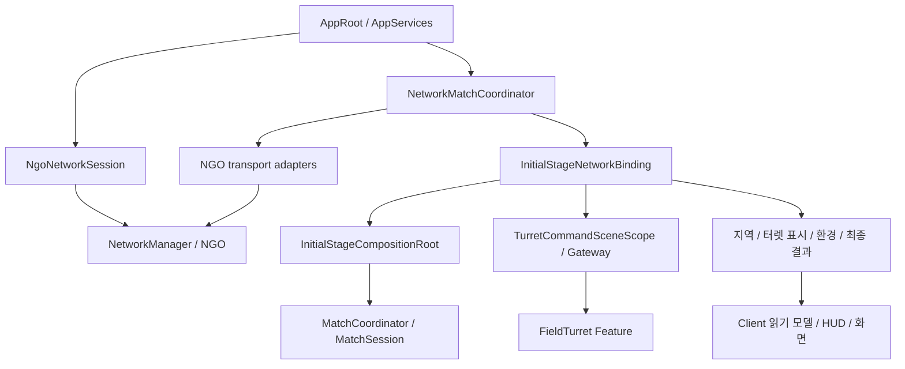
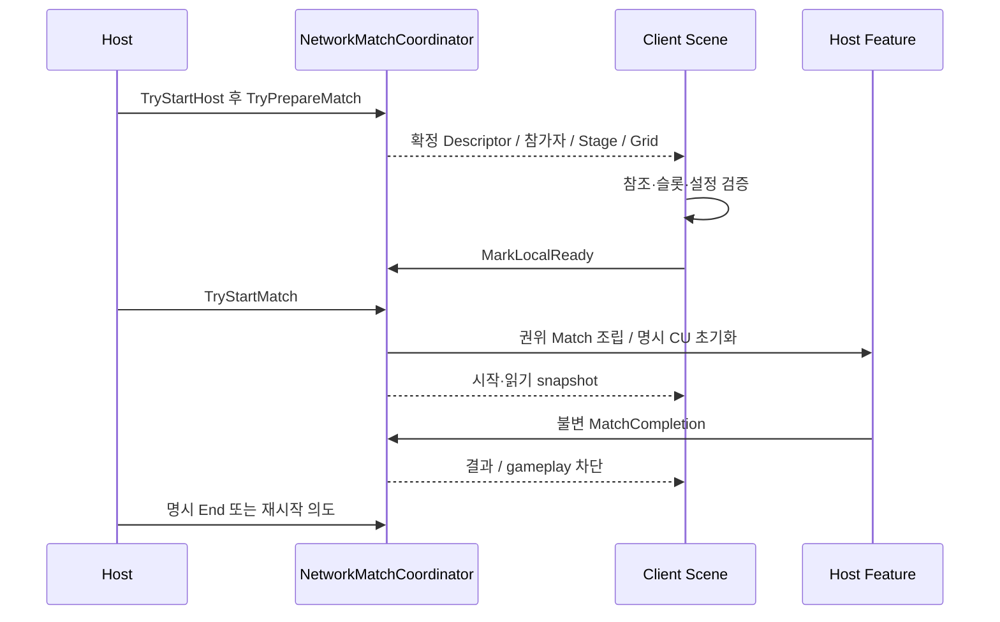

# Network Match 구조와 Feature 연결

기준일: 2026-10-28. 상태: 현재 Core 통합본의 구현 설명. [수동 인수](../planning/2026-10-28-core-acceptance.md)와 [관리 책임](match-management-responsibilities.md)을 함께 읽는다. 전체 코드가 main에 반영된 상태와 구분한다.

## 구성과 소유권



App은 연결/전송 수명을 소유하고 Match 조립은 한 판의 바인딩·구독을 소유한다. 실제 Player·터렛·Enemy 객체와 전투 상태는 해당 Feature의 서버 writer가 관리한다. 순수 C# Domain/Application에서 NGO 타입을 직접 참조하지 않는다.

## 연결과 한 판의 상태

연결 상태는 `Disconnected / StartingHost / StartingClient / Hosting / ConnectedClient / Stopping / Faulted / Disposed`다. Match 상태는 `Idle / Preparing / Running / Ended / Disposed`로 별도다.



정확한 공개 Scene 진입점은 `InitialStageNetworkBinding.TryStartHost()`, `TryStartClient()`, `TryPrepareMatch()`, `TryStartMatch()`, `TryEndMatch()`, `ShutdownConnection()`이다. 내부 준비 신호와 Feature 조립은 바인딩이 처리한다. SinglePlayerHost 진입 정책은 같은 API를 순서대로 호출하며, 참가자 수만 보고 임의의 협동 Match를 시작하지 않는다. 현재 준비 시 접속한 1~2명을 고정한다.

## 식별자와 요청

| 식별자 | 유효 범위 |
| --- | --- |
| ConnectionId / NGO ClientId | 현재 연결. 재접속 뒤 같은 사용자로 임의 재사용하지 않음 |
| PlayerId | 확정 Descriptor의 참가자 |
| MatchId | 한 판. 재시작하면 새 값 |
| DescriptorId / 준비 세대 | 이번 준비·전송 문맥. 늦은 이전 메시지 격리 |
| EntityId | 현재 Match의 논리 객체. Feature 교체 시 규약에 따라 연결 |
| NetworkObjectId | 실제 NGO 객체 수명. PlayerId/EntityId와 동일시하지 않음 |
| RequestId | 명령의 GUID. 재전송과 충돌 구분 |

터렛 요청은 `ITurretCommandRequester`를 주입받아 제출한다. Gateway가 SDK 실제 발신자를 참가자와 대조하고, Host가 Match/gameplay·거리·생존·상태를 확인한 뒤 FieldTurret API를 실행한다. UI는 pending/거부/확정 결과를 표시한다. 지원 의도는 ON/OFF, CU 자동 활성화, 레벨 승급/강등, 세부 강화/강등이다. Repair/Restore는 아직 이 명령 집합에 없다.

## Player/UI 파트가 연결할 실제 Player

`InitialStageNetworkBinding.RegisterAuthorityPlayerActor(matchId, playerId, actor)`는 **Host에 실제로 존재하는 actor**를 등록하고 `IDisposable`을 반환한다. 현재 Match 명령 scope가 준비된 후 등록한다. Player/UI의 서버 spawn·교체·despawn 경로에서 lease를 관리한다.

```csharp
// Player/UI의 서버 actor 수명 코드에 주입된 binding을 사용합니다.
_interactionLease = binding.RegisterAuthorityPlayerActor(matchId, playerId, serverActor);
// 교체/Despawn/소유 scope 해제 시:
_interactionLease?.Dispose();
_interactionLease = null;
```

재등록 전 이전 lease를 해제하고 등록 실패를 숨기지 않는다. `IPlayerInteractionActor`에서 서버의 실제 위치·생존·조작 가능 상태를 읽는다. Client가 제출한 위치/생존 bool을 권위 자료로 등록하지 않는다. 현재 개발 검증 fixture와 Player/UI의 실제 NetworkBehaviour 연결은 구분한다.

## 완료·표시·정리

`NetworkMatchCoordinator.IsGameplayRunning`이 공용 준입 상태다. 연결이 유지되어도 결과 확정 후에는 새 gameplay를 받지 않는다. 최종 결과와 지역/터렛/환경 전송은 각각 Match/준비 세대·revision을 확인한다. 결과를 전달하기 전에 Session/anchor를 없애지 않는다.

`HasPendingCompletion` 동안 결과 송신을 처리한다. 이 값은 모든 Client의 제품 수준 UI 인수 ACK를 보장하지 않는다. Client 단독 Scene 결정은 거부한다. Host의 1~2인 공동 재시작/이동은 NGO 전체 로드 완료→전원 Feature 준비→명시 시작 경로로 연결했다. 관련 규칙은 [Scene API](scene-flow-api.md), [화면 API](screen-management-api.md)에 있다.

AppRoot.Update의 공통 pump는 Unity 주 스레드에서 전송/조율 작업을 진행한다. NGO의 NetworkTickSystem은 SDK가 관리한다. 공통 pump, 게임 시간, 물리 FixedUpdate, 날씨 갱신 주기를 하나의 Tick으로 취급하지 않는다.

## 현재 구현의 경계

- 실제 Player 이동/전투 복제와 각 Feature의 NetworkBehaviour는 Player/UI·FieldTurret·Enemy/Encounter 책임이다.
- Steam 인증·초대·매칭, SOS·중도 참가·Host Migration·제품 전체 협동 플레이는 이번 기반 범위 밖이다.
- 권위 Initial_Stage는 NGO ServerTime 기반 공용 시계를 쓰고 Weather는 공용 예약을 사용한다. Client 시각 anchor 복제·참가자 위치에 따른 필드 정지도 연결했으며 실제 두 프로세스의 세대 교체를 확인했다. 실제 원격 Player의 포털/출입 요청은 담당 연결이 필요하다. [시간 API](match-time-api.md)의 계약을 따른다.
- SDK 두 인스턴스·개발 actor·이전 Windows fixture 성공과 최신 두 실행 파일의 실제 Player 게임 인수를 구분한다.

공유 시 Player/UI의 서버 actor 등록 시점과 FieldTurret·Enemy/Encounter의 원본 writer/표시 복제 경계를 확인한다. 공동 Scene 이동은 Core가 구현했으며 실제 두 실행 파일의 세 Match·귀환 검사와 Player 전투 복제 인수를 구분한다. 현재 Runtime을 재설계한다고 발표하기 전에 실제 API와 후속 제안을 분리해 설명한다.


## 공용 시간·참가자 위치 읽기 (2026-11-02)

서버 소유 `NetworkMatchAnchor`의 `NetworkMatchTimeState`로 정지·배속·epoch·revision·현재 준비 세대와 참가자의 우주선 위치를 복제한다. 기존 NGO 연결을 재사용하고 Client에 시계/위치 쓰기 권한을 주지 않는다. `MatchTimeSceneReplication`이 같은 SDK 서버 시각에서 읽기 시계를 계산해 Scene Feature에 연결한다. [현재 시간 API와 검증 수준](match-time-api.md#client-읽기와-네트워크-전송)을 따른다. 실제 원격 Player의 Spawn/출입 요청 구현과 구분한다.

## 11월5일 공유 Scene 검증

`NgoSceneFlow`는 고정 참가자 집합 전원의 NGO 완료를 기다린다. 로드 중 접속 집합 변경·미완료·timeout·Host 종료는 입장 성공으로 취급하지 않는다. NGO SDK의 완료 callback 내부에서 곧바로 다음 Scene 작업을 시작하지 않고 내부 정리 뒤 진행한다. 실시간 deadline도 별도로 둔다.

`GameFlow.LaunchMissionAsync`의 Host 출격이 Scene 로드 이후 `StartAfterSceneTravelAsync`를 호출한다. 새 descriptor에 모든 참가자의 준비 응답이 모여야 `TryStartMatch`한다. 직접 Manual 경로는 여전히 TryPrepare→CanStart→TryStart 순서로 사용할 수 있다. Client는 같은 Scene의 실제 조립이 끝난 뒤 App 흐름을 Mission으로 반영한다.

격리 Windows 같은 Build의 Host/Client에서 협동 Match3개(모두 새 ID), 공유 귀환2회, Client 시계·환경 Match 일치, AppRoot1개와 마지막 Enemy0개를 확인했다. 이 결과가 실제 원격 Player 생성·공격 입력 복제·Steam 인증을 보장하지 않는다.
