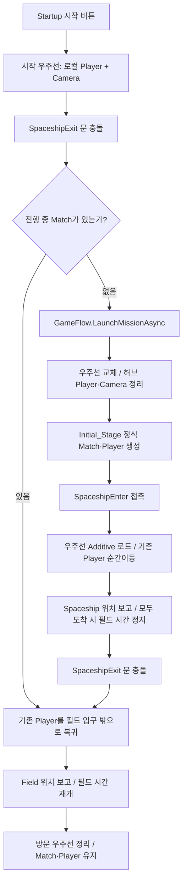

# 우주선 출격과 필드 왕복

수정일: 2026-11-05. 시작 순서가 바뀌어도 허브 Player와 Match Player를 중복 생성하지 않도록 연결한 경로입니다. 최신 후속은 [카메라·페이드·첫 출격 위치 결과](../planning/2026-11-05-spaceship-fade-results.md)를 참고합니다.

## 실제 이동 경로

첫 출격은 `Initial_Stage`가 이미 로드돼 있다고 가정하지 않습니다. 필드의 `PlayerStart_Local`을 기존 우주선 문 밖 복귀 위치로 옮겼고, `PlayerStart_Peer`도 옆으로 3칸 띄워 배치했습니다. 시작 우주선에 들어올 때 필드와 Match를 미리 켜는 방식으로 바꾸지는 않았습니다. `GameFlow.LaunchMissionAsync`로 Scene을 교체하고 실제 Match 준비가 끝날 때까지 기다립니다. 시작 허브의 이동용 Player와 Camera는 정리하고, 필드 조립부가 정식 Player와 Camera를 연결합니다.

전투 중 방문은 다릅니다. 필드 Scene과 Match는 계속 유지합니다. Player의 위치만 우주선 내부로 옮기며 actor의 Scene 소유권도 필드에 남습니다. 돌아올 때 새 Match·Player를 만들지 않고 기존 위치 등록을 Field로 돌립니다. 필드 입구 Collider 바깥으로 배치하므로 즉시 재입장하는 루프를 피합니다.

## 파일과 책임

| 파일 | 역할 |
| --- | --- |
| `SpaceshipEnter.cs` | 기존 필드 트리거. Player 접촉을 `EnterAsync` 요청으로 전달 |
| `SpaceshipExit.cs` | 기존 문 애니메이션·문 Collider 유지. 충돌을 `ExitAsync` 요청으로 전달 |
| `ISpaceshipTravel` / `ISpaceshipTravelConsumer` | Unity 출입문과 Core 사이의 작은 이동 계약. AppRoot가 Scene 로드 때 주입 |
| `SpaceshipTravelService.cs` | 첫 출격/임시 방문 구분, 이동 입력 잠금, Additive 로드·정리, 위치 보고, 카메라 즉시 정렬 |
| `MatchCameraFollow.cs` | 최초 Bind와 포털 이동 때 `SnapToTarget()`. 평소 이동의 SmoothDamp는 유지 |
| `SceneFadePresenter.cs` | 우주선 출입 전용. 0.3초 암전 → 최소 0.3초 실제 이동/대기 → 0.3초 화면 복귀. 문구·진행 바 없음 |
| `LoadingScreenPresenter.cs` | Startup 등 일반 진입의 검은 배경, `임시 로딩 화면`, 하단 진행 바. 우주선↔필드에서는 표시하지 않음 |

`ISpaceshipTravel`은 Transform/Collider를 받는 Unity Presentation 경계이므로 엔진에 의존하지 않는 Contracts/Application에 넣지 않았습니다. 문에서 AppRoot를 전역 검색하거나 새 GameManager를 만들지 않습니다.

## 제작 설정

- 필드 Scene: `Assets/Scenes/Gameplay/Initial_Stage.unity`.
- 우주선 Scene: `Assets/Scenes/Spaceship/SpaceShipGrayBox.unity`.
- 필드 출입구의 `destinationName`을 실제 내부 표식인 `Capsule`로 수정했습니다. 이전 값 `SpacshipEnter`는 현행 우주선 Scene에 존재하지 않았습니다. 비활성 표식의 위치만 사용하며 표식 자체를 켜지 않습니다.
- 기존 출구의 `returnSceneName: Initial_Stage`, 문 Animator와 애니메이션 이벤트 `ActivateDoorCollider(int)`는 유지합니다.
- `EnterAsync(Collider2D)` / `ExitAsync(Collider2D)`는 같은 문 요청을 코드에서 검증할 때도 사용합니다. 실제 Player 접촉 이벤트가 같은 함수를 호출합니다.
- 이동 중에는 Core가 자기 입력 lease만 잡습니다. 실시간 기준 0.3초에 걸쳐 검게 만든 후 이동을 시작하고, 완전 암전 상태를 최소 0.3초 유지한 뒤 0.3초에 걸쳐 화면을 돌립니다. 게임 정지·배속에 영향을 받지 않으며, Scene 준비가 길면 암전 구간을 연장합니다. 이동·실패 복구와 Camera 정렬은 모두 암전 안에서 끝냅니다.
- 시작 우주선 Camera는 Initial_Stage 기준으로 orthographic size **18**, culling mask **4190711**, SolidColor/투명 검정 배경, depth **-1**, near/far **0.3/1000**, Z **-10**을 사용합니다. 배율·레이어는 `SpaceshipHubSettings`에서 관리합니다.
- 도착 표식이 없으면 새로 로드한 방문 Scene을 정리하고 원래 Player 위치·필드 위치 보고·입력을 복구합니다. 처음부터 로드돼 있던 Scene은 실패했다고 임의 제거하지 않습니다.

## 네트워크 경계

첫 출격은 기존 Host GameFlow/NGO Scene 진입 정책을 따릅니다. 진행 중 방문은 전체 Match의 Scene을 교체하는 동작이 아니므로 로컬 Additive 경로를 사용합니다. Host 권위 actor의 도착 사실을 `PlayerMatchPresence.TryReportLocation`으로 보고합니다. 다른 권위 actor가 우주선에 남아 있으면 우주선을 먼저 내리지 않습니다.

Client actor의 출입 요청을 Host가 검증하는 별도 RPC는 이번 패치에 추가하지 않았습니다. 보고권 없는 actor를 이동시킨 뒤 시간 상태가 틀어지도록 두지 않고 이동 전에 명확히 거부합니다. 이 패치의 왕복 검증은 로컬/Host actor 기준이며 2인 Client 출입 완료로 확대하지 않습니다. 실제 원격 Player 생성·위치 보고 연결과 함께 후속 통합해야 합니다.

## 확인 결과

실제 검사 결과는 [이번 패치 결과](../planning/2026-11-05-spaceship-travel-results.md)에 기록합니다. 필드의 저장·날씨 추첨·콘솔 상호작용 설계를 대신 변경하는 패치가 아닙니다.
