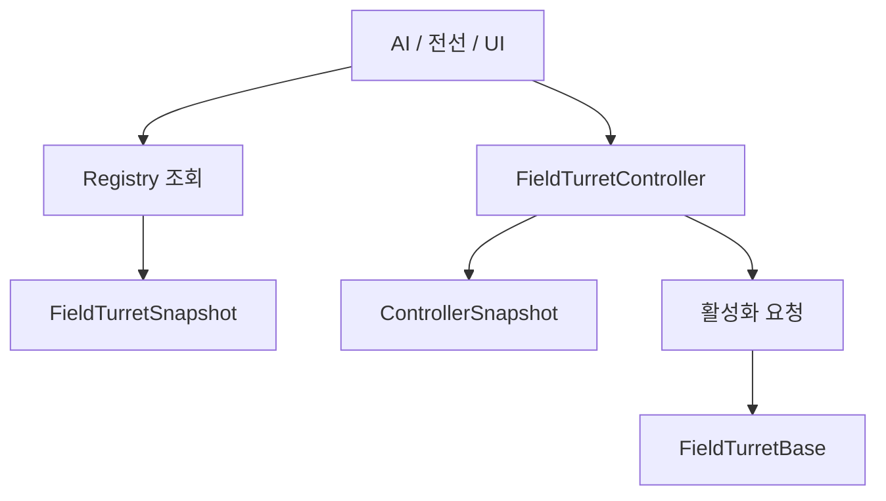

# 터렛 연동 가이드

최종 갱신: 2026-10-26
상태: Canon / Missile 구현 가이드. 제품 정책과 네트워크 계약은 별도 합의 대상.

냉각·수동 조작·강화 제한은 main `8d08001a`에 병합된 PR #525까지 포함한다.

## FieldTurret 명칭

맵에 배치된 터렛 시스템은 **FieldTurret**, 플레이어가 설치하는 보조 터렛은 기존 **TemporaryTurret / PlayerTurret**로 구분한다. FieldTurret 명칭 변경은 PR #547로 main에 반영됐다. 실제 화면·다중 클라이언트 인수와는 구분한다.

| 이전 이름 | 현재 이름 |
| --- | --- |
| `TurretBase` / `TurretController` | `FieldTurretBase` / `FieldTurretController` |
| `TurretDefinition` / `TurretInstanceRegistry` | `FieldTurretDefinition` / `FieldTurretInstanceRegistry` |
| `CanonTurretLv1`~`Lv3` | `FieldCanonTurretLv1`~`Lv3` |
| `MissileTurretLV1`~`LV3` | `FieldMissileTurretLV1`~`LV3` |
| `LaserTurret` | `FieldLaserTurret` |
| `TowerBullet` / `TowerMissile` | `FieldTurretBullet` / `FieldTurretMissile` |
| `DefaultCanonTurret` / `DefaultMissileTurret` / `DefaultLaserTurret` | `DefaultFieldCanonTurret` / `DefaultFieldMissileTurret` / `DefaultFieldLaserTurret` |
| `TeamHJD.Game.Turrets` 및 `.Contracts` / `.Tests` | `TeamHJD.Game.FieldTurrets` 및 `.Contracts` / `.Tests` |
| `Assets/Scripts/Features/Turrets` | `Assets/Scripts/Features/FieldTurrets` |
| `Assets/Prefabs/Turrets` / `Assets/Data/Turrets` | `Assets/Prefabs/FieldTurrets` / `Assets/Data/FieldTurrets` |
| `TurretTest.unity` | `FieldTurretTest.unity` |

활성화·체력·수리·승급·해금 API의 동작과 Definition ID, 직렬화된 필드 이름, 레이어·태그는 유지한다. 스크립트·프리팹·데이터의 `.meta` GUID를 유지하고 Unity 객체 및 런타임 상태 타입에 `MovedFrom` 정보를 추가했다. 외부 소비자는 새 타입·네임스페이스·경로를 사용한다. Core의 `TurretState`, `TurretSpatialInput`, `IBattlefieldTurretInputSource`, Enemy의 `TargetType.Turret` 같은 공용 계약과 플레이어 터렛 타입은 이번 변경에서 이름을 유지한다.

다른 영역에서 터렛을 사용한다면 내부 구현부터 읽을 필요는 없다. 필요한 작업에 맞는 문서부터 확인한다.

| 하고 싶은 일 | 먼저 읽을 문서 |
| --- | --- |
| 테스트 씬에 터렛 배치 | [빠른 시작](quick-start.md) |
| 초기 상태를 지정해 터렛 생성 | [명시적 초기화](initialization.md) |
| 터렛 ID 조회와 활성화 또는 피해 적용 | [API 사용법](api-reference.md) |
| AI와 전선 및 UI에 값 제공 | [스냅샷](snapshots.md) |
| 발사부터 피격까지 실행 순서 확인 | [전체 구조와 Mermaid](../turret-system-guide.md) |
| 연동 전 확인해야 할 제약 | [검증과 제한 사항](testing.md) |
| Initial 씬의 플레이어 상태·터렛 조작 UI | [Player UI API](../player-ui-api.md) |

## 읽기와 변경의 경계

정보만 필요한 소비자는 `FieldTurretSnapshot` 또는 `FieldTurretControllerSnapshot`을 받는다. 복사본을 변경해서 터렛 상태를 바꿀 수는 없다. 상태 변경은 명령 API로 요청한다.

상세 구현의 원본은 [Turret System Guide](../turret-system-guide.md)다. 이 문서 묶음은 외부 사용자가 필요한 API를 찾기 위한 입구이며 새 게임 규칙을 정의하지 않는다.
