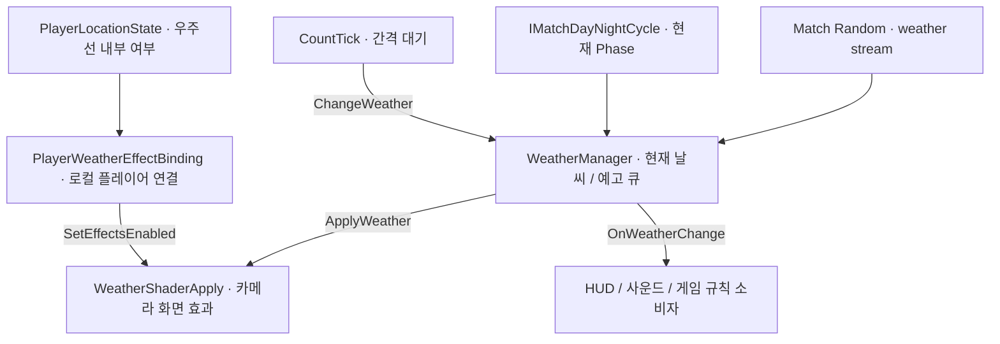

# 날씨 시스템 설계와 API 사용법

기준일: 2026-11-08
상태: 현재 작업 트리의 구현을 기준으로 한 사용 설명서. 다른 브랜치의 통합 구현이나 PR의 계획을 현재 동작으로 간주하지 않는다.

이 문서는 날씨를 **언제 변경하는지**, **다음 날씨를 어떻게 선택하는지**, **결과를 화면과 다른 기능에 어떻게 전달하는지** 설명한다. 대상은 현재 작업 트리의 `WeatherManager`, `CountTick`, `WeatherShaderApply`, `PlayerWeatherEffectBinding`이다.

## 1. 설계와 책임

날씨 상태, 변경 간격, 화면 표현, 로컬 플레이어 위치 연결을 분리한다.

| 구성 요소 | 책임 | 소스 |
| --- | --- | --- |
| `Map.WeatherManager` | Match 난수 연결, 현재 날씨·예고 큐 관리, 낮/밤별 가중치 추첨, 변경 알림, 셰이더 적용 요청 | [WeatherManager.cs](../../Assets/Scripts/Map/WeatherManager.cs) |
| `Map.CountTick` | 일정 간격을 기다린 뒤 `ChangeWeather()` 호출 | [CountTick.cs](../../Assets/Scripts/Map/CountTick.cs) |
| `WeatherShaderApply` | 카메라에 날씨 Material 적용, 화면 전환 보간, 효과 표시/숨김 | [WeatherShaderApply.cs](../../Assets/Scripts/Map/WeatherShaderApply.cs) |
| `PlayerWeatherEffectBinding` | 로컬 플레이어 위치 알림을 카메라 효과 표시 여부에 연결 | [PlayerWeatherEffectBinding.cs](../../Assets/Scripts/Map/PlayerWeatherEffectBinding.cs) |
| `PlayerLocationState` | 우주선 내부 여부 보관, 변경 시 알림 | [PlayerLocationState.cs](../../Assets/Scripts/Features/Player/PlayerLocationState.cs) |
| `Map.WeatherChangeEvent` | 날씨별 Action 필드 선언. 현재 변경 흐름에서는 호출되지 않음 | [WeatherChangeEvent.cs](../../Assets/Scripts/Map/WeatherChangeEvent.cs) |



`WeatherManager`에서 날씨가 바뀌는 것과 카메라 효과가 보이는 것은 별개다. 우주선 안에서 효과를 숨겨도 현재 날씨, 큐, 변경 타이머는 계속 진행한다. 비 피해·이동 속도·몬스터 능력치 같은 게임 효과를 이 셰이더가 적용하지는 않는다. 필요한 기능이 날씨를 읽거나 변경 알림을 받아 자신의 규칙을 적용한다.

## 2. 초기화와 변경 흐름

### 2.1 시작할 때

1. `WeatherManager.Awake()`가 같은 GameObject의 `WeatherChangeEvent`를 가져온다. 지정된 셰이더 컴포넌트가 없거나 `MainCamera` 태그가 아니면 `Camera.main`에서 다시 찾는다.
2. `OnEnable()`에서 임시 날씨 UI 갱신 함수를 정적 `OnWeatherChange`에 구독한다. `OnDisable()`에서 해제한다.
3. Match 조립부의 `RandomConsumerScope`가 `IRandomConsumer.BindRandom()`을 호출하면 `WeatherManager`가 `"weather"` 전용 난수 스트림을 받고 예고 큐를 채운다. 난수 바인딩 전 `FillWeather()` 호출은 아무 작업도 하지 않는다.
4. `WeatherManager.Start()`가 예고 큐 채우기를 시도하고 Inspector의 현재 날씨로 임시 UI와 카메라를 갱신한다. **시작 시 `OnWeatherChange`는 발생하지 않는다.**
5. `CountTick.Awake()`가 같은 GameObject의 `WeatherManager`를 가져온다. `Start()`에서 반복 코루틴을 시작한다.

현재 구현에서는 시작 날씨를 새로 뽑지 않는다. Inspector의 `currentWeather`를 사용하고, 앞으로 사용할 큐 항목을 추첨한다. 다른 컴포넌트의 `Start()`와 실행 순서는 별도로 보장되지 않으므로, 초기 구독자가 예고 큐까지 즉시 받을 수 있다고 가정하지 않는다.

### 2.2 시간이 지나거나 수동 호출했을 때

`ChangeWeather()`는 다음 순서로 동작한다.

1. Match 난수 스트림을 사용할 수 없으면 변경하지 않고 반환한다.
2. 현재 `IMatchDayNightCycle.Phase`를 읽는다. 같은 GameObject에 구현체가 없으면 `Day`로 처리한다.
3. 이전에 큐를 채운 Phase와 현재 Phase가 다르면 기존 예고를 비운다.
4. 해당 Phase의 가중치로 큐를 목표 개수까지 채운다.
5. 큐의 맨 앞 날씨를 꺼내 `currentWeather`로 설정한다.
6. 같은 Phase의 가중치로 큐를 다시 목표 개수까지 채운다.
7. 카메라의 `ApplyWeather(currentWeather)`를 호출한다.
8. `OnWeatherChange(currentWeather, weatherQueue)`로 현재 날씨와 **보충된 이후의 예고 큐**를 알린다.

큐는 먼저 들어간 항목이 먼저 적용되는 FIFO 구조다. 같은 날씨가 연속으로 들어갈 수 있고, 현재와 같은 날씨가 나와도 변경 알림은 발생한다. 카메라는 같은 날씨를 재적용할 때 전환을 다시 시작하지 않는다.

`CountTick`은 `WaitForSeconds(weatherChangeTime)` 이후 위 흐름을 호출한다. Unity의 스케일된 시간을 사용하므로 `Time.timeScale`의 영향을 받으며, 프레임 단위 대기라 정확한 시각을 보장하는 예약 API는 아니다. 수동 변경을 호출해도 진행 중인 간격 대기는 초기화되지 않는다.

### 2.3 현재 추첨 규칙

| 값 | 의미 |
| --- | --- |
| `Weather.SUNNY` | 맑음 (`0`) |
| `Weather.RAIN` | 비 (`1`) |
| `Weather.THUNDERSTORM` | 뇌우 (`2`) |
| `Weather.HEATWAVE` | 폭염 (`3`) |
| `Weather.WEATHER_COUNT` | 개수 표시용 값 (`4`). 실제 날씨로 사용하지 않음 |

비공개 `GetWeather(phase)`는 선택한 Phase의 `WeatherWeight[]`에서 전체 가중치를 더하고, Match의 `"weather"` 난수 스트림으로 `0` 이상 합계 미만의 정수를 한 번 뽑는다. 각 항목의 가중치를 순서대로 빼다가 음수가 되는 항목의 날씨를 반환한다. 가중치가 `0`인 항목은 선택되지 않는다.

```text
항목 확률 = 항목 weight / 같은 Phase의 전체 weight 합
```

낮 기본값은 `SUNNY 5`, `RAIN 2`, `THUNDERSTORM 1`, `HEATWAVE 2`로 각각 50%, 20%, 10%, 20%다. 밤 기본값은 `SUNNY 6`, `RAIN 2`, `THUNDERSTORM 2`, `HEATWAVE 0`으로 각각 60%, 20%, 20%, 0%다. 전체 가중치 합이 0이면 오류를 남기고 `SUNNY`를 반환한다.

낮/밤 Phase가 바뀌면 기존 큐 전체를 버리고 새 Phase의 가중치로 다시 채운다. 같은 Phase에서 Inspector 값을 바꿔도 이미 채운 항목은 유지되며 이후 보충 항목부터 반영된다. 현재 브랜치에는 `IMatchDayNightCycle`의 실제 구현체가 없으므로 별도 구현체를 같은 GameObject에 붙이지 않으면 항상 낮 가중치를 사용한다.

## 3. Scene 설정

1. 날씨 관리 GameObject 하나에 `WeatherManager`와 `CountTick`을 함께 둔다. `WeatherChangeEvent`는 `WeatherManager`의 `RequireComponent`로 추가된다.
2. 실제 화면을 렌더링하는 `MainCamera` 태그의 Camera에 `WeatherShaderApply`를 붙인다.
3. `WeatherManager`의 `_weatherShaderApply`에 해당 컴포넌트를 연결한다. 비어 있으면 `Awake()`에서 `Camera.main`의 컴포넌트를 찾지만, 이후 새 카메라로 자동 재연결하지 않는다.
4. 날씨별 Material과 전환 Material을 카메라 컴포넌트에 지정한다.
5. 우주선 내부 효과 숨김이 필요하면 같은 카메라에 `PlayerWeatherEffectBinding`을 두고, 로컬 플레이어 조립부에서 actor를 연결한다.

### Inspector 설정표

| 컴포넌트 / 필드 | 코드 기본값 | 의미 |
| --- | --- | --- |
| WeatherManager / `currentWeather` | `SUNNY` | 시작 날씨. 읽기는 `CurrentWeather` |
| WeatherManager / `weatherQueueSize` | `5` | 예고 큐 목표 개수. 채울 때 최소 1 적용 |
| WeatherManager / `_dayWeatherWeights` | 맑음 5·비 2·뇌우 1·폭염 2 | 낮에 사용하는 날씨별 가중치 목록 |
| WeatherManager / `_nightWeatherWeights` | 맑음 6·비 2·뇌우 2·폭염 0 | 밤에 사용하는 날씨별 가중치 목록 |
| WeatherManager / `tmpweatherImage`, 색상 필드 | 선택 사항 | 임시 UI Image 색상 표시. Image가 없으면 건너뜀 |
| CountTick / `weatherChangeTime` | `5`초 | 자동 변경 간격. Inspector 최소 0.01 |
| WeatherShaderApply / 날씨별 Material | 지정 필요 | 맑음·비·뇌우·폭염 화면 효과 |
| WeatherShaderApply / `_transitionMaterial` | 선택 사항 | 이전·다음 화면 합성. 없으면 즉시 새 효과 렌더링 |
| WeatherShaderApply / `_transitionDuration` | `1.5`초 | 전환 시간. 0이면 즉시 적용 |

이 표는 **필드의 코드 기본값**이다. 실제 Scene/Prefab에 저장된 값이 있으면 그 값이 사용된다. `CountTick`에는 `RequireComponent`나 누락 방어가 없으므로 같은 객체에 WeatherManager가 있는지 확인한다. 정적 알림에 발신자 정보가 없으므로 여러 WeatherManager를 동시에 활성화하는 구성을 피한다.

현재 [Initial_Stage Scene](../../Assets/Scenes/Gameplay/Initial_Stage.unity)에는 같은 객체에 세 관리 컴포넌트가 배치돼 있고, Scene의 버튼은 `ChangeWeather()`를 호출한다. MainCamera에는 날씨 화면 효과 컴포넌트가 연결돼 있다. 새 가중치 배열은 코드 기본값을 가지며 Scene에서 별도 override한 값이 있으면 해당 값을 사용한다. 이는 저장된 참조 확인 결과이며 실행 검증 결과는 아니다.

## 4. 팀원용 API 사용법

### 4.1 현재 날씨 읽기

`WeatherManager` 참조를 Inspector에서 연결하거나 소유 조립부에서 전달받아 사용한다. `CurrentWeather`는 읽기 전용이다.

```csharp
using Map;
using UnityEngine;

public sealed class WeatherReaderExample : MonoBehaviour
{
    [SerializeField] private WeatherManager weatherManager;

    public bool IsRaining()
    {
        return weatherManager != null
            && weatherManager.CurrentWeather == WeatherManager.Weather.RAIN;
    }
}
```

위 판정은 `RAIN`만 포함한다. 뇌우도 비로 취급할지는 소비 기능이 `THUNDERSTORM` 조건을 추가해 결정한다.

### 4.2 변경 알림 구독하기 — HUD·사운드·게임 규칙

활성화 시 `+=`, 비활성화 시 `-=`로 연결한다. 최초 상태는 별도로 `CurrentWeather`에서 읽는다.

```csharp
using System.Collections.Generic;
using Map;
using UnityEngine;

public sealed class WeatherListenerExample : MonoBehaviour
{
    [SerializeField] private WeatherManager weatherManager;

    private void OnEnable()
    {
        WeatherManager.OnWeatherChange += HandleWeatherChanged;
        if (weatherManager != null)
            ApplyCurrentWeather(weatherManager.CurrentWeather);
    }

    private void OnDisable()
    {
        WeatherManager.OnWeatherChange -= HandleWeatherChanged;
    }

    private void HandleWeatherChanged(
        WeatherManager.Weather current,
        Queue<WeatherManager.Weather> forecast)
    {
        ApplyCurrentWeather(current);

        // 보관할 때는 복사한다. 배열의 0번이 다음 날씨다.
        WeatherManager.Weather[] forecastCopy = forecast.ToArray();
        // forecastCopy를 자신의 예고 UI 데이터로 전달한다.
    }

    private void ApplyCurrentWeather(WeatherManager.Weather weather)
    {
        // 자신의 UI·사운드·규칙을 현재 상태에 맞게 갱신한다.
        // 같은 날씨 알림이 반복돼도 효과가 중복 누적되지 않게 구현한다.
    }
}
```

`OnWeatherChange`는 C# `event`가 아닌 **공개 정적 Action 필드**다. 외부에서 `=`로 덮어쓰거나 직접 `Invoke`하지 않는다. 직접 알림만 발생시키면 실제 현재 날씨·카메라는 바뀌지 않는다. 콜백에서 `ChangeWeather()`를 다시 호출하면 재진입하므로 피한다. 구독자 예외를 격리하는 처리도 없으므로 자신의 콜백에서 예외가 발생하지 않게 한다.

전달되는 `Queue`는 복사본이 아닌 내부 큐다. **`Dequeue`, `Enqueue`, `Clear`로 수정하지 않는다.** 이후 변경에도 같은 큐가 재사용되므로 과거 예고를 보관하려면 위처럼 복사한다. 현재 큐를 조회하는 공개 프로퍼티는 없고, 시작 시 알림도 없으므로 이 API만으로는 시작 직후 예고 전체를 읽을 수 없다.

### 4.3 다음 날씨로 진행시키기

```csharp
weatherManager.ChangeWeather();
```

이 호출은 **큐의 다음 날씨로 진행**한다. 원하는 날씨를 인자로 지정하는 함수는 아니다. `CallWeatherChange()`도 내부에서 같은 함수를 호출하며 Unity Button의 `OnClick` 같은 Inspector 연결에 사용할 수 있다.

현재 공개 API에는 `SetWeather(RAIN)`, 예고 큐 교체, 런타임 가중치 setter, 타이머 Reset/Pause가 없다. 임의 추첨, 특정 날씨 강제 지정, 단순 화면 미리보기는 서로 다른 요구이므로 `ChangeWeather()`를 무조건 대신 사용하지 않는다. 자동 CountTick이 동작 중이면 수동 변경 뒤에도 원래 대기 종료 시 자동 변경이 이어진다. 난수 스트림이 바인딩되지 않았거나 현재 권한에서 사용할 수 없으면 `ChangeWeather()`는 아무 날씨도 소비하지 않는다.

### 4.4 카메라 효과만 바꾸거나 숨기기

```csharp
// 아래 weatherEffects는 Inspector/조립부에서 받은 WeatherShaderApply 참조다.
weatherEffects.ApplyWeather(WeatherManager.Weather.RAIN);
weatherEffects.SetEffectsEnabled(false); // 화면 효과 숨김
weatherEffects.SetEffectsEnabled(true);  // 현재 보관 중인 날씨 효과 다시 표시
```

`ApplyWeather`는 카메라 표현만 바꾼다. WeatherManager의 상태·큐·알림을 갱신하지 않으므로 실제 날씨 변경 용도로 사용하지 않는다. 다음 Manager 갱신 시 화면은 Manager의 날씨로 다시 적용된다.

첫 적용은 즉시 반영하고 이후 서로 다른 날씨 사이를 보간한다. 효과를 다시 켜면 맑음 화면에서 현재 날씨로 전환한다. 해당 날씨 Material이 없으면 원본 화면을 그대로 출력한다. 컴포넌트는 `OnRenderImage`와 `Graphics.Blit`을 사용하므로 다른 렌더 파이프라인으로 이전할 때 이 경로가 지원되는지 별도 확인해야 한다.

`MainCamera` 태그가 아닌 객체에 붙이면 `Awake()`에서 해당 Camera와 컴포넌트를 비활성화한다. 뇌우의 번개 위치 계산은 카메라의 `orthographicSize`를 사용한다. 이 번개는 화면 연출이며 피격·데미지 판정 API가 아니다.

### 4.5 우주선 내부에서 로컬 효과 숨기기

`PlayerWeatherEffectBinding`은 `ILocalPlayerActorConsumer`를 구현한다. 로컬 플레이어 조립부가 다음 API로 연결한다. 일반 HUD나 다른 기능에서 매번 호출할 필요는 없다.

| 메서드 | 동작 |
| --- | --- |
| `PrepareLocalActor(MatchId, PlayerId)` | 이전 위치 구독 정리, 효과 표시 상태 복구 |
| `BindLocalActor(MatchId, PlayerId, GameObject)` | actor의 `PlayerLocationState` 구독, 현재 위치 즉시 반영 |
| `UnbindLocalActor(MatchId)` | 현재 연결된 Match가 같을 때 구독 해제 |

연결된 로컬 actor에서 `LocationChanged(true)`가 오면 숨기고, `false`면 다시 표시한다. 위치 시스템은 `PlayerLocationState.CheckLocation(bool)`으로 상태를 갱신한다. 같은 값이면 알림을 반복하지 않는다. actor에 `PlayerLocationState`가 없으면 경고를 남기고 위치 연결은 이루어지지 않는다.

이미 이 바인딩이 연결돼 있다면 입출구 코드에서 `SetEffectsEnabled`를 중복 제어하기보다 기존 위치 변경 경로를 사용한다. 바인딩 해제·파괴 시에는 이전 구독을 제거하고 효과를 다시 표시한다. 이 기능은 로컬 화면에만 영향을 주며 전역 날씨를 맑음으로 변경하지 않는다.

현재 추적된 `Assets`의 C# 코드에서는 `CheckLocation(bool)`을 호출하는 곳을 확인하지 못했다. 따라서 **위치 상태를 전달받아 효과를 숨기는 연결은 있지만, 실제 포털 진입만으로 자동 호출된다고 보장할 수는 없다.** 입출구 담당자는 기존 위치 흐름을 확인하고 필요한 지점에서 해당 로컬 actor의 상태를 갱신해야 한다.

## 5. 현재 구현과 Core API의 관계

현재 `WeatherManager`는 `IRandomConsumer`를 구현하고 Match 조립부가 제공하는 이름별 난수 스트림을 사용한다. 반면 `IMatchWeatherSource`와 `ICheckpointParticipant`는 구현하지 않는다. `CountTick`도 공용 Match clock/scheduler나 낮밤 전환 이벤트를 사용하지 않는다. 따라서 **난수 소비는 Match 범위에 연결되지만, 현재 날씨·예고의 Host 권위 발행, Client 복제, 저장/복원은 `WeatherManager`만으로 연결되지 않는다.**

Core 환경·시간·난수 문서에는 별도 통합 단계의 설명이 포함돼 있다. 해당 계약이 존재하는 것과 현재 Map 구현에 연결된 것은 구분해야 한다.

| 항목 | 이 문서 기준 구현 | Core 연동 시 확인할 경계 |
| --- | --- | --- |
| 날씨 추첨 | `IRandomConsumer`로 주입된 `"weather"` 스트림 | Host 권한 범위에서만 난수 사용 가능 |
| 변경 시점 | `WaitForSeconds` 반복 | Match clock/scheduler 또는 낮밤 정상 진행 신호 |
| 날씨 읽기 | `CurrentWeather`, 정적 Action | `IMatchWeatherSource`, 불변 환경 snapshot |
| 권한/복제 | Manager 자체 검사 없음 | Host만 상태 결정, Client는 확정 snapshot 적용 |
| 저장/복원 | 현재 Map 클래스에 구현 없음 | 현재 날씨·큐·타이머와 Core 난수 상태 각각 저장 |

외부 기능이 Core에서 확정된 현재 날씨만 필요하면 `IMatchEnvironmentSource.TryGetCurrentWeather(matchId, out weatherId)`를 사용한다. source·snapshot·날씨가 없거나 다른 Match의 snapshot이면 `false`와 빈 ID를 반환한다. 이 API는 `WeatherManager`나 셰이더를 직접 조회하지 않는다. 다만 현재 `WeatherManager`가 `IMatchWeatherSource`를 구현하지 않으므로 이 조회 API에 Map 날씨를 발행하는 writer 연결은 별도 범위다.

참고 계약: [Random API](core-random-api.md), [Match 시간 API](match-time-api.md), [Match 환경 API](match-environment-api.md), [체크포인트 실행 API](checkpoint-execution-api.md).

## 6. 문제를 확인할 때

| 증상 | 확인할 내용 |
| --- | --- |
| 자동 변경이 안 됨 | Match 난수 바인딩·사용 권한, CountTick과 WeatherManager가 같은 객체인지, 코루틴 시작 여부, GameObject 활성 상태와 `Time.timeScale` 확인 |
| 시작 날씨 알림이 안 옴 | Start는 알림을 발생시키지 않음. 초기 현재 값은 `CurrentWeather`로 읽기 |
| 예고가 달라지거나 사라짐 | 구독자가 원본 Queue를 수정하는지 확인 |
| 같은 날씨가 계속 나옴 | 중복 허용 추첨임. 현재 Phase의 `WeatherWeight[]`와 이미 채워진 큐 확인 |
| 밤 가중치가 사용되지 않음 | 같은 GameObject의 `IMatchDayNightCycle` 구현체와 `Phase` 확인. 구현체가 없으면 `Day` fallback 사용 |
| 내부 날씨는 바뀌는데 화면은 그대로 | 카메라 참조, MainCamera 태그, 날씨 Material, 효과 숨김 상태, 렌더 경로 확인 |
| 우주선 안에서도 효과가 보임 | 로컬 actor 연결, actor의 PlayerLocationState, 실제 위치 변경 알림 확인 |
| ChangeWeatherRain 등에 구독했는데 호출 안 됨 | WeatherChangeEvent의 필드는 현재 발행되지 않음. 실제 알림은 WeatherManager.OnWeatherChange |
| 수동 변경 직후 다시 바뀜 | CountTick의 기존 대기는 수동 변경으로 초기화되지 않음 |
| 변경 이벤트에서 일부 기능만 갱신됨 | 앞선 구독자 예외, 정적 Action 덮어쓰기, 구독 해제 누락 확인 |

## 7. 문서 확인 범위

위 소스의 공개 멤버, 초기화 순서, 호출 지점과 데이터 소유권을 대조했다. 설명용 API 예제는 현재 선언에 맞춰 작성했다. 이번 문서 갱신에서 Unity PlayMode·원격 Host/Client 실행·화면 효과 검증은 수행하지 않았다. 다른 브랜치에서 구조가 바뀌면 해당 소스를 확인해 기준 버전과 이 문서를 함께 갱신한다.
