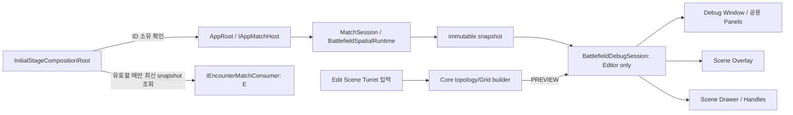

# Stage 1 PoC 2차 배치 결과

기준일: 2026-10-08 · 브랜치: `feature/core` · 실행 Scene: `Assets/PoC/Spaceship/Scenes/Initial_Stage.unity`

후속 [Game Debugger 배치 결과](2026-10-08-game-debugger-batch-results.md)가 실제 spawn/despawn·authority/request 관측, 상위 Window와 통계 및 Scene 터렛 검증을 추가했다. 아래 B0~B3/과거 미연결 기록은 해당 작업 당시 근거이며 후속 관측 구현과 구분한다. 공식 PlanId·후보 점수·전체 전투 Gate는 여전히 별도다.

## 결론

양현석이 독립적으로 맡는 B0~B3를 구현했다. 이번 작업은 Core 소유권·공간 진단의 보강이며 **전체 PoC/전투/팀 통합 완료 판정은 아니다.** 팀원이 수정 중인 Scene YAML과 터렛 기능, 조수빈의 Encounter lifecycle/판단 기록은 변경하지 않았다. 원격 Issue 변경·push·PR 발행도 이번 배치에서는 하지 않았다.

## 배치와 커밋 경계

| 배치 | 결과 | 주요 파일/검사 |
| --- | --- | --- |
| B0 | 완료 · `5a323898` | 1차 공간 Spawn 정책·Match 바인딩·첫 자동 요청 및 기존 검증을 보존. public SpatialSpawnCandidate/Allocation은 개별 파일로 분리 |
| B1 | 완료 · `b4244599` + `413b20f8` | `CurrentMatchId / TryEndMatch`, Scene 소유권 검사, 명시적 소비자 참조·낡은 provider 무효화, App host 경유 위치 통지. 소유권/통지 테스트 2개 |
| B2 | 완료 · `f5e2d4b6` | 진단 Session·표시 설정·Scene drawer·Overlay 분리. Window 종료가 source를 해제하지 않음 |
| B3 | 완료 · `77b131c0` | 탭/셀 상세·OOB ID·선택 강조·기하 법선·범례·프리셋·캡처 메타데이터·64개 이력. Editor 테스트 3개 |
| B4 | 조수빈과 계약/구현 필요 | Match-scoped Encounter, Executor/authority 주입, PlanId/dedup/result/candidate 진단. 이영빈은 Player 실제 타깃/체력 연동, 김진태와 조수빈은 지점 규칙 |
| B5 | B4 후 양현석/조수빈 연결 | 진짜 후보 이유·계획/실행·분대 타깃 진단 및 1차 임시 런처 교체. 현재 UI에 값을 추측해 넣지 않음 |
| Gate T | 터렛 업로드 뒤 검증 | 같은 Scene/Build에서 비공선 3개 터렛, topology·과열 유지/파괴 제거, Spawn 선택 및 실제 상호 전투 |

각 커밋은 독립된 변경 경계이지만 순서대로 적용한다. B1 후속 컴파일 이름 충돌/해제 방어 변경은 B1 PR에 포함하고, B3의 Editor 테스트 asmdef 참조는 Editor PR에 포함한다. PR을 나눌 때 파일 이동만으로 런타임 계약을 빼먹지 않는다.

## 구현 흐름과 경계

- `TryEndMatch(expectedId)`가 false면 이전 소유자의 종료 요청이며 새 Match는 유지된다. Scene의 Update와 터렛 이벤트도 같은 ID를 검사한다.
- Scene 소비자 참조는 `_encounterConsumerBehaviour`로 연결한다. 현재 저장 Scene의 미지정 조회는 호환 경로로만 남겼으며 복수 소비자는 오류다. Scene 직렬화 연결은 업로드 뒤 담당자가 한다.
- Feature의 Unbind 예외를 기록하되 Core/Player 정리를 중단하지 않는다. **조수빈의 Executor 재구성·Enemy 정리·요청 중복 방지를 이 코드가 대신 보장하지 않는다.**
- Runtime `UnityEditor` 의존성을 추가하지 않았다. Editor의 static session은 편집 도구 상태이지 게임 서비스 locator가 아니다.
- PREVIEW는 실제 Match가 아니다. LIVE는 AppRoot의 현재 snapshot이며 종료된 snapshot은 즉시 지운다. STALE 캐시 대신 UNAVAILABLE 표시를 사용한다.

## 사용 순서

1. `Tools > TeamHJD > Battlefield Debug` → Overview에서 소스/범례를 읽는다.
2. Scene View Overlays 메뉴 → `Battlefield`. 창을 닫고도 레이어를 켜고 끌 수 있다.
3. Battlefield 탭 → 공용 에셋/현재 Match override와 셀 상세. Pick cell을 켜고 XY에서 클릭한다. 일반 Scene 편집으로 돌아갈 때 끈다.
4. Topology 프리셋은 외곽 법선을 보여준다. 화살표는 기하 안→밖이고 우세 지표가 아니다. Grid 프리셋은 점유 관찰용이다.
5. Capture → Commit/Build 라벨을 직접 입력 → 메타데이터 복사 → Scene/Game View를 함께 캡처한다. Capture는 게임 변경 명령과 과밀 라벨을 숨기지만 게임을 멈추거나 snapshot을 고정하지 않는다.
6. Encounter 탭의 수동 요청은 기존 조수빈 경계를 그대로 사용한다. 후보 이유·PlanId·권한이 구조화되어 들어오기 전에는 해당 값을 N/A로 표시한다.

Grid 각 축 약 1,024개 선, 점유 면 2,048개, 라벨 128개 상한은 **렌더링 제한**이다. 선택 셀/데이터는 전체 Core snapshot을 조회한다. Preview는 정적 터렛만 집계하며 Player/Enemy는 LIVE에서만 의미 있다. 이력은 최대 64개, Scene/Play 전환 때 비운다. 기록은 영구 게임 로그가 아니다.

## 실제 검증 증거

Unity CLI · Unity `6000.3.23f1` · 2026-10-08 KST.

| 검사 | 결과 | 로컬 증거 |
| --- | --- | --- |
| 전체 기본 EditMode 회귀 | 23 통과 / 0 실패 / 명시적 통합 1 제외 | `%TEMP%/poc-phase2-editmode.xml` |
| 새 Editor 진단만 실행 | 3 통과 / 0 실패 | `%TEMP%/poc-phase2-editor.xml` |
| 명시적 Initial_Stage Enter/Exit Play Mode | 1 통과 / 0 실패 | `%TEMP%/poc-phase2-autospawn.xml` |

마지막 통합은 Match `9849601b515d476a8986ec6907eefae2`, revision 2, Player 1개, Host 시작, 2개 plan/Slime 10개(왼쪽 5·오른쪽 5)를 기록했다. 터렛/삼각형/전선은 0이고 `No targetable Player or Turret found` 경고가 남았다. 자동 생성은 검증됐지만 **Player 공격/피격·타깃 전투는 검증하지 못한 별도 연결**이다.

Editor 검사: 창 생성/파기 후 source 보존, 잘못된 셀 ID 거부, Match 종료 시 snapshot/Grid/선택 제거, Capture가 게임 상태를 바꾸지 않음, Overlay panel 생성. 화면 배치·실제 클릭·법선 화살표의 육안 QA는 아직 하지 않았으며 테스트 통과로 시각 QA를 대체하지 않는다. Windows Build/2인 네트워크/실제 Scene unload-reload 전체 경로도 별도 검사다.

첫 컴파일에서 Unity 6 `UnityEngine.EntityId`와 Domain 이름 충돌이 발견돼 alias로 수정했다. 실패를 통과로 표시하지 않았으며 위 결과는 수정 후 실행이다. 개인 `Validation/`은 그대로 미추적 보존했다.

## 다음 담당별 준비

- 양현석/조수빈: 첫 요청·반복 cadence·권한·PlanId/revision 불일치 처리와 read-only 진단 DTO 합의. Core Domain에 Enemy 정책 필드를 추가하지 않는다.
- 이영빈/조수빈: Player의 실제 체력/생존→타깃 adapter, Enemy 타깃 없을 때 재검색 주기와 피해 계약 검증.
- 황재동/양현석/조수빈: 터렛 업로드 → Scene 참조 한 번 병합 → Gate T 캡처.
- 김진태·조수빈: AreaId/통로/해금 규칙과 실제 SpawnRadius 위치의 bounds/점유 재검증.

GitHub #443/#458/#459/#420의 미충족 검증을 닫지 않았다. 기존 #460 완료는 진단 기반의 완료 의미이며 이번 시각화 보강의 완료 근거로 소급 변경하지 않는다.
