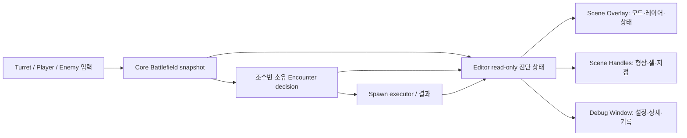

# Stage 1 PoC 2차 통합·시각 진단 설계 초안

기준일: 2026-10-08 · 상태: **양현석 단독 B0~B3 구현·CLI 검사 완료 / B4·B5 팀 계약 대기** · 기준 Scene: `Assets/PoC/Spaceship/Scenes/Initial_Stage.unity`
[1~3차 통합 준비표](2026-10-07-stage1-poc-integration-prep.md) · [Core 실행 구조](../../Assets/PoC/Core/README.md)

## 목표와 현재 증거

진행 결과는 [배치 결과/검증/사용법](2026-10-08-phase2-batch-results.md)에 기록합니다. 아래 감사 표는 **구현 전 발견 사항**이며 현재 코드와 혼동하지 않습니다. B0는 `5a323898`로 보존했고 B1의 ID 소유권 검사, App host 경유 위치 통지, 명시적 소비자 참조와 B2/B3의 창 독립 표시·Overlay·셀 상세·캡처를 구현했습니다. 실제 Scene YAML은 변경하지 않았습니다. STALE snapshot은 보관하지 않고 소스 종료 시 지워 `UNAVAILABLE`로 표시합니다. 프리셋은 지금 데이터로 동작하는 Topology/Grid/Capture만 제공합니다. Spawn Decision/Combat 프리셋은 B4/B5 계약 이후입니다.

2차는 “적이 생성됐다”에서 “**같은 Match의 상태를 보고 계획한 적이 타깃과 상호작용하며, 그 판단·결과를 팀이 화면으로 확인한다**”로 넘어가는 단계다. 전체 팀의 같은 Build 플레이 판정·제품 가설 결론은 3차로 남긴다. 터렛은 담당 팀원이 작업 후 올릴 예정이므로 **실제 터렛 배치·삼각형·전선·터렛 타깃의 Scene 검증은 업로드 이후 Gate T**로 미룬다. 양현석이 터렛이나 Player/Enemy 기능을 대신 구현하는 계획은 아니다.

- Core의 `BattlefieldSpatialSnapshot`에는 `MatchId`, `Revision`, Turret vertex/triangle/boundary edge, Grid 셀별 T/P/E ID·개수와 범위 밖 ID가 있다. **전선 압력·우세·공격 방향 값은 없다.**
- `SpawnPointSpatialPolicy`는 현재 후보 필터와 분대 세트 배분을 수행하지만, 후보별 탈락 이유·점수·plan ID를 진단 결과로 보관하지 않는다. `EncounterRuntime`은 계획/실행 결과를 문자열로만 반환한다.
- 구현 전 `BattlefieldDebugWindow`의 Scene 등록은 창에 묶여 있었다. B2에서 `BattlefieldDebugSession / BattlefieldSceneDrawer / BattlefieldSceneOverlay`로 분리해 창 종료 후에도 표시를 유지한다. `OnGUI`의 무조건 repaint를 제거했다. `SpawnPoint`의 기존 빨간 반경 Gizmo는 그대로 두었으며 조수빈의 계획 표시를 겹쳐 만들지 않았다.
- 1차 CLI 통합 테스트에서는 Host·2개 지점·Slime 10마리 생성이 통과했지만 타깃 없음 경고가 났고, 터렛 0개라 삼각형/전선은 0이었다. B0 커밋으로 기준점을 고정했고 2차 마지막 명시적 테스트에서도 같은 결과를 확인했다. 기존 `Validation/`은 별도 미추적 자료이며 포함하지 않았다.
- GitHub [#443](https://github.com/Team-HJD-21/unity-6-the-developer/issues/443)·[#458](https://github.com/Team-HJD-21/unity-6-the-developer/issues/458)은 양현석의 Core 생산 경계, [#459](https://github.com/Team-HJD-21/unity-6-the-developer/issues/459)는 조수빈의 Match-scoped Encounter·SpawnPlan/실행 경계다. [#460](https://github.com/Team-HJD-21/unity-6-the-developer/issues/460)은 기존 Editor 진단 기반으로 닫혀 있으므로 아래 **확장**은 별도 후속 범위로 추적하고, 완료된 Issue의 의미를 소급해 바꾸지 않는다.

## 2차 통합 작업 묶음

| 순서 | 구현/합의 결과 | 주 소유자와 연결점 | 2차 수용 증거 |
| --- | --- | --- | --- |
| 1. 전투 대상 연결 | Player를 먼저 Enemy의 `TargetableComponent` 후보에 연결하고 체력/사망을 반영한다. Turret adapter의 등록·파괴/비활성 정책은 황재동·조수빈이 리뷰하되 실제 Scene 검증은 Gate T다. 생성 직후 목표 선택, 목표 사망/소실 후 재선택 경로를 잇는다. | 이영빈이 Player 상태 adapter, 황재동이 Turret 상태, 조수빈이 타깃 선택/공격 계약을 소유. 양현석은 Match ID·생성 수명만 확인. | Player 대상의 “No targetable …” 원인 해소 및 Enemy 이동→타격→피해/Despawn. 터렛 결과는 미검증으로 남김. |
| 2. Encounter 수명·명령 | 자동 첫 요청을 `EnemyNetworkTestLauncher`의 임시 0.5초 정책에서 Match 소유 Encounter 시작/종료 경계로 옮긴다. Host/Server 권한, 요청 원인, 중복 plan 실행 거부, 실패/재시도, Scene 종료 시 해제를 명시한다. 반복 요청의 트리거·최소 간격은 조수빈과 합의 전까지 확정하지 않는다. | 조수빈이 Encounter와 Spawn adapter 소유([#459](https://github.com/Team-HJD-21/unity-6-the-developer/issues/459)); 양현석은 Core snapshot 공급/Scene composition 계약 검토. | 같은 Match에서 plan ID가 한 번만 실행되고 종료 후 구독/요청이 남지 않음. |
| 3. 읽기 전용 결정 기록 | 조수빈이 후보 지점·선택/제외 이유, 사용한 `MatchId/Revision`, preset/budget, 지점별 planned/actual count, 권한·실패 이유를 불변 진단 값으로 제공한다. Editor가 같은 규칙을 재계산하지 않는다. | 조수빈이 데이터 의미/생성 시점, 양현석이 Contracts의 최소 진단 경계와 Editor 소비 방식 합의. | 화면의 선택 근거와 서버 계획·실행 로그가 같은 plan ID를 가리킴. |
| 4. Map/지점 검증 | `SpawnPointId`, `AreaId`, 반경, 점령·통로·해금 상태 중 **실제 정책에 사용할 값만** 합의한다. 지역 해금이 아직 구현되지 않았다면 Unknown/Deferred로 표시한다. | 김진태·조수빈, 양현석은 Grid bounds/좌표 계약 검토. | 사용 가능·제외 지점과 Scene 좌표가 일치하고 Grid 밖 지점을 설명 가능. |
| 5. Editor 진단 확장 | 아래 Scene 레이어·Overlay·Debug Window를 같은 read-only 데이터 소스로 묶는다. 게임 로직 계산은 Core/Enemy/Encounter에 남긴다. | 양현석 주도, 조수빈의 진단 계약 협조. | 창을 닫아도 레이어 표시 가능, Edit Preview와 Play Live를 구분, 팀 공유 캡처 재현 가능. |

## 구현 전 감사: 빠진 연결과 위험

| 현재 코드의 사실 | 2차 설계에서 필요한 조치 | 소유/차단 관계 |
| --- | --- | --- |
| `EnemyNetworkTestLauncher`가 디버그 UI, Host 시작, 0.5초 자동 요청을 함께 소유한다. `EncounterRuntime` 생성자는 Scene의 Executor를 검색해 보관하며, Match 해제 시 런처의 캐시를 재구성하지 않는다. NGO 오브젝트는 `DontDestroyOnLoad`로 이동한다. | 게임 진행용 Encounter scope와 테스트 UI를 분리한다. Executor/권한 의존성을 명시적으로 주입하고 Match 종료·Scene 재진입 때 낡은 참조와 요청을 폐기한다. | 조수빈 구현, 양현석 composition/수명 검토. 현재 전역 `IEncounterMatchConsumer` 단일 검색은 복수 Scene에서 애매하다. |
| `InitialStageCompositionRoot.OnDestroy()`는 자신이 만든 Match인지 비교하지 않고 `EndCurrentMatch()`를 호출한다. | Match ID 또는 소유 handle을 확인해 이 Scene이 시작한 Match만 종료한다. 새 Scene Match를 이전 Scene이 끝내지 않도록 한다. | 양현석이 먼저 보강 가능. |
| `MatchSimulation.Start()`는 `Running`으로 바꾸지만 Encounter 전용 시작 이벤트는 없다. 게임 명령 `Execute()`는 아직 `NotHandled`다. | 0.5초를 게임 규칙으로 승격하지 않는다. 명시적 Match 시작 신호/Host ready 이후 첫 요청, 이후 의미 있는 상태 변경 이벤트와 제한된 주기 점검을 조합한다. 매 `Update` 스폰 판단은 하지 않는다. | 양현석과 조수빈이 트리거 계약 합의, 결정/주기는 조수빈 소유. |
| 계획은 SpawnPoint **중심**의 Grid 셀만 검사한다. Executor는 그 뒤 `SpawnRadius` 내 임의 오프셋에 생성한다. `AreaId`/통로/아군 삼각형 내부/중복 SpawnPoint ID는 정책에서 검사하지 않는다. | 서버의 실제 배치 위치도 bounds·점유·충돌/접근성 조건으로 재검증할지 정한다. `AreaId` 의미와 아군 Territory 내부 금지는 김진태·조수빈 결정 전까지 확정하지 않고 진단에 `Unknown`으로 남긴다. 중복·빈 ID는 명시적 오류로 다룬다. | 조수빈/김진태. 반경 바깥 생성은 현재 결과와 다른 위치가 될 수 있는 실제 위험. |
| 정책은 Grid의 적 수를 읽지만 입력은 Scene에서 0.1초 간격, **셀 점유 변화가 있을 때만** 갱신된다. 계획에 사용한 revision과 실제 실행 revision의 일치 보장은 없다. | `MatchId + revision + plan ID`를 계획에 고정하고, 실행 직전 지점·권한을 재검증한다. snapshot이 바뀌었을 때 거부 또는 재계획 중 하나를 조수빈이 정하고 사유를 기록한다. | 양현석은 snapshot 계약, 조수빈은 plan/실행 일관성. |
| Player prefab에는 `TargetableComponent`가 없고 `TargetableComponent.CanBeTargeted`는 초기 체력이 0이면 false다. Enemy 분대는 목표가 없으면 매 서버 `Update`마다 Scene의 Targetable을 다시 검색한다. | 이영빈이 실제 Player 체력과 타깃 상태를 연결하고 조수빈이 재검색을 상태 변경/간격 제한으로 조정한다. 무기 터렛은 `DamageableTargetAdapter`가 `IsActivated`를 기준으로 후보를 제한하고 CU는 생존 중 항상 후보가 된다. 과열·전원 Off 때의 표적 가능 여부는 황재동과 조수빈이 결정한다. | 이영빈·조수빈은 터렛 업로드 전에도 진행 가능. 황재동의 실제 터렛 검증은 Gate T. |
| Grid snapshot은 셀별 ID·개수를 제공하지만 움직이는 Player/Enemy의 **정확한 월드 위치**와 타깃 연결선은 담지 않는다. Encounter는 후보 탈락/선택 이유를 구조화하지 않고 문자열만 반환한다. | 정확 위치·분대 타깃은 해당 Feature의 read-only 진단 adapter에서 받는다. 후보 이유는 조수빈의 정책 결과에서 기록하며 Editor가 재계산하지 않는다. `AppRoot.BattlefieldSnapshotChanged`는 `UNITY_EDITOR` 전용이므로 Build용 HUD를 이 이벤트에 매달지 않는다. | 양현석 Editor, 조수빈/이영빈 진단 공급. |

권장 기본 결정은 **서버가 Match 시작 후 한 번의 첫 요청을 받고**, 이후 상태 변화는 요청 원인으로 기록하되 실제 반복 판단은 조수빈이 제한된 scheduler에서 수행하는 것이다. `PlanId`는 한 Match 내 단조 증가하는 순번과 `MatchId`로 식별하고, `BattlefieldRevision`과 입력 preset/budget을 함께 보관한다. 성공·빈 계획·후보 없음·권한 없음·stale snapshot·부분 생성은 서로 다른 결과 코드로 남긴다. 이는 제안이며 난이도/빈도/지역 해금 규칙의 확정은 아니다.

## 2차 구현 배치: 6개와 후속 Gate T

| 배치 | 소유·선행 | 구현 단위와 커밋 경계 | 배치 종료 검사 |
| --- | --- | --- | --- |
| **B0 — 1차 기준점 고정** | 양현석, 선행 없음 | 현재 미커밋 1차 공간 정책·자동 생성·문서만 복구 가능한 커밋으로 묶는다. `Validation/`과 팀원 Scene 변경은 섞지 않는다. | 기존 Grid 7·정책 3·자동 생성 1 테스트 결과와 변경 파일 목록을 기록. 아직 전체 PoC 통과로 표기하지 않음. |
| **B1 — Match 수명 경계** | 양현석, B0 | Match ID가 일치할 때만 종료하는 Scene scope, 명시적 Encounter 소비자 연결의 API, 이전 Scene 참조 무효화 계약. Scene YAML 직렬화 변경은 터렛 업로드 후 한 담당자가 처리한다. | Match 교체·Scene unload·다시 진입에서 이전 Match/Executor가 새 Match를 오염시키지 않는 작은 수명 테스트. |
| **B2 — Editor 표시 기반 분리** | 양현석, B0와 병행 가능 | 현재 `BattlefieldDebugWindow`에서 read-only 진단 상태·Scene drawer·설정 UI를 분리하고 Scene Overlay를 추가한다. 기존 Grid 기본값/Play Mode override는 그대로 유지한다. | Debug Window를 닫아도 Scene 레이어 토글이 작동하고, 종료 시 구독/표시가 정리됨. Core/Enemy 런타임에 Editor 참조 없음. |
| **B3 — 지금 있는 데이터의 시각화** | 양현석, B2 | Territory/Grid/Frontline, 셀 선택 상세·범위 밖 경고, PREVIEW/LIVE/STALE, 범례와 Capture 프리셋. 실제 Turret Scene 없이 기하/좌표 단위 테스트와 빈 Scene 표시 상태를 확인한다. | 현재 snapshot의 Match/revision과 화면 값이 같고, 없는 전선·우세값은 `N/A`로 표시. 3개 터렛 실제 화면 증거는 Gate T. |
| **B4 — Encounter 결정·실행 계약** | 조수빈 주도, 양현석/김진태/이영빈 협의; B1의 연결 계약 합의가 선행, B2·B3와 구현 병행 가능 | 조수빈이 Match-scoped Encounter, 주입된 Executor/권한, plan ID·중복 거부·결과 코드와 후보 판단 기록을 구현한다. 양현석은 snapshot/진단 계약만 제공하고, 이영빈은 Player 타깃 adapter, 김진태는 지점/구역 의미를 확인한다. 각 Owner 코드·커밋을 분리한다. | 터렛 없이도 Player 대상으로 plan→spawn→타깃/피해, 빈 후보·중복·Host 아님·종료/재진입 테스트. 이영빈/김진태 미완료는 명시적 조건부로 표시. |
| **B5 — 진단 결합·공유 증거** | 양현석+조수빈, B3/B4 | 조수빈의 읽기 전용 결정 기록을 Editor의 후보·planned/actual·실패 이유·선택 분대 표시와 결합한다. 1차 임시 런처의 자동 경로를 새 경로로 교체하고 한 번만 실행되는지 확인한다. | 동일 `MatchId/revision/plan ID`로 화면·로그·실제 수가 연결된 캡처 1세트. Game View 전용 HUD는 요구가 확정되지 않으면 만들지 않음. |
| **Gate T — 터렛 업로드 후 별도 검증** | 양현석·황재동·조수빈·이영빈, B5와 Turret 업로드 | 한 담당자가 `Initial_Stage` Scene을 병합하고 비공선 Turret 3개, 과열/파괴/복구, topology 갱신, 후보 재계획과 실제 타깃을 같은 Build에서 시험한다. | V/T/F 변화와 Turret 대상 공격/피해·Spawn 선택 결과의 스크린샷/영상. 그 전에는 #443/#458/#459/#420의 관련 확인란을 성급히 닫지 않음. |

의존성은 `B0 → B1`, `B0 → B2 → B3`, `B1 계약 합의 → B4`, `B1+B3+B4 → B5 → Gate T`이다. 조수빈의 B4 내부 구현은 B2/B3와 병렬 가능하지만 연결 계약을 합의하기 전에는 통합하지 않는다. B0~B5가 이번 2차 작업 배치이고 Gate T는 팀원 산출물을 기다리는 **조건부 검증**이다. 양현석 단독으로 먼저 쌓을 수 있는 것은 B0~B3이며, B4의 Enemy 정책·Executor를 양현석의 역할로 흡수하지 않는다.

## 시각 진단 구조

`Scene Overlay`는 작은 조작 패널, `Handles`는 월드 좌표에 그리는 도형, `Gizmos`는 개별 Scene 오브젝트의 배치 보조, `Debug Window`는 표와 설정을 맡는다. 세 곳이 각각 정책을 계산해서 다른 결과를 내면 안 된다. Unity 6는 [SceneView Overlay](https://docs.unity3d.com/6000.0/Documentation/ScriptReference/Overlays.Overlay.html)와 [SceneView.duringSceneGui](https://docs.unity3d.com/6000.0/Documentation/ScriptReference/SceneView-duringSceneGui.html)를 제공한다. 기존 창과 분리한 Editor-only presenter가 Scene 렌더링을 소유하고, 창·Overlay는 표시 상태를 공유하도록 한다. 별도 “Editor Core”나 런타임의 `UnityEditor` 참조는 만들지 않는다.

| 레이어 | 화면 표현 | 현재 데이터/추가 계약 | 주의 |
| --- | --- | --- | --- |
| Territory | 삼각형 반투명 청록 면, vertex 번호·터렛 상태 뱃지, boundary edge 실선 | Core snapshot으로 바로 가능; 터렛 사격/전력 상태는 황재동의 별도 조회 | 면은 **아군 기하 영역**이지 안전도/우세도가 아니다. |
| Frontline | 외곽 edge 굵은 주황 선, edge ID/길이·인접 삼각형 선택 상세 | Core `FrontlineEdges`, `EdgeAdjacencies` | 안→밖 법선은 기하 표시로는 가능하지만 “우세 방향” 화살표로 명명하지 않는다. 압력·우세·색 tint는 규칙 합의 전 미표시. |
| Uniform Grid | 얇은 셀 경계, T/P/E 점유 아이콘, 선택 셀의 원시 ID·좌표·범위 밖 경고 | Core Grid snapshot으로 가능 | 전 셀 라벨 상시 표시 대신 줌/선택/점유 셀에만 표시한다. 적 수는 **밀도**이지 위험 점수가 아니다. |
| Spawn 후보·계획 | 지점 원/반경, 사용 가능/제외 배지와 이유, planned 숫자, actual 숫자를 서로 다른 표기로 표시 | 기존 `SpawnPoint` Gizmo + 조수빈의 결정 기록/실행 결과 필요 | “선택됨”과 “실제로 생성됨”을 같은 색·숫자로 합치지 않는다. Enemy 공격력/전선 우세로 해석하지 않는다. |
| 전투·수명 | 선택한 분대→현재 타깃 연결선, 대상 미등록 경고, Match 시작/종료·plan 실행 타임라인 | 조수빈의 타깃/plan 이벤트 및 이영빈·황재동 상태 adapter 필요 | 모든 적의 선을 상시 그리면 과밀하다. 선택 분대 또는 최근 이벤트만 표시한다. |

Overlay 기본 화면은 `PREVIEW / LIVE / STALE`, `MatchId` 짧은 표기와 revision, Host/Client, 활성 레이어 토글, 범례·캡처 프리셋으로 제한한다. 상세 설정(공용 Grid 기본값, 현재 Match override, 후보별 탈락 사유와 planned/actual 표, 최근 이벤트)은 Debug Window에 둔다. Edit Mode는 실제 Match가 아니므로 `PREVIEW`, Play Mode의 활성 snapshot만 `LIVE`; 종료·Scene 전환 뒤 이전 값은 즉시 제거하거나 `STALE`로 명시한다.

Debug Window의 정보 구조는 `Overview`(Scene/Match/권한/오류), `Battlefield`(Grid 설정·셀·Territory), `Encounter`(후보→plan→실행), `History`(최근 이벤트·캡처 메타데이터) 네 영역으로 제한한다. 조회 표에서 셀/SpawnPoint를 선택하면 Scene View에서 그 지점만 강조하고, Scene 선택을 바꾸지 않아도 상세를 읽을 수 있게 한다. **값 변경 명령**인 공용 asset 저장, 현재 Match Grid override, `Request Encounter`, 테스트 런타임 설치는 조회 패널과 시각적으로 분리하고 적용 대상(공용 에셋/현재 Match/Scene)을 버튼 옆에 명시한다. `Capture` 프리셋은 명령 버튼·과도한 ID 라벨을 숨기되 상태 배지·범례·계획/실행 차이는 남긴다.

시각 언어는 의미 중복을 줄인다: Territory 청록 반투명 면, Grid 옅은 중립 선, Frontline 주황 실선, Spawn 선택 지점 테두리 강조, 제외 지점 회색 사선, 실행 실패 빨간 `!`. 색만으로 상태를 전달하지 않고 아이콘/선형/짧은 라벨과 범례를 함께 둔다. `SpawnPoint.OnDrawGizmos`의 고정 빨간 원은 레이어가 중복되지 않도록 배치 Gizmo와 계획 표시 중 어느 쪽이 반경을 그릴지 하나로 정한다. 레이어 프리셋은 `Topology`, `Spawn Decision`, `Combat`, `Capture` 네 개면 충분하다.

## 공유용 스크린샷·영상 규격

- 모든 캡처에 Scene 이름, Commit/Build, Unity 버전, `MatchId/revision`, `PREVIEW/LIVE`, Host/Client, Grid 크기, preset/budget와 시각화 범례가 보이게 한다. 긴 MatchId는 화면에 축약하고 상세 창/로그에서는 원문을 복사할 수 있게 한다.
- 터렛 업로드 전에는 Grid·Spawn 후보의 채택/제외 이유와 planned/actual 수, Player 타깃/피해 또는 실패 메시지를 먼저 캡처한다. 터렛 업로드 후 Gate T에서 배치 전/후 V/T/F·Grid 변화와 Turret 타깃을 같은 포맷으로 추가한다. 실패도 숨기지 않는다.
- 30~60초 영상: Match 생성 → 전선/점유 표시 → Encounter 요청·plan ID → 실제 생성 → 타깃/상호 피해 → 종료 순서. 화면 녹화 시작 전에 `Capture` 프리셋으로 라벨 밀도를 낮춘다.
- **Scene Overlay/Handles 캡처는 Editor Scene View의 증거**다. Game View나 Windows Build에서도 보이는 게임 UI로 주장하지 않는다. 플레이 화면 공유가 필요하면 Game View와 Scene View를 나란히 녹화하거나 별도 개발용 Runtime HUD를 후속 범위로 합의한다.

## 설계 안전장치와 완료 기준

- `MatchId + revision + plan ID`를 함께 표시한다. 다른 Match/오래된 snapshot의 지점·결과를 섞지 않는다. 최근 기록은 Editor 쪽 크기 제한 ring buffer로 보관하고 Play Mode 종료·Scene 변경 때 비운다.
- Scene 그리기는 snapshot/진단 변경 또는 표시 옵션 변경 시 갱신하고, `OnGUI`마다 무조건 전체 Scene을 다시 그리는 방식은 정리한다. Grid 라벨·분대 연결선은 선택/줌/개수 제한을 둔다. 가능하면 후보 수와 그리기 비용도 진단한다.
- Editor는 read-only 진단과 명시적 수동 테스트 명령만 보유한다. 자동 Encounter 진행, 승인/제외/난이도 계산, 네트워크 권한의 진실 원천은 런타임에 둔다.
- 양현석이 독립적으로 완료할 수 있는 2차 범위는 **Match 수명/공간 조회 계약 보강, 창과 분리된 Scene 진단 표시, Grid/Topology/상태 캡처 프리셋**이다. 조수빈의 Match-scoped Encounter·plan 중복 방지·결정 기록, 이영빈·조수빈의 Player 타깃/상호 피해는 각 Owner의 2차 통합 완료 조건이다. 실제 터렛 결과와 같은 Build의 재미·지역 해금/승패 판정은 Gate T/3차로 남긴다.

### 소유권과 PR 경계

1. **1차 기준 PR(B0):** 이미 로컬에서 검증한 공간 정책·자동 생성과 문서를 우선 분리한다. 2차의 미완성 계약을 섞지 않는다.
2. **양현석 Core 수명 PR(B1):** Match ID/Scene 소유 경계와 해제 테스트. Enemy 정책 변경 없이 컴파일·수명 테스트가 가능해야 한다.
3. **양현석 Editor PR(B2+B3):** 창과 독립된 Scene 표시, Overlay, 현재 Core 데이터 레이어와 캡처 프리셋. 조수빈의 미병합 진단 DTO 없이도 동작한다.
4. **양현석/조수빈 계약 및 조수빈 런타임 PR(B4):** 계약을 먼저 리뷰하고 조수빈이 Match-scoped Encounter·plan ID/중복·실패·결정 기록을 구현한다. Player adapter는 이영빈의 독립 변경으로 합칠 수 있다. 기존 Core Domain에 Enemy 정책 필드를 넣지 않는다.
5. **양현석/조수빈 진단 결합 PR(B5):** 실제 조수빈 plan/실행 값을 Editor에 연결하고 1차 임시 자동 요청을 교체한다. 터렛 업로드 뒤 Scene 병합·전체 증거는 Gate T의 별도 PR/검증 기록으로 둔다.

이 분리는 Issue #459의 조수빈 소유권을 유지하면서 양현석의 Core·Editor 책임을 분명히 하기 위한 작업 단위다. Turret 담당 팀원이 작업 중인 `Initial_Stage` Scene YAML을 양현석이 동시에 편집하지 않고 Prefab/Adapter/계약을 우선 작업한다. 캡처나 문서 때문에 검증되지 않은 PR을 먼저 완료 처리하지 않는다.

## 팀 합의가 필요한 질문

| 미결정 사항 | 권장 출발안 | 최종 결정자 |
| --- | --- | --- |
| 첫 Encounter와 반복 요청 | Match가 `Running`이 되고 Host/Server가 준비되면 **한 번** 첫 요청. 이후 상태 변경은 dirty/request 신호로 받고 조수빈의 제한된 scheduler가 평가한다. `Update`마다 SpawnPlan 생성 금지. 요청 간격과 실패 재시도는 아직 수치 확정하지 않는다. | 조수빈, 양현석이 Match 시작 계약 검토 |
| 네트워크 시작 권한 | Host 생성은 Match/Network composition adapter가 맡고 Encounter는 이미 정해진 권한을 받아 실행한다. Encounter 요청이 호출될 때마다 `StartHost()`를 결정하지 않는다. 2인 동기화 완료로 해석하지 않는다. | 양현석·조수빈 |
| `SpawnPlan` 식별·실패 | Match 내 단조 증가 plan 순번, `MatchId`, 사용한 Battlefield revision을 기록하고 동일 plan 재실행은 거부. 후보 없음/권한 없음/stale/부분 생성은 구별한다. 변경된 snapshot에 대한 거부 vs 재계획은 한 가지로 합의한다. | 조수빈 |
| Player/Turret 표적 가능 조건 | 이영빈은 Player의 실제 체력에서 `TargetableComponent`를 갱신한다. Turret의 전원 Off·과열 상태는 배치 topology와 별개로 표적 가능 여부를 황재동과 조수빈이 결정하고, 파괴는 후보에서 제거한다. | 이영빈·황재동·조수빈 |
| `AreaId`·통로·점령·지역 해금 | 실제 Scene/기획에 존재하는 값만 정책에 넣는다. 존재하지 않는 것은 `Deferred/Unknown`으로 표시하고 임의의 접근 가능성·우세 수치를 만들지 않는다. | 김진태·조수빈 |
| 진단 계약의 assembly 경계 | Core Domain이 아니라 작은 읽기 전용 Contracts DTO를 양현석과 조수빈이 합의하는 안을 우선 검토한다. Enemy 전용 asmdef를 만들면 Editor 참조 방향과 기존 Assembly-CSharp 의존성을 함께 확인한다. | 양현석·조수빈 |
| 공유 화면 | Scene View의 Overlay/Handles와 Game View를 나란히 녹화하는 방식으로 먼저 진행. 별도 개발용 Runtime HUD는 Windows Build 증거가 필요하다고 팀이 결정할 때 추가한다. | 양현석·전체 |

터렛 팀원의 업로드 이후에는 Grid 내부 XY에서 **활성·미파괴·비공선 3개 이상**인지 확인하고 Play Mode에 진입해야 첫 자동 Encounter가 그 topology를 본다. Play Mode 중 터렛을 바꿨다면 Match revision/V/T/F 갱신을 먼저 확인하고 수동 `Request Encounter`로 재계획을 비교한다. 현재 전선은 삼각형 외곽선이지 적의 점유 영역이나 승패·우세 수치가 아니다.
