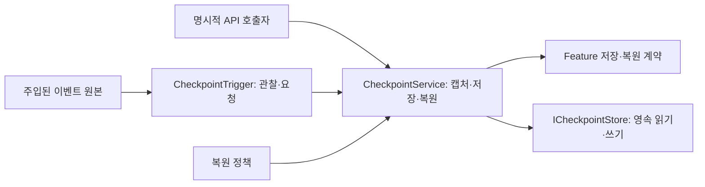

# 2026-11-02 양현석 스프린트 — 게임 사이클·공용 시간·안전장치·Core 정리

갱신: 2026-11-02 KST. 상태: PL 사용자 결정과 이번 주 작업 범위 / 설계·구현 준비. 아래 기능의 구현 완료를 의미하지 않는다.

기준: main `5e39728c`의 [10월 30일 기획 보강](2026-10-30-planning-review.md), [10월 31일 정기회의](2026-10-31-regular-meeting.md), [Product Plan](../product/PROJECT_PLAN.md). 11월 2일 정책은 이 문서에서 추가한 PL 결정이며 과거 회의 발언으로 소급하지 않는다.

## 1. 이번 주 산출물

추가 인수 조건: 전체 목표 구현 뒤에도 **PR을 발행하지 않는다.** PL이 Core를 다시 이해하고 검토할 수 있도록 실제 진입점·호출 순서·책임·Feature 접점·읽는 순서를 정리하는 단계를 거친다. 커밋 분리는 유지하되 PR 준비와 발행을 구분한다.

| 작업 | 이번 주 범위 | 결과물 |
| --- | --- | --- |
| 게임 사이클 | 부팅·시작 진입 → 우주선 내부의 메인 허브 → Mission 선택·출격 → 행성 플레이 → 결과·귀환·다음 준비 연결 | 우주선을 플레이 공간으로 사용하는 실행 흐름. 진행 중 허브 출입과 Match 종료 뒤 귀환을 구분 |
| Steam API | 사용자 식별·인증, 초대·로비·매칭, NGO 연결과 App 수명의 접점 조사 및 구현 설계 | 공식 자료와 선택 근거, Core/SDK 책임 및 단계별 도입 계획. SDK 선택이나 서비스 구현 완료를 선행 가정하지 않음 |
| Weather·Time | 기존 전달 문서에 따라 Core 공용 게임 시계·취소 가능한 예약 API 제공 후 김진태의 Feature 연결 | NGO 서버 시각에서 게임 정지·배속을 반영하고 날씨·시간대·Encounter 조건이 동일한 게임 시간을 사용하는 경로 |
| 저장·안전장치 | 체크포인트 캡처·저장·로드·복원 API, 재실행 후 저장 지점 복원 기반, 경험치·재화 보존 정책, 이벤트 관찰·요청 경계 | 실행 서비스와 이벤트 관찰자를 분리. 어떤 이벤트에 반응할지는 이번 범위에서 선택하지 않음 |
| Core 전체 검토·정리·문서화 | 기존 Core 전체와 Feature 접점의 책임·의존성·수명·공개 API 검토, 필요한 구조 정리, 코드 주석과 팀 문서 보강 | 기존 코드와 신규 기능을 함께 설명하는 실제 구조도·호출 지도·읽는 순서. 초기 점검과 구현 후 전체 재검토 포함 |

보스 상세는 최신 회의대로 기본 루프 통합 뒤 다룬다. 이번 주 저장 구현 추가는 과거 Stage 1 PoC의 완료 조건을 변경하지 않는다.

## 2. 확정한 우주선 정지 정책

- 싱글에서는 플레이어가 우주선 내부에 있으면 필드 게임 시간·시뮬레이션을 정지한다.
- SOS로 2명이 참가한 상태에서는 **두 명 모두 우주선 내부일 때만** 정지한다. 한 명이라도 필드에 있으면 계속 진행한다. 한 명이 필드로 나가면 재개한다.
- 판정은 Host의 참가자·위치 상태를 사용한다. Client의 로컬 메뉴나 TimeScale이 공유 Match의 정지 권한을 가지지 않는다.
- 여기서 Tick 정지는 게임 시간·몬스터·터렛 등 필드 진행을 말한다. NGO 통신 시각·전송·연결 유지 처리는 계속 동작한다.
- 우주선 내부 이동·UI는 필드 정지 중에도 사용 가능해야 한다. 전역 `Time.timeScale = 0`만으로 필드와 허브를 함께 멈추는 구현을 피하고, 공용 시계와 각 Feature의 진행 경계를 연결한다.
- 날씨·낮밤과 게임 시간 기반 예약도 이 필드 정지를 따른다. 정지한 시간을 복귀 시 밀린 진행으로 한꺼번에 처리하지 않는다.
- 이 정책을 수용하는 계약과 현재 1~2인 경로를 우선 구현한다. 실제 SOS 매칭·도중 참가 전체 구현을 이번 주 시간 서비스 완료 조건으로 추가하지 않는다.

## 3. 저장·복원 정책

- 게임 종료 후 재실행은 저장 지점을 읽어 복원한다. 메모리의 `MatchSnapshot`, Game Debugger JSON, 프로필 Fake를 실제 디스크 저장/전체 Feature 복원으로 취급하지 않는다.
- 안전장치 발동 시 게임 상태는 체크포인트 시점으로 되돌린다. **경험치와 재화는 기본적으로 복원 직전의 현재 값을 유지**한다.
- 재화는 설정에 따라 체크포인트 값으로 함께 되돌릴 수 있게 한다. 캡처 자료와 복원 정책을 분리해 보존/롤백을 선택한다. 같은 정책으로 복원하는 도중 일부 파트만 다른 기준을 사용하지 않게 한다.
- 경험치 유지에 연결되는 레벨·토큰·성장 자료의 일관성, 재화 소비와 구입한 성장의 관계는 Feature 저장 계약에서 함께 정의한다. 필드 스냅샷과 프로필을 덮어쓰는 순서로 우연히 정해지게 하지 않는다.
- 재실행 시에는 저장된 자료만 복원할 수 있다. 체크포인트의 필드 상태와 보존 대상 성장/재화의 영속 저장 시점·revision 관계를 정의해 아직 저장하지 않은 값을 보존했다고 표시하지 않는다.
- 이전 행성 재방문은 점령 상태를 유지하며 기존 몬스터 처치 사건·재보상을 반복하지 않는 10월 31일 방향을 따른다. 이를 사망 후 안전장치 복귀와 구분한다.
- 완전 재시작은 초기 상태로 돌아가는 별도 동작이다. 안전장치 복원 버튼과 같은 의미로 사용하지 않는다.

## 4. 저장·복원 실행과 이벤트 관찰의 분리

11월 2일 PL 후속 결정: 이번에는 저장·복원 API와 이를 요청하는 이벤트 관찰 경계까지 구현한다. **저장·복원이 자동 실행되는 상황이나 이벤트 목록은 작성·선택하지 않는다.** 과거 회의의 후보를 기본 트리거로 사용하지 않는다.

아래 명칭은 책임을 설명하기 위한 목표 이름이며 아직 구현된 API가 아니다. 실제 계약은 기존 네이밍 규약에 맞춰 확정한다.

| 요소 | 책임 |
| --- | --- |
| `CheckpointService` | 명시적인 저장·복원 요청을 받아 Feature 캡처/검증, 영속 저장, 복원·실패 처리를 조율. 언제 호출할지의 게임 규칙은 소유하지 않음 |
| `ICheckpointStore` | 버전이 있는 체크포인트 자료의 읽기·쓰기. 로컬 바이너리 구현을 서비스 뒤에 주입 |
| `CheckpointTrigger` | 주입된 이벤트를 관찰하고 실행 서비스에 요청하는 어댑터. 구독·해제 수명을 관리하며 게임 상태를 직접 저장하거나 변경하지 않음 |
| 복원 정책 | 경험치·재화 보존과 재화 롤백 선택을 실행 서비스가 일관되게 적용할 자료. 저장·복원 호출 조건과 구분 |

공개 API는 저장과 복원을 구분하고 완료·실패·취소 결과를 돌려준다. 요청은 Host 권위·현재 실행 세대와 연결해 중복 실행·과거 요청·저장 중 복원 충돌을 통제한다. 관찰자는 매 프레임 조건을 임의로 탐색하지 않고 제공된 이벤트를 구독할 수 있게 설계한다. 실제 이벤트 원본을 정하기 전에는 자동 호출을 연결하지 않는다.

저장·복원 책임 분리의 근거는 [10월 3일](2026-10-03-poc-followup.md), 저장 자료 후보와 복원 경계의 근거는 [10월 17일](2026-10-17-regular-meeting.md)이다. 이번 주 구현 범위와 경제 보존 정책은 11월 2일 사용자 결정으로 추가했다. 호출 상황의 미선정은 구현을 막는 확인 대기 항목이 아니다.

## 5. Core와 Feature 접점

| 영역 | Core 역할 | Feature 역할 |
| --- | --- | --- |
| 시간·정지 | Host의 게임 시계·pause/rate·참가자 허브 상태 판정·읽기 복제·Match 수명 | Player는 실제 허브 출입 사실 제공, Enemy/FieldTurret/World는 필드 진행 정지·재개 연결 |
| Weather/Time | clock/scheduler·권위/취소·환경 snapshot 및 Encounter 연결 | 김진태가 날씨·낮밤 규칙·예고·표현과 예약 등록/해제 연결 |
| 안전장치 | 저장 요청 조율, 일관된 캡처 시점·저장 버전·바이너리 입출력·복원 순서·실패 처리·경제 보존 정책 | Player·CU·FieldTurret·지역·Spawn·Weather/Time이 실제 원본에서 저장 자료를 제공하고 복원 |
| 프로필·경제 | 기존 Backend 권위/Local Binary 경계를 유지하고 필드 체크포인트와 프로필 저장을 구분 | 경험치·재화·해금·성장 원본과 일관된 revision 제공 |

현재 `IProfileService`는 프로필 읽기·쓰기 계약, `FakeProfileService`는 메모리 구현이다. 현재 `PlayerProfileSnapshot`에는 재화·해금이 있고 경험치·전체 성장 자료는 아직 없다. `MatchSnapshot`도 실제 Scene Feature 전체의 캡처/복원 구현이 아니다. 이번 저장 작업은 실제 writer의 계약과 바인딩을 포함해야 한다.

시간 복원은 저장된 게임 경과 시각·날씨/낮밤 상태를 기준으로 새 실행 세대에 연결하는 방향으로 설계한다. 과거 NGO 연결 시각·NetworkObjectId·callback delegate를 저장해 재사용하지 않는다. 복원 전에 과거 예약·요청을 취소하고 Feature가 복원 상태에 맞게 다시 등록하도록 한다.

## 6. 구현 배치·PR 검토 순서

이번 주 스프린트와 추가 요청을 **하나의 전체 실행 배치**로 관리한다. 내부 실행은 8단계로 나누고, 각 단계 결과와 남은 항목을 이 문서에 기록한다. 현재 상태는 준비이며 구현 완료가 아니다.

| 단계 | 작업 | 완료 기준 | 예상 PR 묶음 |
| --- | --- | --- | --- |
| B0 | main 통합 후 기준선 확인·Core 전체 목록 및 API 호출자 조사 | 현재 소스/Scene/assembly 기준, 실제 문제·정리 후보·의도된 설계·미구현 경계 구분, 병합 후 컴파일 기준 확보 | 선행 PR 검토·분리 준비 |
| B1 | Core 책임·디렉터리·공개 API 정리와 기존 핵심 함수 설명 보강 | 필요한 분리만 적용, 호출 경로·소유권·시그니처 변경 영향 추적, 변경한 동작 회귀 확인 | 관련 모듈별 refactor/docs PR |
| B2 | 공용 게임 시계·scheduler·참가자 허브 상태와 필드 정지 | Host 권위, 게임/네트워크 시간 분리, 등록·취소·정지·배속·종료/재시작 계약 구현 | Time / FieldPause |
| B3 | 김진태의 Weather/Time 연결 및 기존 예약·Game Debugger 시간 통일 | 새 서비스와 기존 writer 중복 제거, 실제 환경 snapshot/다음 Encounter 조건 소비 확인 | Weather |
| B4 | 안전장치 저장·복원 API·이벤트 관찰 경계·복원 정책·바이너리 저장소·Feature 연결 | 실제 캡처·디스크 쓰기/읽기·복원, 경제 보존/재화 롤백, 실행 세대·오류·취소 처리. 자동 호출 상황은 선택하지 않음 | SaveStore / Checkpoint |
| B5 | 부팅·우주선 메인 허브·출격·행성 플레이·결과/귀환의 게임 사이클 | 기존 App/Scene/Match/UI 경계를 사용해 왕복, 저장/복원 API 주입 지점 제공 | GameFlow |
| B6 | Steam 조사·도입 설계 | 공식 근거, SDK/인증/사용자·로비/초대·NGO·App 수명 경계, 도입 순서 문서 | SteamDesign |
| B7 | 전체 Core 재검토·팀 사용 문서·주석 최종 점검과 통합 인수 | 아래 전체 검토·문서 기준 충족, 남은 문제의 원인/범위/소유자 기록, 구현/검증 수준 구분 | 수정이 발생한 기능의 PR에 반영 |

Steam 조사는 다른 단계와 독립적으로 진행할 수 있다. 공개 API·함수 설명은 각 단계에서 동작 변경과 함께 고치고 B7에서 전체를 다시 확인한다. 문서화를 마지막 단계에만 몰아두지 않는다.

우선 현재 통합 브랜치에서 복구 가능한 커밋으로 전체 작업을 쌓고 리뷰 목적별로 분리한다. 11월 2일 사용자 추가 지시에 따라 **PR의 읽기 쉬움을 우선하며 기존 예상 5개에 맞추지 않는다.** 아래 기능/설계 7개가 검토 단위 후보이며, 필요한 구조 정리는 관련 기능 앞에 모듈별 PR로 둔다. 구조 정리·동작 변경·문서만의 변경을 구분해 커밋한다. 실제 분리 범위는 구현과 선행 PR 반영 상태를 확인한 뒤 고정한다.

### PR을 읽는 순서와 분리 기준

| 후보 | 리뷰에서 판단할 중심 질문 | 선행 변경 |
| --- | --- | --- |
| Time | 게임 시간과 예약의 정지·배속·취소·수명이 일관적인가? | 관련 모듈 구조 정리가 필요하면 먼저 반영 |
| FieldPause | 참가자 출입에 따라 필드만 올바르게 정지·재개하며 네트워크/허브는 동작하는가? | Time |
| Weather | Weather/TimeOfDay가 공용 시계를 사용하고 환경·Encounter 경계를 유지하는가? | Time, 정지 경로 검증에는 FieldPause |
| SaveStore | 저장 자료·버전·바이너리 읽기/쓰기·실패 처리가 일관적인가? | 저장 자료 계약 |
| Checkpoint | 실제 상태 캡처/복원과 경제 보존 정책·이벤트 관찰 수명이 올바른가? | SaveStore, 게임 시각 복원에는 Time |
| GameFlow | 허브와 행성 사이에서 App·Match·Scene·UI 수명이 일관되게 연결되는가? | FieldPause, Checkpoint의 주입 계약 |
| SteamDesign | Steam과 기존 Core의 역할·도입 순서가 명확하고 구현 가능한가? | 독립 조사 가능, 최신 실제 API와 마지막 대조 |

- **한 PR은 한 가지 리뷰 목적을 가진다.** 다른 목적의 버그 수정·대규모 주석 수정·폴더 이동을 끼워 넣지 않는다. 필요한 구조 정리는 기존 동작 보존을 확인하는 별도 PR로 먼저 제시한다.
- 하나의 계약과 실제 구현·호출부·필요한 검증·사용 문서는 함께 읽을 수 있는 단위로 묶는다. 리뷰어가 별도 채팅이나 아직 없는 다음 PR을 읽어야 현재 변경의 동작을 이해하는 상태를 피한다.
- 광범위한 파일 이동·이름/서식 변경은 기능 수정과 분리하고 이전→이후 대응표를 제공한다. 기존 API 설명만 보강하는 변경도 모듈별로 나눠 의미 있는 diff를 유지한다.
- 각 PR은 자기 base에 대해 컴파일·해당 범위 검증이 가능한 상태로 준비한다. 이후 PR에서야 맞춰지는 시그니처나 누락된 호출부를 남기지 않는다.
- 가능하면 main을 base로 사용하고 의존 PR이 병합되면 차이를 재확인한다. 병합 전 의존 PR을 base로 삼는 경우 선행 링크·읽는 순서·실제 delta를 명시한다. diff에 이전 PR 내용이 중복 표시되지 않는지 생성 전 확인한다.
- [.github PR Template](../../.github/pull_request_template.md)의 요약에는 바뀐 동작을 먼저 쓰고, 핵심 변경에는 **API 계약 → 실행 서비스/정책 → Scene/Feature 연결 → 검증** 순서로 읽을 주요 파일을 안내한다. 영향·검증·되돌릴 단위는 해당 PR 범위만 설명한다. Mermaid는 수명/의존성을 이해하는 데 필요한 경우에 사용한다.
- 함수 주석은 실제 수정과 같은 PR에서 최신화한다. 이미 구현된 기능의 사용법과 예정 기능을 구분하고, 테스트·수동 확인의 실제 증거를 기재한다. Issue의 완료 범위가 충족되는 PR에만 Closes를 둔다.

11월 2일 확인 시 선행 Core PR #570~574는 모두 OPEN이다. #570·574는 CHANGES_REQUESTED, #572·573은 APPROVED, #571은 승인 판정이 없다. 승인은 병합 완료와 다르다. 이번 작업은 이 선행 변경에 의존하므로 기존 PR의 리뷰 보완·기준선 정리와 신규 스프린트 PR의 차이를 기록하고, 이미 발행한 구현을 신규 기능으로 중복 포함하지 않는다. 이 계획 작성으로 PR 수정·발행·병합을 수행하지 않았다.

수동 인수는 Initial_Stage와 Game Debugger 기준으로 진행한다. 허브의 참가자 정지 정책과 날씨·예약 정지/재개를 확인한다. 저장은 명시적 API 호출로 캡처·영속 쓰기·읽기·복원, 경험치·재화 기본 유지 및 재화 롤백 옵션, 재실행 후 저장 자료 복원을 검증한다. 검증용 호출을 자동 저장 규칙으로 사용하지 않는다. 설계·코드 컴파일·수동 플레이 증거를 서로 대신하지 않는다.

## 7. main 동기화 기록

- origin/main 및 로컬 main: `5e39728c`.
- 현재 `codex/core-sprint-20261026-integration`에 merge commit `385f72c6`으로 반영했다. 기존 발행 PR의 커밋 이력을 재작성하지 않았다.
- 충돌은 `EnemySpawnExecutor`의 World 공간 입력 인자·제작 지점 검사 조건을 보존하고 main의 최신 Enemy 변경을 합쳤다. Docs 목차는 양쪽 자료를 함께 유지했다.
- 기존 사용자 폰트 수정과 `Validation/`을 보존했다. 병합 후 충돌·diff 정적 확인을 수행했으며 이번 동기화의 Unity 컴파일·PlayMode는 아직 실행하지 않았다.

## 8. Core 전체 검토 범위와 초기 확인

초기 조사 기준: 현재 작업 브랜치 `2be2136c`와 실제 `Assets/Scripts/Core`. C# 파일 352개 중 Editor 53개, Tests 경로 36개, Bootstrap 개발 진단 3개, 나머지 260개다. 파일 수는 정리 대상을 찾는 참고값이며, 분리·삭제는 책임·수명·호출 경로와 변경 이유를 기준으로 판단한다.

13개 Core asmdef의 이름 기반 내부 참조 그래프에서는 순환을 찾지 못했다. Domain/Application/Contracts 소스의 직접 Unity/NGO 참조 검색에도 결과가 없었다. 이는 초기 정적 확인이며 Feature까지 포함한 의존성 감사나 Unity 컴파일 통과를 뜻하지 않는다.

| 우선 확인 대상 | 실제 확인한 내용 | 배치에서 할 일 |
| --- | --- | --- |
| [InitialStageCompositionRoot](../../Assets/Scripts/Core/Bootstrap/SceneComposition/InitialStageCompositionRoot.cs) | 615줄. Host 조립·Client 연결, Player/HUD·환경·Encounter 연결, 공간 수집과 종료 정리 조율 | 조립 순서는 composition root에 유지하고 반복 갱신·하위 수명 책임의 집중을 검토. 기존 scope/binding 재사용 여부를 먼저 확인 |
| [AppRoot](../../Assets/Scripts/Core/Bootstrap/AppRoot.cs) / [AppServices](../../Assets/Scripts/Core/Application/AppServices.cs) | AppRoot 370줄. App 서비스 조립/전달·Match·Scene/UI·전송 수명 관리가 이어짐 | 각 자원의 단일 소유자·attach/detach·초기화 rollback·Dispose 순서를 확인. 의미 없는 전달 클래스나 두 번째 서비스 검색기를 추가하지 않음 |
| [공개 터렛 요청](../../Assets/Scripts/Core/Contracts/Turrets/ITurretCommandRequester.cs) | TrySubmit의 bool과 서버 결과 이벤트의 의미가 함수별 XML 설명에 없음. Host는 반환 전에 결과를 통지할 수 있음 | 실제 호출자가 접수/실행 성공을 혼동하지 않도록 함수 설명·예제·구독 순서 보강 |
| [네트워크 Scene 바인딩](../../Assets/Scripts/Core/Bootstrap/SceneComposition/InitialStageNetworkBinding.cs) | actor 등록의 반환 lease와 호출 시점은 팀 문서에 있으나 함수 설명이 짧음. 주석에 이전 파트 문자 B가 남아 있음 | 누가 등록하는지, Host의 어떤 actor인지, 호출 가능한 시점과 누가 해제하는지를 설명. 담당 표기는 실제 파트명 사용 |
| [EncounterRequestService](../../Assets/Scripts/Core/Application/Encounter/EncounterRequestService.cs) | 공개 요청 서비스와 인터페이스의 함수 설명이 부족하고 파일 설명에 이전 파트 문자 E가 남아 있음 | 검증된 발신자·현재 Match/환경 조회·중복 요청·확정 결과·해제 수명 설명 |
| [MatchSimulation](../../Assets/Scripts/Core/Domain/Match/MatchSimulation.cs) / [AppBootstrap](../../Assets/Scripts/Core/Bootstrap/AppBootstrap.cs) | Execute는 NotHandled를 반환하는 경계, Bootstrap은 개발용 Profile/Platform Fake를 조립 | 의도된 미구현과 실제 제품 API를 구분. 현재 호출자/대체 경로를 확인한 뒤 보존·이관·삭제 판단 |
| [Grid 경계](../../Assets/Scripts/Core/Domain/Battlefield/BattlefieldGridConfiguration.cs)와 [SpawnCompositionPlanner](../../Assets/Scripts/Features/Enemy/Spawning/SpawnCompositionPlanner.cs) | Core Grid는 Maximum 좌표를 마지막 셀에 포함하지만 World 원점 Planner는 left/bottom이 Maximum이면 거부함 | 기존 #574 리뷰와 연결해 점·선·양의 면적 영역의 경계 의미와 셀 인덱스를 함께 확인. 이 문서 작성으로 코드를 수정한 것은 아님 |
| Editor/개발 진단과 Runtime | Game Debugger·Scene 시각화·개발 Build 검증이 Core 하위에 함께 존재. 개발 진단은 조건부 컴파일됨 | Editor 전용 참조·실제 빌드 포함·진단의 상태 쓰기 권한·경로/기능 이름을 확인 |
| 문서·폴더 기준 | Convention의 기능 폴더 예시에 Turrets가 남아 있으나 실제 경로는 FieldTurrets | 실제 디렉터리·namespace·asmdef·API 이름과 문서의 대응 갱신 |

위 표는 초기에 확인한 설명 부족과 검토 후보이며, 모든 후보를 버그나 확정 분리 대상으로 판정한 것은 아니다.

전체 검토는 Bootstrap, Application, Contracts, Domain, Infrastructure, Content, Presentation, Editor, Tests 각각에 대해 수행한다. 실제 호출자는 Player/UI·FieldTurret·Enemy/Encounter·World/Weather·Spaceship·Scene 제작 경로까지 확인한다.

- 각 상태의 writer·소유자, App/연결/Match/Scene/화면 수명, 초기화 실패 rollback, 구독·lease·취소 정리.
- 중복 상태·중복 시계·중복 전송 pump·공개되지 않아도 되는 API·사용하지 않는 추상화·실제 호출 없는 코드. 외부 Feature/Scene/직렬화 참조까지 확인한 후 변경.
- 요청/조회/사실 이벤트 구분, Host/Client 권위와 스레드 조건, 세대/revision·중복 실행·종료 후 늦은 콜백 처리.
- Snapshot/Config/Profile/Definition의 역할, 실제 게임 상태와 표시용 projection의 차이, 저장 가능한 값과 Unity/NGO 실행 객체의 차이.
- 반복 탐색·매 프레임 할당·공간 재계산과 기록 보존 상한. 프로파일 근거 없이 전부 이벤트화하거나 갱신 주기를 임의로 변경하지 않음.
- asmdef 의존성·Editor/개발 코드 분리, Scene/Prefab/GUID/직렬화 필드와 기존 API 호출자의 이관 영향.

폴더 이동·타입/필드 변경은 Unity `.meta`와 GUID·직렬화 참조를 보존하고 실제 소비자와 함께 처리한다. namespace·공개 메서드 명칭·네트워크/저장 형식 변경은 영향·대응 관계를 기록한다.

## 9. 함수 설명·팀 문서 완료 기준

주석 규약의 기준은 [Naming and Architecture Conventions](../architecture/naming-and-architecture-conventions.md#공개-api와-함수-설명)으로 둔다. API 설명은 **무엇을 하는가, 누가 언제 호출하는가, 반환/결과를 어떻게 해석하는가, 호출자가 무엇을 정리하는가**를 실제 코드에 맞춰 작성한다.

| 문서 위치 | 이번 배치에서 유지할 내용 |
| --- | --- |
| [Docs README](../README.md) | 팀원이 찾아가는 기준 목차·현재 상태·읽는 순서 |
| [Core README](../../Assets/Scripts/Core/README.md) | 실제 디렉터리, 부팅부터 허브/Match/종료/복원까지 함수 흐름, 클래스 읽는 순서와 용어 |
| [Core API 사용 규약](../architecture/core-api-usage.md) | 파트별 API/주입 지점, 호출 전제·결과·예제·해제 책임. 구현된 API와 예정 API 구분 |
| [운영 책임](../architecture/match-management-responsibilities.md) 및 기능별 API 문서 | App/Match/Scene/Feature 의존성·등록/해제·상태 writer, 시간·정지·저장/복원 접점과 Mermaid |
| [명명·주석 규약](../architecture/naming-and-architecture-conventions.md) | 공개 API XML 설명, 짧은 역할 헤더와 내부 설명의 기준 |
| 이 스프린트 문서 | 단계별 결과·커밋/PR·검증 증거·남은 기능 및 담당 경계 |

기존 문서를 우선 보강한다. 시간/안전장치처럼 별도 기능 계약이 필요한 문서는 실제 구현에 맞춰 architecture 아래에 추가하고 위 목차에서 연결한다. 개인 조사·PL 메모는 Docs/Local 또는 YGDocs의 ignore를 유지한다. 배포된 기술 문서 사이트 반영은 문서 확정 후의 공유 작업으로 구분한다.

공개 연동 API는 파트별 호출 지도와 실제 호출부를 대조해 누락을 확인한다. 비공개 함수도 흐름·분기 이유가 이해하기 어려운 곳은 간단히 설명하며, 단순 대입·명확한 getter를 반복 해설하지 않는다. 변경할 때 함수 설명과 코드·호출 예제를 함께 고친다.

각 단계는 변경 범위에 맞는 컴파일·회귀 검사를 수행하고, 종료·취소·실패·Host/Client·저장 일관성 등 계약이 바뀌는 부분에 집중한다. 동일 전체 테스트를 매 커밋마다 반복하지 않는다. 마지막에는 신규 기능을 포함한 Core 전체 검토와 필요한 게임 사이클 인수를 수행한다. 팀원이 소스 주석·README·API 문서만으로 자신의 등록·요청·결과·해제 경로를 찾을 수 있어야 한다.

## 10. 실행 결과

| 항목 | 결과·증거 | 남은 작업 |
| --- | --- | --- |
| B0 main 병합 후 컴파일 | Unity 6000.3.23f1 실제 작업 프로젝트 batch compile 종료 0. 출발 source `6bef8edc`. 비공개 증거 `Docs/Local/Validation/Sprint20261102/B0/compile.log`. 기존 EnemyMovement 필드 숨김·우주선 미사용 상태 변수 경고는 이력으로 보존 | PlayMode·Host/Client 인수는 별도 |
| B1 기존 공개 API 설명 1차 | 터렛 요청, Encounter 요청, Scene adapter, Host actor 등록, App 전송 pump의 호출자·결과·lease 설명 보강. 기존 6개 C# 파일은 주석을 제외한 내용이 동일함을 비교 | Core 전체 주석·책임 검토는 진행 중 |
| B2 공용 모듈 | [공용 시간·예약 API](../architecture/match-time-api.md)의 clock/scheduler·SDK/Unity timestamp 어댑터 구현. Unity EditMode `MatchTimeTests` **10/10 통과**, 종료 0. 비공개 증거 `Docs/Local/Validation/Sprint20261102/B2-Time/results.xml` | Scene/MatchCoordinator·Weather·Game Debugger 실제 이관 및 네트워크/필드 정지 연결 |
| B2 권위 Scene 시간 이관 | MatchTimeService 수명과 Host NGO timestamp 연결. 변경 후 시간/Match 순수 검사 **18개 통과**, Scene fixture 초기 실패 후 수정하여 실제 Play Mode **1/1 별도 통과**. 증거 `B2-Integration/fixed-namespace/results.xml`의 성공 18개와 `fixed-domain-closure/results.xml` | 참가자 출입 필드 정지·Client 시간 복제, Weather scheduler 이관. 순수/Scene 결과를 단일 실행 성공으로 합치지 않음 |
| B3 현재 Weather 예약 | CountTick/WeatherManager의 Host 예약을 공용 scheduler에 연결. Weather 집중 검사 **3/3**, 별도 실행에서 실제 Initial_Stage 예약 등록·완료 차단 **1/1 확인**. 증거 `B3-Weather/fixed-fixture-reset/results.xml`, `B3-Weather/results.xml`의 Scene 성공 항목. 초기 fixture 누적 카운터 오류와 로그 보존 | 실제 TimeOfDay source·Client 시각 표현은 김진태 Feature/다음 연결 범위. 날씨 추첨·예고·효과 기획을 추가하지 않음 |
| B6 Steam 조사·설계 | [Steam API 접합 설계](../architecture/steam-integration-design.md)에 Valve·wrapper·NGO community transport 원본을 근거로 플랫폼/Backend 인증·로비/실제 전송·App 수명·식별자·도입/검증 순서를 정리 | SDK/transport 최종 채택과 실계정·AppID/Backend 연동은 후속 구현. 이번 주 범위는 조사·설계이며 패키지는 설치하지 않음 |

### 필드 정지 연결과 회귀 보완 (2026-11-02)

- [필드 정지 API](../architecture/match-field-pause-api.md)의 `MatchPresenceService`/`MatchFieldSceneScope`/`PlayerMatchPresence`를 추가했다. Host의 실제 actor 위치 등록과 참가자 전원 우주선 판정을 공용 시계에 연결한다. 정지 중 Player 이동/UI와 연결은 유지한다.
- Enemy 서버 행동·공격·장치 우회 AI, 터렛 전력 회복·냉각·자동 활성화·공격, Player/터렛 탄환·미사일·지연 타격·폭발·필드 설치물과 관련 쿨다운을 같은 정지에 연결했다. 필드 개체의 물리·Animator/Particle 진행을 보존/복구하고 임시 생성물은 gameplay 완료 취소로 정리한다.
- Game Debugger Overview에 읽기 전용 필드 상태/배속/참가자 위치를 추가했다. Actor를 전역 검색해서 시간을 임의 선택하지 않고 생성자/소유자로부터 시계·취소를 명시적으로 전달한다.
- Additive Scene에서 Player가 활성 Hub에 생성되어 HUD와 소속이 달라지는 오류를 고쳤다. 생성 소속은 PlayerStart의 Scene이며 잘못된 부모 Scene은 거부한다. 이 수정은 필드 정지와 별도 커밋으로 둔다.
- 검증: `B2-FieldPause/results.xml` 초기 **19/19**; 생성물 수명/Player 효과 보강 뒤 `feature-lifetime/results.xml` **84/91**, 실패 7개; fixture/소속/시계 대기와 선행 스폰 이력 반영 후 `verified-waits/results.xml` **10/10**, Unity 종료0. 중간 fixture 인자 컴파일 실패·진단 실행도 보존한다. 서로 다른 실행을 하나의 91/91로 표시하지 않는다.
- 실제 Initial_Stage 위치 보고에서 공용 시각·터렛 자동 활성화 쿨다운·필드 Rigidbody 정지/재개, Player Rigidbody/Host 유지, 완료 뒤 임시 생성물 정리를 확인했다. 적 스폰·이동, 실제 서버 적에 대한 Player 탄환 피해와 미사일 수명 검사를 함께 수행했다.
- 남은 B2/B5 연결은 Client의 읽기 시간 anchor, 원격 Player 생성/출입 명령, 실제 Additive 포털 왕복·부팅 Hub 흐름이다. B4 저장/복원은 아직 미구현이며 자동 저장 사건은 선정하지 않는다. Steam SDK는 설치하지 않았다.

### Host/Client 시간·필드 읽기 연결 (2026-11-02)

- `MatchTimeReplica`, `NetworkMatchTimeState`, `MatchTimeSceneReplication`으로 기존 서버 소유 anchor의 시간·참가자 위치 복제를 연결했다. 다른 Match/준비 세대·과거 revision을 거부하며 Client는 시간/위치 보고 권한을 얻지 않는다.
- `FieldSimulationSceneScope`로 권위/Client의 공통 Feature lease 수명을 분리했다. Client의 로컬 Player 무기 입력과 이후 생성 적의 물리/애니메이션도 같은 읽기 시계를 받는다. SpawnedEnemyRegistry의 구독자는 자신의 실제 NetworkManager/Scene 범위만 처리한다.
- 실제 UTP Host/Client 두 SDK 인스턴스의 전송·정지·위치·새 epoch 복원과 연결 유지, 순수 replica/serializer/권한, 실제 Initial_Stage Host 정지를 **16/16**, Unity 종료0으로 확인했다. 초기 읽기 연결 검사는 별도 **7/7**이다. 증거: `B2-TimeReplica/results.xml`, `client-fields/results.xml`.
- Additive 상태의 Enemy도 현재 활성 Hub가 아닌 Executor Scene에 생성되게 명시했다. 실제 서버 생성/Scene 소속/Player 탄환 피해 **1/1**, 종료0. 증거 `B2-TimeReplica/additive-enemy/results.xml`.
- Game Debugger Overview와 API 문서를 갱신했다. 아직 실제 원격 Player 생성자/Client 포털 요청, 전체 Hub 왕복·프로세스 두 개 인수는 완료가 아니다. B4 저장/복원 작업을 이어 진행한다.

### B4 저장소·자료 계약 (2026-11-02)

- [체크포인트 저장소 API](../architecture/checkpoint-storage-api.md)의 불변 metadata/section·슬롯·복원 정책과 실제 BinaryCheckpointStore/codec를 구현했다. 파일/Feature 버전과 크기 제한, 손상 검사, 완성본 교체, 실패/취소의 기존 저장 보존을 포함한다.
- 기본 정책은 World 복원·경험치/성장/현재 재화 유지이며 재화만 명시 rollback 옵션을 둔다. 이는 정책 자료이며 아직 실제 Feature 복원을 실행한 상태는 아니다.
- 실제 IO 집중 검사 **8/8**, Unity 종료0. 증거 `B4-Store/io-continuations/results.xml`. 독립 저장소 인스턴스 재읽기와 잠긴 기존 파일 교체 실패 시 보존/임시 정리까지 포함한다. 최초 async fixture는 첫 쓰기 후 정체되어 자체 검사 PID를 확인·종료하고 로그를 남겼다. 순수 IO await의 컨텍스트 포획을 해제한 뒤 통과했다.
- 실제 Test Framework는 **1.6.0**이다. 초기 접두 glob에서 Performance package 3.5.0을 잘못 선택한 표기를 수정했다. 제품 IO 코드를 테스트에 맞춰 바꾸지 않았다.
- 다음은 저장 실행기/관찰 경계/실제 Feature writer/프로필 보존과 재실행 연결이다. 캡처/복원의 임시 정지는 우주선 정지와 소유권을 분리해야 한다. 자동 저장·복원 사건은 계속 미선정이다.

저장 슬롯 입력 후속 보강: OS별 대소문자 구분에 따른 충돌을 막기 위해 소문자로 정규화하고 Windows 장치 예약 이름을 거부한다. 해당 입력 계약 검사 **1/1**, Unity 종료0 (`B4-Store/portable-slots/results.xml`). 전체 IO 검사를 반복한 결과로 표시하지 않는다.

### B4 실행 준비: 정지 소유권

MatchTimeService에 owner별 AcquirePause lease를 추가했다. 참가자 정책/다른 lease와 독립적으로 해제되며 종료 후 재개하지 않는다. Preparing의 로딩 시간은 게임 초에 포함하지 않고 준비 중 복원도 진행 정지 상태를 유지한다. 1차22/22 후 준비 시간 보강에 대한 집중6/6, Unity 종료0 (`B4-PauseOwnership`).

### B4 실행·요청 경계

[CheckpointService와 CheckpointTrigger](../architecture/checkpoint-execution-api.md)를 구현했다. 같은 프레임 캡처와 IO 분리, 대상/권위 검증, 사전 준비 후 적용, 실패 시 전체 백업 복구와 부분 상태 Fault, 기본 성장·재화 보존/명시 재화 롤백, Match/epoch/sequence 요청 관찰 및 해제를 포함한다. 실행기+payload 13/13, 실행기+관찰 15/15 집중 검사 결과를 보존했다 (`B4-Execution`). 같은 10개 실행기 검사를 두 번 더해 별개 28개 검사로 표시하지 않는다. 실제 Scene writer/프로필 영속성/재실행 게임 사이클은 아직 진행 중이다.

### B4 실제 공간·CU writer

현재 Session의 Battlefield Grid 및 지역 정의/모드/점유를 `MatchSpatialCheckpointParticipant`로, 실제 CU HP/배치를 `ControlUnitHealth`의 별도 checkpoint partial 파일로 연결했다. `RegionSceneBinding.RestoreCheckpoint`는 최초 구역을 임의로 다시 해금하지 않고 저장 점유를 적용한다. 공통 Transform 자료는 유한 값·정규화 회전을 확인한다. 공간 5개 통과, CU 초기화 fixture 수정 후 해당 3개 통과, Unity 종료0 (`B4-SpatialCu/approved`, `B4-SpatialCu/cu-initialization`). 실제 전체 Scene 저장/복원·Player/터렛/Enemy/Weather writer는 이어 진행한다. 샌드박스 라이선스 대기로 중단한 최초 실행은 테스트 통과에 포함하지 않았다.

물리 복원 기반: `CheckpointRigidbody2DState`와 `FieldSimulationActor.CaptureBody/RestoreBody`로 정지 전 simulated·속도·수면 상태와 복원 후 복귀 값을 분리한다. Transform과 물리 좌표가 달라 재개 때 예전 위치로 돌아가는 문제도 함께 수정했다. 집중 3/3 및 실제 PlayMode 1/1 통과, Unity 종료0 (`B4-Physics/pose-sync`, `B4-Physics/play-scene-setup`). 초기 실패와 fixture 오류는 보존하며 통과 수에 합치지 않는다.
