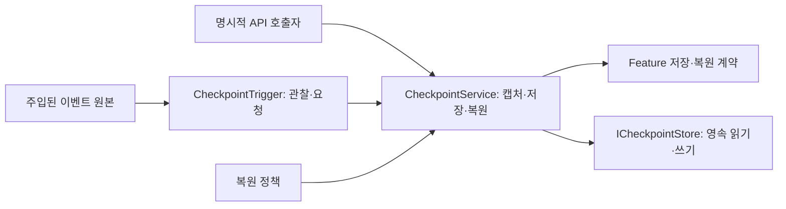

# 2026-11-02 양현석 스프린트 — 게임 사이클·Steam 설계·공용 시간·안전장치

갱신: 2026-11-02 KST. 상태: PL 사용자 결정과 이번 주 작업 범위 / 설계·구현 준비. 아래 기능의 구현 완료를 의미하지 않는다.

기준: main `5e39728c`의 [10월 30일 기획 보강](2026-10-30-planning-review.md), [10월 31일 정기회의](2026-10-31-regular-meeting.md), [Product Plan](../product/PROJECT_PLAN.md). 11월 2일 정책은 이 문서에서 추가한 PL 결정이며 과거 회의 발언으로 소급하지 않는다.

## 1. 이번 주 산출물

| 작업 | 이번 주 범위 | 결과물 |
| --- | --- | --- |
| 게임 사이클 | 부팅·시작 진입 → 우주선 내부의 메인 허브 → Mission 선택·출격 → 행성 플레이 → 결과·귀환·다음 준비 연결 | 우주선을 플레이 공간으로 사용하는 실행 흐름. 진행 중 허브 출입과 Match 종료 뒤 귀환을 구분 |
| Steam API | 사용자 식별·인증, 초대·로비·매칭, NGO 연결과 App 수명의 접점 조사 및 구현 설계 | 공식 자료와 선택 근거, Core/SDK 책임 및 단계별 도입 계획. SDK 선택이나 서비스 구현 완료를 선행 가정하지 않음 |
| Weather·Time | 기존 전달 문서에 따라 Core 공용 게임 시계·취소 가능한 예약 API 제공 후 김진태의 Feature 연결 | NGO 서버 시각에서 게임 정지·배속을 반영하고 날씨·시간대·Encounter 조건이 동일한 게임 시간을 사용하는 경로 |
| 저장·안전장치 | 체크포인트 캡처·저장·로드·복원 API, 재실행 후 저장 지점 복원 기반, 경험치·재화 보존 정책, 이벤트 관찰·요청 경계 | 실행 서비스와 이벤트 관찰자를 분리. 어떤 이벤트에 반응할지는 이번 범위에서 선택하지 않음 |

보스 상세는 최신 회의대로 기본 루프 통합 뒤 다룬다. 이번 주 저장 구현 추가는 과거 Stage 1 PoC의 완료 조건을 변경하지 않는다.

## 2. 확정한 우주선 정지 정책

- 싱글에서는 플레이어가 우주선 내부에 있으면 필드 게임 시간·시뮬레이션을 정지한다.
- SOS로 2명이 참가한 상태에서는 **두 명 모두 우주선 내부일 때만** 정지한다. 한 명이라도 필드에 있으면 계속 진행한다. 한 명이 필드로 나가면 재개한다.
- 판정은 Host의 참가자·위치 상태를 사용한다. Client의 로컬 메뉴나 TimeScale이 공유 Match의 정지 권한을 가지지 않는다.
- 여기서 Tick 정지는 게임 시간·몬스터·터렛 등 필드 진행을 말한다. NGO 통신 시각·전송·연결 유지 처리는 계속 동작한다.
- 우주선 내부 이동·UI는 필드 정지 중에도 사용 가능해야 한다. 전역 `Time.timeScale = 0`만으로 필드와 허브를 함께 멈추는 구현을 피하고, 공용 시계와 각 Feature의 진행 경계를 연결한다.
- 날씨·낮밤과 게임 시간 기반 예약도 이 필드 정지를 따른다. 정지한 시간을 복귀 시 밀린 진행으로 한꺼번에 처리하지 않는다.
- 이 정책을 수용하는 계약과 현재 1~2인 경로를 우선 구현한다. 실제 SOS 매칭·도중 참가 전체 구현을 이번 주 시간 서비스 완료 조건으로 추가하지 않는다.

## 3. 저장·복원 정책

- 게임 종료 후 재실행은 저장 지점을 읽어 복원한다. 메모리의 `MatchSnapshot`, Game Debugger JSON, 프로필 Fake를 실제 디스크 저장/전체 Feature 복원으로 취급하지 않는다.
- 안전장치 발동 시 게임 상태는 체크포인트 시점으로 되돌린다. **경험치와 재화는 기본적으로 복원 직전의 현재 값을 유지**한다.
- 재화는 설정에 따라 체크포인트 값으로 함께 되돌릴 수 있게 한다. 캡처 자료와 복원 정책을 분리해 보존/롤백을 선택한다. 같은 정책으로 복원하는 도중 일부 파트만 다른 기준을 사용하지 않게 한다.
- 경험치 유지에 연결되는 레벨·토큰·성장 자료의 일관성, 재화 소비와 구입한 성장의 관계는 Feature 저장 계약에서 함께 정의한다. 필드 스냅샷과 프로필을 덮어쓰는 순서로 우연히 정해지게 하지 않는다.
- 재실행 시에는 저장된 자료만 복원할 수 있다. 체크포인트의 필드 상태와 보존 대상 성장/재화의 영속 저장 시점·revision 관계를 정의해 아직 저장하지 않은 값을 보존했다고 표시하지 않는다.
- 이전 행성 재방문은 점령 상태를 유지하며 기존 몬스터 처치 사건·재보상을 반복하지 않는 10월 31일 방향을 따른다. 이를 사망 후 안전장치 복귀와 구분한다.
- 완전 재시작은 초기 상태로 돌아가는 별도 동작이다. 안전장치 복원 버튼과 같은 의미로 사용하지 않는다.

## 4. 저장·복원 실행과 이벤트 관찰의 분리

11월 2일 PL 후속 결정: 이번에는 저장·복원 API와 이를 요청하는 이벤트 관찰 경계까지 구현한다. **저장·복원이 자동 실행되는 상황이나 이벤트 목록은 작성·선택하지 않는다.** 과거 회의의 후보를 기본 트리거로 사용하지 않는다.

아래 명칭은 책임을 설명하기 위한 목표 이름이며 아직 구현된 API가 아니다. 실제 계약은 기존 네이밍 규약에 맞춰 확정한다.

| 요소 | 책임 |
| --- | --- |
| `CheckpointService` | 명시적인 저장·복원 요청을 받아 Feature 캡처/검증, 영속 저장, 복원·실패 처리를 조율. 언제 호출할지의 게임 규칙은 소유하지 않음 |
| `ICheckpointStore` | 버전이 있는 체크포인트 자료의 읽기·쓰기. 로컬 바이너리 구현을 서비스 뒤에 주입 |
| `CheckpointTrigger` | 주입된 이벤트를 관찰하고 실행 서비스에 요청하는 어댑터. 구독·해제 수명을 관리하며 게임 상태를 직접 저장하거나 변경하지 않음 |
| 복원 정책 | 경험치·재화 보존과 재화 롤백 선택을 실행 서비스가 일관되게 적용할 자료. 저장·복원 호출 조건과 구분 |

공개 API는 저장과 복원을 구분하고 완료·실패·취소 결과를 돌려준다. 요청은 Host 권위·현재 실행 세대와 연결해 중복 실행·과거 요청·저장 중 복원 충돌을 통제한다. 관찰자는 매 프레임 조건을 임의로 탐색하지 않고 제공된 이벤트를 구독할 수 있게 설계한다. 실제 이벤트 원본을 정하기 전에는 자동 호출을 연결하지 않는다.

저장·복원 책임 분리의 근거는 [10월 3일](2026-10-03-poc-followup.md), 저장 자료 후보와 복원 경계의 근거는 [10월 17일](2026-10-17-regular-meeting.md)이다. 이번 주 구현 범위와 경제 보존 정책은 11월 2일 사용자 결정으로 추가했다. 호출 상황의 미선정은 구현을 막는 확인 대기 항목이 아니다.

## 5. Core와 Feature 접점

| 영역 | Core 역할 | Feature 역할 |
| --- | --- | --- |
| 시간·정지 | Host의 게임 시계·pause/rate·참가자 허브 상태 판정·읽기 복제·Match 수명 | Player는 실제 허브 출입 사실 제공, Enemy/FieldTurret/World는 필드 진행 정지·재개 연결 |
| Weather/Time | clock/scheduler·권위/취소·환경 snapshot 및 Encounter 연결 | 김진태가 날씨·낮밤 규칙·예고·표현과 예약 등록/해제 연결 |
| 안전장치 | 저장 요청 조율, 일관된 캡처 시점·저장 버전·바이너리 입출력·복원 순서·실패 처리·경제 보존 정책 | Player·CU·FieldTurret·지역·Spawn·Weather/Time이 실제 원본에서 저장 자료를 제공하고 복원 |
| 프로필·경제 | 기존 Backend 권위/Local Binary 경계를 유지하고 필드 체크포인트와 프로필 저장을 구분 | 경험치·재화·해금·성장 원본과 일관된 revision 제공 |

현재 `IProfileService`는 프로필 읽기·쓰기 계약, `FakeProfileService`는 메모리 구현이다. 현재 `PlayerProfileSnapshot`에는 재화·해금이 있고 경험치·전체 성장 자료는 아직 없다. `MatchSnapshot`도 실제 Scene Feature 전체의 캡처/복원 구현이 아니다. 이번 저장 작업은 실제 writer의 계약과 바인딩을 포함해야 한다.

시간 복원은 저장된 게임 경과 시각·날씨/낮밤 상태를 기준으로 새 실행 세대에 연결하는 방향으로 설계한다. 과거 NGO 연결 시각·NetworkObjectId·callback delegate를 저장해 재사용하지 않는다. 복원 전에 과거 예약·요청을 취소하고 Feature가 복원 상태에 맞게 다시 등록하도록 한다.

## 6. 구현 배치·PR 검토 순서

1. Core 공용 시계·scheduler와 허브 출입/필드 정지 계약을 구현한다.
2. Weather/Time과 기존 예약·Game Debugger를 같은 게임 시간에 연결한다.
3. 안전장치 자료·경제 복원 정책·바이너리 저장소와 실제 Feature 캡처/복원 경로를 구현한다.
4. 허브의 진입·출격·결과 귀환을 게임 사이클로 연결하고 저장·복원 API의 주입 경계를 제공한다. 자동 저장·복원 이벤트 선정은 이 배치에 포함하지 않는다.
5. Steam 도입 설계를 기존 App/Match/프로필·네트워크 경계와 대조한다.

복구 가능한 커밋으로 나누고 위 기능별로 PR을 분리할 수 있도록 한다. 정확한 PR 수·Issue 대응은 구현 범위 확정 후 정리한다.

수동 인수는 Initial_Stage와 Game Debugger 기준으로 진행한다. 허브의 참가자 정지 정책과 날씨·예약 정지/재개를 확인한다. 저장은 명시적 API 호출로 캡처·영속 쓰기·읽기·복원, 경험치·재화 기본 유지 및 재화 롤백 옵션, 재실행 후 저장 자료 복원을 검증한다. 검증용 호출을 자동 저장 규칙으로 사용하지 않는다. 설계·코드 컴파일·수동 플레이 증거를 서로 대신하지 않는다.

## 7. main 동기화 기록

- origin/main 및 로컬 main: `5e39728c`.
- 현재 `codex/core-sprint-20261026-integration`에 merge commit `385f72c6`으로 반영했다. 기존 발행 PR의 커밋 이력을 재작성하지 않았다.
- 충돌은 `EnemySpawnExecutor`의 World 공간 입력 인자·제작 지점 검사 조건을 보존하고 main의 최신 Enemy 변경을 합쳤다. Docs 목차는 양쪽 자료를 함께 유지했다.
- 기존 사용자 폰트 수정과 `Validation/`을 보존했다. 병합 후 충돌·diff 정적 확인을 수행했으며 이번 동기화의 Unity 컴파일·PlayMode는 아직 실행하지 않았다.
