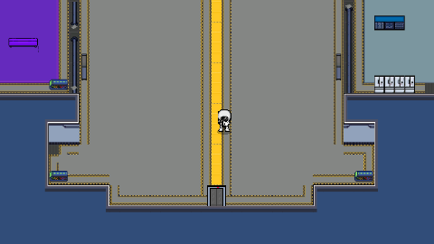

# 낮밤·Steam·시작 우주선 패치 결과

**추가 왕복 패치:** [우주선 첫 출격·필드 왕복 결과](2026-11-05-spaceship-travel-results.md). 아래는 낮밤·Steam 구현 시점의 기록이며, 이후 출입문 연결과 임시 로딩 문구를 추가했습니다.

기준: `codex/core-feature-integration-20261105`, 이전 Core 정리 `ded96c144` 이후 추가 승인한 작업이다. **PR/push/merge는 하지 않았다.** 실제 구현과 자동 확인, 아직 다른 담당/계정이 필요한 범위를 아래처럼 구분한다.

## 추가한 기능

| 기능 | 실제 연결 |
| --- | --- |
| 낮5분/밤5분 | Core 공용 게임 시각으로 계산. 정지·배속을 따르고 Host가 확정한다. 지연 프레임은 현재 구간으로 한 번 따라잡는다 |
| 낮밤→날씨 | 구간 전환 때 기존 ChangeWeather 호출. 같은 Scene의 CountTick 독립 예약은 등록하지 않음. 날씨 선택/예고 큐/효과는 기존 Weather 소유 |
| 환경/저장 | day/night가 기존 환경 snapshot으로 Client/다음 Encounter에 전달. world/time-of-day로 기준/구간을 복원하며 복원 자체는 날씨를 새로 뽑지 않음 |
| Steam SDK | Steamworks.NET2025.165.0/SDK1.65 고정, 실제 AppID4336820·사용자/소유권 확인·App callback/종료·2인 정원 로비 생성/참가/초대 API |
| 시작 우주선 HOTFIX | 기존 Scene에는 시작용 Player/카메라가 없었음. 실내 배치점에서 실제 Stage Player prefab과 Camera를 생성. 허브는 이동만 허용하고 전투 Match를 만들지 않음 |
| 로딩 | 불투명 검은 배경과 하단 바만 표시. Scene→Mission 준비 완료까지 유지. 수치 진행률이 없는 구간은 이동하는 바. 메뉴/결과 화면의 기존 에셋/폰트 유지 |
| 진단 | Game Debugger Overview의 PLATFORM · STEAM에서 설정/초기화/사용자/로비 API를 확인하고 Match 환경에서 낮밤과 남은 게임 초를 봄 |

날씨별 배율·밤의 적 구성·조명 연출·추가 습격은 임의로 만들지 않았다. 다음 Encounter 계획에 환경을 전달하며, 전환 자체가 새 요청을 생성하지 않는다.

## 수동 확인 항목 중 내가 직접 끝낸 것

| 이전 확인 항목 | 실제 자동 확인 |
| --- | --- |
| 시작 버튼과 우주선 | 실제 Startup의 Start 버튼 호출→우주선. Player/Camera·실내 GPU 렌더·합성 키 입력을 통한 이동·허브에서 공격/설치 차단·재진입/AppRoot1개 |
| 메뉴와 입력 잠금 | 실제 Input System Esc로 열기/닫기·이동 잠금/해제, 사망 잠금은 메뉴를 닫아도 유지 |
| 로딩 | 실제 App의 로딩 View를 GPU로 확인. 검은 배경90% 이상/하단 바·버튼/텍스트 없음·입력 잠금과 해제. 실제 Scene 전환/게임 준비 경로도 검사 |
| 낮밤·날씨 | 300/600초 경계와 큰 시각·실제 Stage의 단축 구간에서 내부 진입 정지/필드 복귀 재개·전환당 날씨 호출1회·옛 타이머 중복 없음 |
| 낮밤 저장 | 밤의 상태/남은 구간을 복원해도 Weather 이벤트가 추가 실행되지 않고 다음 예약이 다시 연결됨 |
| 실제 Save gate | 운영 Weather writer가 없는 실제 Scene은 저장을 거절함. 가짜 writer로 제품 Save를 우회하지 않음 |
| 파일→새 Match | 기존 actual binary 입장 성공/외부 writer 거절/읽기 취소/입장 중 취소/일반 입장 취소와 실제 HP·감속·개체 ID/시간 복원 회귀 |
| CU·Player·World 생성 | 기존 실제 원본 검사에서 CU/Player/무기/장치 저장 및 World/source 생성·수명·CU 완료/취소 경계 회귀 |
| 공유 Scene/다음 판 | 같은 Windows Build의 Host/Client에서 서로 다른 협동 Match3개·공유 귀환2회·Client 밤 상태 수신·귀환 후 Player/Camera·AppRoot1개·마지막 Enemy0. 양쪽 종료0 |
| 실제 Steam | 현재 계정/AppID로 SDK 초기화·앱 이용 권한·로비 생성/나가기·종료. 실제 AppRoot가 TimeScale0에서도 callback 처리. Standalone과 EXE 폴더를 작업 디렉터리로 한 실행도 종료0 |

## 실행 결과와 한계

- `final-functional.xml`: **31/31**, Unity 종료0. 이 실행은 검은 로딩 화면 추가 전의 확대 기능 검사다.
- `loading-and-final-scope.xml`: **18/19**. 로딩/우주선·낮밤·CU/Player/World 검사는 통과했고, 실제 Steam 요청1회가 SDK의 `k_EResultTimeout`으로 실패했다. 이를 숨기거나 assertion을 낮추지 않았다. 성공 기록과 별도로 보존한다.
- 이후 현재 코드의 Windows Build `native-build-loading.exit=0`. 같은 Build의 **Host/Client 각 종료0**, 별도 **Steam 모드 종료0**. 실제 생성·로비 나가기·TimeScale0 callback을 확인했다.
- EXE 폴더에 개발 AppID 파일을 두고 그 폴더에서 실행한 SDK 검사도 **종료0**. 번들 steam_api64.dll이 고정 SDK 파일과 SHA256 일치한다. 프로젝트 root 덕분에만 성공한 것으로 남기지 않았다.
- 처음 NoSteamClient는 사용자 Steam 실행/로그인 후 해소됐다. 로비 Timeout의 내부 원인은 단정하지 않는다. SDK 실패는 이유를 전달하고 명시 재요청할 수 있으며 Fake로 바꾸지 않는다.
- 처음 발견한 Runtime Build의 Editor 전용 MatchConfig 조회는 공개 런타임 MatchId 검사로 고쳤다. fixture의 입력 전달/도메인 재로드 조건과 실제 제품 결함은 구분했다.
- 전체 게임/모든 팀 테스트가 한 번에 녹색이라는 보고는 아니다. 각 XML/로그/중간 실패는 Git 제외 `Docs/Local/Work/DayNightSteam-20261105`에 있다. Native 낮밤 전송 검증은1.5초의 격리 제작 데이터로 가속했으며 **제품 기본값은 낮300/밤300초**다. 검증 드라이버/대역은 제품 커밋에 넣지 않았다.

## 이제 내가 직접 볼 것은 최소한 이것만

1. 아래 캡처의 우주선 카메라 배율·시작 위치와 검은 로딩 바의 위치/두께가 원하는 느낌인지. 기존 시작/메뉴/HUD의 최종 해상도·가독성·조작감 같은 시각 인수만 남긴다. 위 기능 순서를 전부 다시 수행할 필요는 없다.
2. 두 번째 Steam 계정의 앱 실행 권한을 준비한다. 현재 계정으로 초기화/로비 생성은 확인했고, 다른 계정의 참가/친구 초대 인수에는 별도 계정·실행 환경이 필요하다. 초대 UI와 실제2계정 시험을1계정 성공으로 대신하지 않는다.

현재 프로젝트에서 보려면 컴파일 후 Play를 중단하고 Startup에서 다시 시작한다. Steam 모드는 SteamAppSettings의 Use Steam을 켜고 새 Play에서 사용한다. 공유 기본값은 팀원의 계정 준비 전에도 개발 검사가 가능하도록 개발 모드다. 내 계정으로 SDK 준비 여부를 다시 수동 판정할 필요는 없다.

## 진태님과 겹치는 부분 / 그대로 남긴 것

수정 전 [배치 문서](2026-11-05-day-night-and-steam-batches.md)에 경계를 적고 `WeatherManager.Core.cs`의 예약/신호 접점만 바꿨다. 실제 WeatherManager.cs의 추첨·예고 큐/가중치, 셰이더·효과, Weather 고유 writer와 실제 포털/콘솔은 이번에 수정하지 않았다. 시작 우주선도 기존 World Scene을 다시 저장하지 않고 Core 설정/조립부에서 연결했다.

기존 전달본과 달라진 핵심은 **Initial_Stage의 Weather writer가 CountTick 시간을 따로 저장하지 않는 것**이다. 낮밤은 Core world/time-of-day, 실제 날씨/큐/난수는 진태님 world/weather가 맡는다. 독립 Scene의 CountTick 호환은 유지한다.

`Docs/Local/Review/CoreCompletion-2026-11-05/by-owner`와 기존 `CoreSprint-2026-11-02/by-owner`의 네 명 전달 문서를 모두 쉬운 문체로 갱신했다. 각 파일에는 내가 어느 파일을 왜 바꿨고, 어느 Core 함수에 연결했는지만 우선 설명했다. 원본 baseline은 보존하고 이 개인 전달 폴더의 Git 제외도 유지한다.

## 구현/확인을 미루는 항목은 수동 테스트 목록과 구분

- **Steam NGO transport·Backend 인증/프로필:** SDK 로비와 실제 게임 접속은 별개다. 현재 Match 참가자의 local-player/peer-N을 Steam 계정으로 자동 바꾸지 않는다. SDK 사용자 식별을 Backend 재화 검증 완료로 표시하지 않는다.
- **운영 Weather writer·Random 선택·포털/콘솔:** 진태님이 하기로 한 구현이다. 실제 writer가 없으므로 운영 전체 Save 차단은 유지한다.
- **실제 Player 원격 생성/전투 복제:** 담당 Feature의 구현/연결이 필요하다. UTP 두 프로세스의 Core 흐름 검증으로 대신 완료 처리하지 않는다.
- **자동 저장 발동 사건·Boss 승리·밤 밸런스/효과:** 아직 정하지 않은 제품 정책이다. 구현이 없는데 PL에게 테스트만 해달라고 넘기지 않는다.

## 커밋과 읽을 문서

- `08df5d9a1` 낮밤/날씨/저장
- `a3794b0f2` 고정 SDK·플랫폼·로비
- `03320cf2e` 시작 우주선 HOTFIX
- `d65a016ec` 검은 로딩·Esc·개발 진단

[낮밤 API](../architecture/day-night-api.md) · [Steam 사용법](../architecture/steam-api.md) · [화면 수명](../architecture/screen-management-api.md) · [전체 호출 지도](../architecture/core-lifecycle-and-api-guide.md)

개인 변경 세 파일은 이번 작업 커밋에서 제외했다. DefinitionId/ShaderGraph는 앞선 snapshot과 일치하며, NEXON SDF는 현재 Editor 작업 중 추가 변경이 관측되어 되돌리지 않고 현재 사본을 개인 검증 폴더에 보존했다. 변경 원인을 임의 확정하지 않는다. stash10개의 원본/순서는 그대로다.
