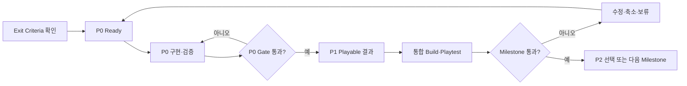
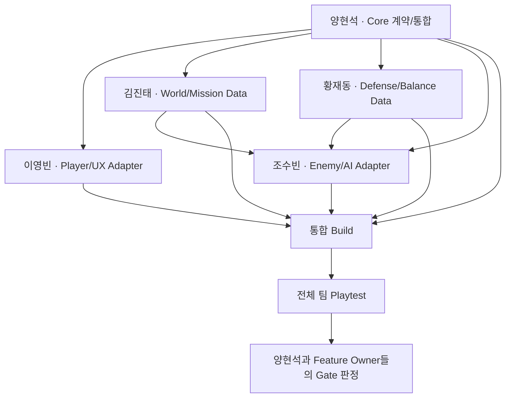

# Development Flow — 전체 개발 흐름

기준일: 2026-09-20
상태: 실행 순서 기준 / Sprint 1 Stage 1 PoC 실행 중

[문서 목차](../README.md)

이 문서는 [milestones-and-core-design.md](milestones-and-core-design.md)의 M0~M5를 Sprint에서 실행하는 방법을 설명한다. Milestone 이름과 범위를 별도로 재정의하지 않는다.

현재 Sprint 1은 2026-10-02까지 Stage 1 PoC를 통합하는 time-box다. PoC 결과는 핵심 재미와 기술 위험을 판정하는 증거이며, 기존 M1/M2 Gate 통과와 프로덕션 이식을 자동 승인하지 않는다.

## 2026-10-24 후속 설계 입력

전사 대조로 켜기 준비 지연과 정상 정지 전 냉각을 구분하고, 파괴 예약 전력·시간 기반 Repair/Restore·복구 취소 후 진행 유지, 키 유지 수리 조작과 모션의 분리를 보강했다. 분대 목표 배정·유지, 스폰량 제어와 경험치 유지·토큰/Blueprint 성장도 후속 구현 입력이다. 정확한 비율·시간·상태 전이와 입력 정책을 정한 뒤 기존 구현과 차이를 확인하고, 같은 Build에서 검증한다. 성장·재화 항목은 기획 검토이며 현재 Sprint 완료 조건이나 M1/M2 Gate를 자동 바꾸지 않는다. 주간 회의 운영은 [Team Workflow](../team/TEAM_WORKFLOW.md#회의-운영--2026-10-24-수기-기준), 근거와 미정 사항은 [회의 검토 기록](2026-10-24-regular-meeting.md)을 따른다.

## 1. 전체 흐름

```text
제품 결정
→ M0 Baseline·Backlog 준비
→ M1 New Core Architecture Slice
→ M2 Single-player Product Vertical Slice
→ M3 2-player Co-op MVP
→ M4 Online Expansion·Content Alpha
→ M5 Beta·Release
```

각 Milestone 내부 흐름은 같다.



## 2. Milestone 요약

| 단계 | 먼저 증명할 것 | Playable 결과 | 다음 단계로 가는 증거 |
| --- | --- | --- | --- |
| M0 | 팀 기준·CI·Backlog가 실행 가능한가 | 안정적인 Baseline | P0 완료, 역할/범위 승인 |
| M1 | 레거시 없이 Core 계약이 작동하는가 | Minimal Test Scene | EditMode/Scene Test와 Core Gate |
| M2 | 게임의 고유한 재미가 있는가 | 15~20분 Single Vertical Slice | 외부 Playtest 지표 |
| M3 | 같은 규칙으로 2인이 안정적으로 하는가 | Invite 기반 Co-op | 2 Client 반복 완주·일관성 |
| M4 | Content·Online·Backend를 반복 운영할 수 있는가 | Alpha | 전체 Flow·복구·Pipeline 검증 |
| M5 | 출시해도 되는가 | Release Candidate | Clean Install·QA·License·운영 검증 |

## 3. 역할 간 선행 관계



- 양현석은 공용 계약과 통합 지점을 먼저 제공하되 Feature를 대신 구현하지 않는다.
- 이영빈·김진태·황재동·조수빈은 계약이 완벽해질 때까지 기다리지 않고 Fake/Interface로 최소 Slice를 병렬 검증한다.
- 김진태와 황재동은 각각 김진태, 황재동이 담당하며, 자신의 Slice를 Fake/Interface로 병렬 검증한다.
- Feature끼리 직접 참조를 늘리지 않고 Definition, Command, Event, Adapter로 연결한다.

## 4. Sprint Planning

1. 현재 Milestone Exit Criteria와 최신 Build를 확인한다.
2. 가장 큰 Risk 하나를 Sprint Goal로 변환한다.
3. 미완료 P0를 먼저 Ready 상태로 만든다.
4. 팀원별 핵심 Task 1개와 작은 Task 1개 이하를 배정한다.
5. 예상 시간 합계는 실제 가용 시간의 70%를 넘지 않는다.
6. 모든 Task에 실명 Owner, 지원자와 가용 시간이 있는지 확인한다.
7. Test Evidence와 통합 날짜를 Task에 적는다.

## 5. 구현과 통합

### 5.1 작은 Slice

한 Slice는 가능한 한 아래 흐름을 끝까지 포함한다.

```text
Definition/Config
→ Domain rule
→ Command/Event
→ Unity Adapter/Presenter
→ Test Scene 또는 통합 Scene
→ 자동/수동 Test Evidence
```

Domain만 대량 작성하거나 Scene만 먼저 완성하는 방식은 피한다.

### 5.2 중간 통합

- Sprint 중간에 완료된 P0/P1을 `main`에 합친다.
- 같은 Build에서 Feature 간 상태·Scene·Save 연결을 확인한다.
- Goal과 무관한 작업은 P3 Backlog로 이동한다.
- 남은 시간으로 Exit Criteria를 달성할 수 없으면 범위를 줄인다.

### 5.3 PR과 Review

```text
Ready
→ Branch
→ 구현·Local Test
→ Self-review
→ PR + Evidence
→ CI
→ Code Owner 승인 + 필요 시 관련 Owner Review
→ Merge
→ 통합 Build
→ Verify
→ Done
```

`main`의 [활성 Ruleset](https://github.com/Team-HJD-21/unity-6-the-developer/rules/23734087)은 Code Owner의 승인 1명, Review 대화 해결, 최신 `Repository checks` 통과를 요구한다. 새 검토 가능 커밋을 push하면 승인을 다시 받아야 한다. Core/Save/Scene/Build/Network처럼 영향이 큰 변경은 이 필수 승인과 별도로 관련 영역 Owner에게도 Review를 요청한다.

## 6. Playtest와 Gate 판정

### 매주

- Release Captain이 동일한 Build와 Test 순서를 준비한다.
- 각 Owner는 자신이 만들지 않은 기능 하나 이상을 확인한다.
- Bug는 재현 순서, 기대/실제 결과, Build/Commit을 남긴다.
- 다음 Build의 Blocker는 최대 3개로 제한한다.

### Milestone 종료

- 양현석이 Exit Criteria 증거를 모은다.
- 각 Feature Owner가 자신의 영역을 통과/미통과로 판정한다.
- 미통과 항목은 수정, 범위 축소, P3 보류 중 하나로 결정한다.
- 모든 P0가 통과하고 핵심 Playable 결과가 있어야 다음 Milestone으로 이동한다.

## 7. 단계별 역할 초점

| Milestone | 양현석 | 이영빈 | 김진태 | 황재동 | 조수빈 |
| --- | --- | --- | --- | --- | --- |
| M0 | 범위·Architecture·CI | Player/HUD 분석 | World/Hub 설계 | Turret/Power 설계 | Enemy/Wave 분석 |
| M1 | New Core·Profile·Match | Player Adapter·HUD | Definition·Test World | Defense Rule/Data | Enemy/Director 최소 Slice |
| M2 | 왕복·Meta UI·통합 | Player Combat·Tutorial | Planet/Hub/Expansion | 3 Turret·Power·Growth | 3 Enemy·Boss·선택된 진행 방식의 Encounter |
| M3 | Steam/Authority/Network | Co-op UX | Ally Agent·Mission | Co-op Balance | Network-safe AI/Encounter |
| M4 | Backend·운영·Alpha Gate | Online UX·Polish | Content Pipeline | Progression/Balance Pipeline | Encounter Pipeline |
| M5 | Release·복구·승인 | UX/접근성 QA | Scene/Content QA | Economy/Balance QA | AI/Performance QA |

Priority별 상세 업무는 Core Design 문서를 사용한다.

## 8. 변경 결정

1. 해결할 Player/기술 문제를 기록한다.
2. 현재 Milestone과 Priority를 판정한다.
3. 추가 작업과 대신 제거·연기할 작업을 함께 적는다.
4. Prototype/Test/Playtest 방법을 정한다.
5. 양현석이 채택·실험·보류·거절을 결정한다.
6. 제품 범위면 Project Plan, 기술 Gate면 Core Design, 역할이면 Role Ownership을 갱신한다.
7. 승인 후에만 Backlog Task를 만든다.

## 9. 지금 실행할 순서

1. [SPRINT_1_STAGE_1_POC.md](SPRINT_1_STAGE_1_POC.md)의 업무를 GitHub Issue로 만들고 담당자·완료 조건·검증 방법을 기록한다.
2. 황재동이 터렛 인스턴스와 평가 데이터를 제공하고 조수빈과 인터페이스를 합의한다.
3. 조수빈이 터렛 목표 배정에 최단거리와 주변 밀집도를 먼저 적용하고, 새 목표가 필요할 때까지 선택을 유지하는 방향을 시험한다. 플레이어 감지 범위 안의 추적과 이탈 뒤 터렛 행동 복귀도 먼저 확인한다. 복합 점수식은 결과가 부족할 때 확장하며 거리·밀집도 기준과 감지·복귀 세부 규칙은 미정이다. ([10월 23일 몬스터 회의](2026-10-23-monster-meeting.md))
4. 김진태가 전제 1의 동적 전선과 전제 2의 지역 해금을 관찰할 Graybox를 조수빈·황재동 결과와 연결한다. 실험 순서·병행 범위는 별도 결정한다.
5. 이영빈이 Netcode/RPC/권한 구조 조사 결과와 현재 PoC의 향후 네트워크 전환 위험을 공유한다.
6. 양현석이 Player 지원 행동과 전제 1·2의 재미 관찰 기준을 정해 한 Build로 통합한다. 사망은 디버그 부활 또는 무적으로 시험하고 승리 조건은 미정으로 둔다.
7. 2026-10-03 회의 시점에는 통합·플레이 테스트 결과가 확인되지 않았다. 주말에 통합을 마무리한 뒤 전선 형성·충돌·끼임을 우선 관찰하고, 재미·문제점·프로덕션 이식 여부를 실제 증거로 판정한다. ([10월 3일 PoC 후속 검토](2026-10-03-poc-followup.md))
8. 10월 5일 논의에 따라 세 전선의 스폰 포인트·ID를 확인하고, 정확한 호출 계약을 코드에서 확인한 뒤 `Spawn`으로 생성부터 시험한다. 생성 성공은 아직 미보고이며, 네트워크 매니저가 필요할 수 있는 이동 검증과 구분한다. ([스폰 연동 검토](2026-10-05-monster-map-spawn-review.md))
9. PoC 동안 최종 아트, 모든 Content, 실시간 협동과 장기 성장 확정은 시작하지 않는다. Spaceship 연구·결과 성장·다음 Mission은 PoC 완료 조건이 아니다.
10. 양현석이 `InitialStageCompositionRoot`에서 `TurretController.ConfigureUnlockZones`를 호출하도록 연결한다. 기본 구역 수 4 사용 방향은 회의에서 확인했지만, 최신 main 정적 검색에서는 호출을 찾지 못했다. Unity 실행 검증은 별도다. ([10월 23일 몬스터 회의](2026-10-23-monster-meeting.md))
11. 조수빈이 Enemy 밸런싱용 몬스터·스쿼드 표를 공유하고 양현석이 검토한다. 실제 업로드와 PR 리뷰 답변은 완료 확인 전까지 미완료로 둔다. ([10월 23일 몬스터 회의](2026-10-23-monster-meeting.md))
12. 조수빈이 기존 PR 리뷰에 답하고 양현석에게 알린 뒤, 이동 속도 갱신과 물리적 밀림·넉백의 상호작용을 재현해 후속 수정 단위와 담당을 확정한다. `AddForce`/`Impulse`는 회의에서 제안된 방향이며 원인·수정·실행 검증은 미확인이다. ([10월 23일 몬스터 회의](2026-10-23-monster-meeting.md))

## 2026-10-30·31 회의 후속의 실행 순서

1. 기본 루프와 실제 통합 시험을 우선한다. 보스 상세·신규 귀환 편의·날씨 수치 후보로 검증 범위를 계속 늘리지 않는다.
2. 스포너 그룹화·분대 프리셋·몬스터/이벤트 스폰과 Core 연동을 확인한 뒤 첫 Stage 배치를 시험하고 반복 조정한다. 점령/해금 구분과 한쪽 확장 반례를 점검하며 단일 전체 점유율 공식을 확정하지 않는다.
3. 터렛/Player/Enemy 대응 자료를 같은 형식으로 정리·갱신한다. 성장 트리·CU 관문, 우주선 필드 정지의 진입/복귀·저장 계약과 도감 UI는 설계/완료 증거를 분리해 확인한다.
4. [파트별 후속과 목표](SPRINT_1_STAGE_1_POC.md)를 진행하되 기존 time-box 기록·실제 인수·새 기대 목표를 섞지 않는다. 11월 내 전제 1/2 선택 목표, 집중 작업/휴식 발언을 새 Sprint나 Gate 완료로 기록하지 않는다.

근거: [10월 30일 전사·수기 대조](2026-10-30-planning-review.md) · [10월 31일 재확인·미정](2026-10-31-regular-meeting.md). 현재 사용자 작업 브랜치의 코드·Scene·미커밋 Docs를 이 문서 동기화에 포함하지 않는다.
