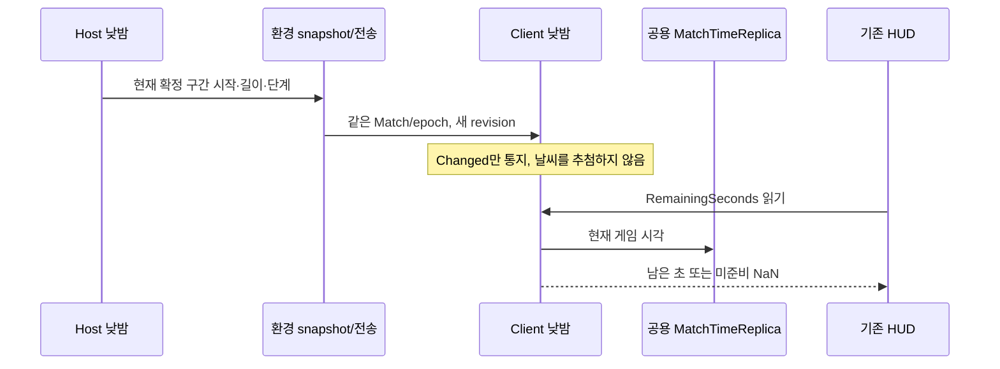

# Client 낮밤 잔여시간 연결

PR: 생성 후 실제 번호를 기록합니다.
작성: 2026-11-11 · Core / 양현석 · 기준 main `f6a8c22c0ee840500ebabd6891dd3ccec3c9c790`

## 왜 바꿨나

Host는 낮5분/밤5분과 Reset을 갖고 있었지만 Client에는 현재 day/night만 전달됐습니다. 그래서 Client HUD는 계속 `--:--`였습니다. Host가 확정한 현재 구간의 시작·길이를 기존 환경 snapshot에 싣고, Client가 이미 받는 공용 게임 시계로 남은 시간을 읽게 했습니다. 다른 파트 소스·HUD·Scene·Prefab은 수정하지 않았습니다.

## 코드 읽는 순서

1. `MatchDayNightCycle.Replica.cs`의 `CapturePhaseAnchor`를 봅니다. Host가 마지막으로 확정한 구간의 시작 시각·낮/밤 길이·단계를 기존 불변 `DayNightCycle` 자료로 제공합니다. 아직 확정하지 않은 다음 구간을 패킷에 섞지 않습니다.
2. `MatchEnvironmentSceneScope.Publish → MatchSession.UpdateEnvironment → MatchEnvironmentRuntime.TryUpdate`가 실제 날씨와 이 구간을 같은 snapshot으로 게시합니다. ID가 그대로인 Reset도 구간 시작이 달라져 revision이 올라갑니다. 기존 3인자 함수와 snapshot 생성자 시그니처는 유지했습니다.
3. `EnvironmentReplicationCodec`이 기존 환경 전송을 사용합니다. 구간이 있으면 v3, 없으면 v2입니다. 새 Reader가 v2도 읽으며 구간이 없는 자료는 그대로 미제공입니다. 새 Manager·전송 채널·Client scheduler를 추가하지 않았습니다.
4. `InitialStageCompositionRoot.BindTimeReplica / BindEnvironmentReplica`가 현재 Client의 공용 시계와 환경을 연결합니다. 어느 것이 먼저 도착하더라도 연결되고, 해제 때 참조를 비웁니다. 필드 전용 시계는 연결하지 않습니다.
5. `ApplyReplica`가 Match/revision을 확인해 표시 기준만 바꿉니다. `ReadReplicaRemainingSeconds`는 같은 Match/epoch의 시계와 기준을 읽습니다. 기존 `IMatchDayNightCycle.RemainingSeconds` 소비자는 그대로 사용합니다.

## 중요한 분기와 호환

- 최초 기준/시계 미수신, 다른 Match·복원 세대 또는 해제 뒤에는 NaN입니다. 미준비를 5분으로 채우지 않습니다. 과거 revision은 무시합니다.
- 시계가 구간 끝을 먼저 지나면 0에서 Host 확정을 기다립니다. Client가 다음 낮밤이나 날씨를 먼저 정하지 않습니다. 수신은 `PhaseAdvanced`를 발생시키지 않습니다.
- Reset은 같은 day/night여도 새 anchor를 전달합니다. 복원 뒤 epoch가 서로 맞을 때만 표시하고 다음 Match에 이전 값을 넘기지 않습니다.
- 환경 v2 읽기는 유지하지만 구형 실행 파일의 v3 읽기는 보장하지 않습니다. 협동은 같은 Build가 필요합니다. 낮밤 저장 section은 기존 v2 쓰기/v1 읽기를 유지합니다.
- Weather 추첨·예고 큐·가중치·셰이더·Weather 저장 writer는 김진태 담당 그대로입니다. 기존 Weather 컴포넌트가 받는 계약을 바꾸지 않았습니다. 이 변경은 전체 Save나 실제 원격 Player 전투 완성을 뜻하지 않습니다.

## 무엇을 검증했나

Unity6000.3.23f1 / NGO2.13.3. [공유 결과와 소스 해시](client-day-night-anchor-20261111.results.json)에 실제 케이스·원본 해시를 기록합니다.

| 검사 | 결과 |
| --- | --- |
| Core 낮밤 읽기 | 7/7. 미준비·정지·배속·경계 대기·자연 경계·epoch 복원·과거 revision·Reset·기존 v1/v2 저장 읽기 |
| 실제 codec | 3/3. v2/v3 왕복, 잘린/잘못된/후행 자료 거절 |
| Editor 실제 Initial_Stage Play | 1/1. 기존 자동/수동 생성, 실제 Match/owner/공용 시계와 진단 유지 |
| Windows Development Build | 성공, 종료0. 제품 Build Settings를 바꾸지 않고 검증 Build만 Stage에서 시작 |
| 독립 Host/Client | `20261111T122319Z-da465d7b`, 동일 Build `987bde6064e44fb2826bafff96bf9edc`, PID46564/32908. 양쪽 종료0, Runtime 오류 서명0 |

독립 실행에서는 Static → ClockPaused → ClockRate → ClockReset → Dynamic → Release → Ended → Restart → FinalEnded → Disconnect → Disconnected의 11단계를 모두 확인했습니다. 기존 실제 터렛 명령 7종도 함께 통과했습니다. CU 실제 피해 후 다음 Scene Update의 패배·양쪽 결과 화면·연결 정리까지 확인합니다. 원격 상호작용 actor는 기존 개발 전용 fixture이며 실제 Player 복제의 인수가 아닙니다.

| Client 표본 | 단계 | 남은 게임 초 | 게임 배속 | 환경 revision |
| --- | --- | ---: | ---: | ---: |
| 시작 | Day | 299.964 | 1 | 2 |
| 정지 | Day | 299.776 | 0 | 2 |
| 2배속 수신 | Day | 299.776 | 2 | 2 |
| 같은 낮 구간 Reset | Day | 299.984 | 1 | 3 |
| Host 밤 전환 | Night | 300.000 | 1 | 4 |
| 새 Match | Day | 300.000 | 1 | 2 |

이 표는 Client가 보낸 값을 Host가 받은 기록입니다. 별도로 Host의 당시 공용 시각과 Client 시각 차이 **1게임초 이하** 및 환경 프레임 hash 일치를 검사했습니다. 두 숫자가 모든 순간 비트 단위로 같다는 주장이 아니며 최대 지연 네트워크 실험은 하지 않았습니다. 자연 경계는 Core 실제 source 검사에서, 두 실행 파일의 밤 전환은 권위 디버그 API에서 각각 확인했습니다.

Standalone 종료 때 기존 ComputeBuffer 정리 경고가 각1줄 남았습니다. 관리 Runtime 오류와 구분하며 이 PR에서 GPU 자원 수명을 해결했다고 표시하지 않습니다. 앞선 검증기의 옛 CU 인터페이스/동기 완료 가정 실패, 테스트 fixture 카운터 초기화 실패는 실패 원본을 보존하고 최종 성공과 구분했습니다.

원본은 로컬 `Docs/Local/Review/CoreExecution-20261111/P3/`와 검증 프로젝트의 `Docs/Local/Validation/CoreSprint20261015/NetworkPair/20261111T122319Z-da465d7b/`에 있습니다. 공유 JSON에는 요약과 원본 SHA256을 넣습니다. 로컬 경로를 팀원이 접근 가능한 원격 링크로 표시하지 않습니다.

## 재실행과 되돌리기

- Unity CLI `test --mode EditMode --filter TeamHJD.Game.Tests.EditMode.DayNightReplicaTests`는 순수/컴포넌트 계약을 확인합니다.
- codec은 Networking.Tests assembly의 PlayMode 검사 `DayNightPhaseCodecTests`입니다. Editor 모드의 발견0건을 성공으로 계산하지 않습니다.
- `CoreNetworkBuildPipeline.BuildWindowsDevelopment` 뒤 `tools/Test-CoreNetworkPair.ps1`가 같은 빌드의 두 프로세스를 실행합니다. 이 스크립트가 시작한 PID만 정리하고 기존 Editor를 조작하지 않습니다.
- 문제가 있으면 이 PR의 phase anchor·codec·Client 연결을 함께 되돌립니다. 한쪽 codec만 되돌려 서로 다른 프로토콜을 섞지 않습니다. 저장 파일·씬 직렬화 migration은 없습니다.

[낮밤 API](../../02_architecture/09_world/day-night-api.md) · [환경 API](../../02_architecture/02_match/match-environment-api.md) · [HUD 사용법](../../02_architecture/09_world/weather-debug-hud.md)
