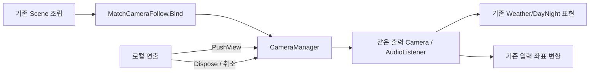

# 로컬 카메라 관리와 임시 시점 전환

PR: [#694](https://github.com/Team-HJD-21/unity-6-the-developer/pull/694)
검증 코드 기준: `93daef45cdc2e00e72177ce259e99ea779181f3c`. 아래 PR 번호 보완은 Runtime 소스를 바꾸지 않습니다.
작성: 2026-11-11 · Core / 양현석 · 기준 main `0d7aa0a21103a6a1f38ef1b45e4a115cdd43bc61`
관련: Refs #637. 실제 Player/Weather 소비자의 최종 인수까지 대신 완료했다고 처리하지 않습니다.

## 바뀐 기능

기존 Player 추적 카메라에 `CameraManager`를 연결했습니다. 컷씬은 별도 실제 Camera를 켜는 대신 현재 출력의 위치·회전·확대를 임시로 바꾸고, 반환 lease를 해제하면 이전 시점으로 돌아갑니다. 같은 Scene의 Weather/입력 카메라 객체를 계속 사용합니다.

새 네트워크 서비스·전역 GameManager·상속 프레임워크·새 카메라 패키지는 추가하지 않았습니다. 현재 게임의 2D XY/정사영 기능에 한정합니다. Player/World/HUD 소스·Scene·Prefab을 수정하지 않았습니다.

## 먼저 볼 코드와 흐름

1. `MatchCameraFollow.Awake → CameraManager.Attach`: 기존 Scene에 있는 Follow의 GUID와 호출 API를 유지하면서 같은 객체에 관리부를 확보합니다.
2. 기존 `InitialStageCompositionRoot.ComposeAuthority / ComposeNetworkMatch`와 `SpaceshipHubCompositionRoot.Compose`가 계속 `Follow.Bind(localPlayer)`를 호출합니다. Manager는 로컬 기본 대상을 갱신하고 과거 임시 시점을 비웁니다.
3. `CameraManager.PushView(marker, seconds, size)`가 임시 요청 하나와 해제 lease를 만듭니다. 마지막 살아 있는 요청이 우선이며, 이전 요청을 먼저 취소해도 나중에 되살아나지 않습니다.
4. `CameraManager.LateUpdate`가 unscaled time의 부드러운 블렌드로 같은 출력에 XY·회전·확대를 반영합니다. 그동안 Follow는 transform 쓰기를 양보합니다. 기본 Player 추적은 기존 SmoothDamp입니다.
5. lease Dispose·marker 삭제는 이전 시점/기본 Player로 복귀합니다. actor 교체는 기존 임시 요청을 무효화하고, 이전 actor의 늦은 Dispose가 새 요청을 바꾸지 못하게 합니다.
6. `InitialStageCompositionRoot.ReleaseOwnedBindings`가 actor를 없애기 전에 `Follow.Bind(null)`로 카메라 임시 상태를 닫습니다. 허브 Release의 기존 해제도 사용합니다.
7. `CameraManager.OnDisable`은 자신이 관리하는 출력과 listener를 끄고 이전의 살아 있는 등록을 선택합니다. 같은 객체를 재바인딩하면 현재 출력으로 다시 선택됩니다. 별도 등록 flag를 중복 보관하지 않으며 새 Play의 static 초기화도 처리합니다.

## 중요한 정책

- 실제 출력 교체는 Scene 조립 수명에서, 임시 시점은 연출 소유자의 lease에서 정리합니다. Server RPC나 다른 참가자 카메라를 조작하는 기능은 아닙니다.
- 블렌드 시간0은 즉시 전환, 양수는 부드러운 전환이며 반환에도 같은 길이를 사용합니다. Match 정지 중에도 로컬 전환은 끝납니다. 게임 시간·입력 잠금·컷씬 재생은 각 소유자의 API를 사용합니다.
- 출력/시점 알림 구독자의 예외는 로그로 남기고 다른 구독자·lease 반환·Scene 정리를 막지 않습니다. 이를 숨겨 성공으로 처리하지 않으며 검사에서는 의도한 예외2개를 LogAssert로 명시했습니다.
- 관리부가 없는 보조 렌더 카메라·미니맵까지 전역으로 끄지 않습니다. 여러 로컬 viewport/split-screen이나 원근 FOV는 이번 계약이 아닙니다.
- 기존 포털 `SnapToTarget`과 0.9초 페이드 호출은 유지합니다. 새 Player 카메라 Prefab 강제 배치나 Weather 재바인딩 구현은 없습니다.

## 실제 확인 결과

[검사 이름·표본·원본/소스 SHA256](local-camera-management-20261111.results.json)에 결과를 기록합니다.

| 검사 | 실제 확인 |
| --- | --- |
| Editor 컴포넌트 계약 | 11/11. 즉시/중첩/역순 해제·marker 삭제·actor 교체/상실·출력/listener 선택·재바인딩 순서·static 초기화·구독자 실패 |
| Initial_Stage Play | 기존 Camera와 Weather 컴포넌트3개 유지, 게임 정지 중 블렌드·확대·복귀, 활성 listener1개 |
| Startup→Hub→Stage→Hub Play | 실제 GameFlow API와 Scene 로드. 각 도착에 유효한 로컬 대상·활성 listener1개 |
| Windows Development / 실제 Host·Client | 최종 빌드 성공. 실제 11단계 재통과, Client 실행 표본8개 모두 자기 Player/출력 Camera 일치, 종료 뒤 target/임시 view 비움. Run `20261111T124847Z-afc34b49`, 양쪽 종료0·Runtime 오류0 |

Play 검사에는 제품 Scene을 저장하거나 Default Player를 교체하지 않았습니다. 처음의 Startup 검사 경로 오타는 검사에서 수정했고 실패 XML을 성공으로 합산하지 않았습니다. 이후 재바인딩 선택 순서 보강 뒤 관련 전체 검사를 다시 수행했습니다.

Startup 왕복에서는 기존 경고인 `PlayerWeatherEffectBinding.cs:35`의 PlayerLocationState 미제공과 `FieldTurretInstanceRegistry.cs:78`의 중복 Instance ID 재할당이 관측됐습니다. 새 카메라 기능으로 원인을 단정하거나 팀원 코드를 고치지 않았습니다. 관리 Runtime 예외와 구분하며 사용자→담당자 인계 항목입니다. 기존 Standalone 종료의 ComputeBuffer 경고도 별도 자원 수명 문제로 남깁니다.

## 팀원 연결과 남은 인수

[실제 사용 예시](../../02_architecture/03_scene-flow/camera-manager-api.md)를 먼저 보면 됩니다. 연출 소유자가 시작/종료/취소에서 PushView와 Dispose를 호출합니다. 실제 Main Camera가 바뀌는 확장을 할 때는 World/입력 소비자가 OutputChanged를 받아 재연결하도록 담당자와 연결합니다. 이번에는 같은 출력 보존으로 접점을 줄였습니다.

현재 #637은 기반 코드·자동 경로 검사까지 진행됐습니다. 실제 마우스 조준·날씨 효과의 육안 검사, 제품 컷씬 연출 및 Player 원격 복제 전체를 이 PR에서 검증했다고 쓰지 않습니다. 기존 별도 렌더 카메라를 관리부에 편입하는 변경도 담당자 승인 후 진행합니다.

## 되돌리기

이 PR의 CameraManager·Follow 연결·Match 종료 해제 한 줄을 함께 되돌리면 기존 Player 추적 경로로 복귀합니다. Scene/Prefab GUID·저장/환경 wire 형식·네트워크 API는 변경하지 않았습니다. 새 관리 API로 연출을 연결한 후에는 그 소비자도 함께 확인해야 합니다.

원본은 로컬 `Docs/Local/Review/CoreExecution-20261111/P4/`에 보관합니다. 사용자 원본 Editor/미커밋 파일/stash는 이 검증 프로젝트와 분리해 유지했습니다.
