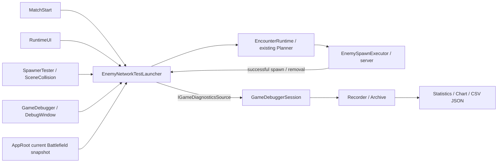

# Game Debugger 사용·연동 가이드

기준일: 2026-10-08 · 상태: 구현 / CLI 검증 · 화면·영상 인수 확인 별도

[배치 계획](../planning/2026-10-08-game-debugger-batch-plan.md) · [구현 결과·검증](../planning/2026-10-08-game-debugger-batch-results.md) · [Core README](../../Assets/PoC/Core/README.md)

## 실행 순서

1. `Assets/PoC/Spaceship/Scenes/Initial_Stage.unity`를 연다.
2. `Tools > TeamHJD > Game Debugger`. 기존 `Battlefield Debug` 메뉴도 유지된다.
3. Play → Overview의 SERVER·Match ID, 터렛·전력과 경고를 확인한다. 첫 Encounter는 기존 정책대로 자동 요청된다. 창을 연다고 자동 요청을 끄지 않는다.
4. Battlefield에서 기존 Grid 에셋/현재 Match override, 셀 선택과 Scene 레이어를 사용한다. 계산은 Core, 창과 Overlay는 표시·명시적 요청만 담당한다.
5. Encounter의 Request는 추가 생성 요청이다. Game View의 Plan & Spawn 및 Scene 충돌도 같은 snapshot 경계를 사용한다. 성공한 수동 요청은 **아직 예약된** 자동 첫 요청만 취소한다. 완료된 자동 요청은 되돌리지 않는다.
6. Statistics의 A=LIVE, Metric=Spawned, Bin=5초가 기본이다. Enemy type / SpawnPoint ID / Squad preset은 정확한 문자열 일치, source는 enum 필터다. 막대에 마우스를 올려 구간을 확인한다.
7. Timeline에서 source/kind/문자열을 검색하고 북마크를 추가한다. 터렛 파괴·복구 마커는 현재 Scene 터렛을 선택/Frame할 수 있다. 실제 제거를 처치로 해석하지 않는다.
8. Capture / Compare에서 종료한 Match ID를 A/B로 선택하거나 JSON을 import한다. Commit/Build 라벨을 직접 입력한 뒤 `Stamp build/commit label on live record`로 활성 기록에 반영한다. Git commit을 자동 추측하지 않는다.
9. Scene Capture preset, Overlay/창, Game/Scene View를 조합해 스크린샷/영상을 남긴다. JSON과 events/samples CSV는 명시적으로 경로를 선택해 저장한다. 기본 저장을 저장소 내부로 강제하지 않는다.

## 창 구성과 데이터의 뜻

| 패널 | 제공 기능 |
| --- | --- |
| Overview | LIVE/PREVIEW, authority, 게임/실제 경과, 수집/손실, 생존 수·귀속 불명 수, 전력, 영역 면적·외곽 길이, 연결 경고, 터렛 목록 |
| Battlefield | 기존 공용 Grid authoring/current override, 레이어·셀 상세·Scene 설치 명령, 현재 터렛 표 |
| Encounter | 기존 snapshot Request, 최근 20개 요청의 source/RequestId/revision/preset/planned/actual 및 사유 |
| Statistics | Spawned/Removed histogram, Alive/CumulativeSpawned/AvailablePower/OperationalRatio/TerritoryArea/FrontlineLength 추이, Planned/Executed/Failures, 필터·A/B |
| Timeline | Match/요청/실제 생성·제거/터렛 파괴·복구/snapshot revision 이력, 검색·북마크·조건부 정지 |
| Capture / Compare | Scene 캡처 메타데이터, 조회용 차트, JSON/CSV 내보내기, import·A/B 비교 |

상단 시간 도구는 로컬 Editor 전용이다. 0.25/0.5/1/2/4배 또는 0~8 직접 입력, Pause/Resume/Step/Restore를 제공한다. `fixedDeltaTime`, FPS, 네트워크 시간을 자동 조절하지 않는다. timeScale=0이면 게임시간만 멈추므로 Step은 비활성이다. Step은 Unity 한 프레임이며 결정론적 Match tick이 아니다. Host의 Pause가 다른 Client를 멈추지는 않는다.

Capture mode에서는 시간·기존 게임 변경 명령을 비활성/숨김 처리한다. 표시 옵션, 기록의 조회/Export와 메타데이터 라벨은 게임 상태를 변경하지 않는다. 이미 무장한 조건부 정지는 별도 상태다. 시간 변경은 창을 닫아도 유지하며 Restore, Play 종료, assembly reload 또는 Editor 종료 때 소유한 값만 복원한다. 외부가 timeScale을 바꾸었다면 그 값을 덮어쓰지 않는다.

## 집계·누락·보존

- 실제 생성은 서버의 `NetworkObject.Spawn()` 성공 후 발행한 사실, 제거는 Executor의 untrack/Despawn 사실이다. 현재 생존 수 차분이나 로그 파싱으로 생성량을 추측하지 않는다. 생성과 제거가 같은 bin에 있어도 각각 집계한다.
- 서버 현재 생존 수는 해당 Match에 귀속된 Executor 추적 수다. 무 context 생성은 별도 귀속 불명 수이며 차트에 현재 Match 생성 사실처럼 넣지 않는다. Client에 서버 집계 계약이 없으면 N/A다.
- 수치 표본은 0.25초 실제 시간 간격, 연결 검사는 1초, UI 갱신은 최대 4Hz. 터렛 topology 면적/외곽 길이는 geometry 변경 때 재계산한다. 정적 데이터와 동적 점유 revision을 혼동하지 않는다.
- 기본 bin은 게임시간 5초. Real clock은 실제 경과시간으로 구간을 바꾼다. bin 상한 2,048개를 넘으면 실제 폭을 늘리고 축에 표시한다. 표본이 없는 bin은 N/A, 없는 값을 0으로 잇지 않는다.
- source/preset/type/point 필터는 **이벤트**에만 적용한다. Alive/Power/Ratio/Area/Length는 Match 전체 표본이다. type/point별 계획 수 계약이 없으므로 해당 필터에서 Planned/Executed/Failures 차트는 N/A다.
- `PARTIAL`은 중간 수집 시작, sequence gap, 상한 초과 또는 정상 종료 마커 부재를 뜻한다. partial 기록의 이벤트 수는 남아 있는 관측량이며 총량 보장이 아니다. 관측 없는 event bin을 0으로 표시하지 않는다.
- Runtime 최근 이벤트 4,096개. Editor 실행 8개, 실행별 이벤트 8,192개·표본 7,200개·마커 512개 상한. overflow 상태를 표시한다. JSON import는 16MiB 이하/schema 1, 동일 Match ID와 유효 시간/수량을 검사한다.
- 종료 기록은 snapshot/활성 Match와 분리된다. domain reload/다음 Play에서도 Editor `SessionState`에 최대 8MiB를 보존하며 초과하면 오래된 실행을 버린다. Editor를 완전히 종료하기 전 필요한 기록은 JSON Export한다. 게임 상태·Replay·영속 저장 기능이 아니다.
- JSON에는 Scene/Unity/수동 Commit·Build 라벨/seed/content/stage/difficulty/mode/초기 Grid/clock policy와 원시 이벤트·표본·마커가 담긴다. 런타임 Grid override의 모든 설정 이력을 재현하는 파일은 아니다. CSV는 사실 이벤트와 표본을 각각 내보내고 숫자는 invariant culture, 문자열은 따옴표·수식 실행 방어를 적용한다.

## 조건부 정지

Timeline에서 요청 실패, 터렛 파괴, Grid OOB를 각각 무장한다. 한 조건이 발생하면 로컬 Editor를 한 번 정지하고 이유를 기록한다. Resume만 누르면 계속 재정지하지 않는다. `Rearm conditions`를 눌러 다음 관측을 기다린다. 과거 buffer 재생은 정지를 발생시키지 않는다. 이미 파괴됐던 터렛을 뒤늦게 수집했다고 신규 파괴를 만들지 않는다. OOB가 지속 중이면 재무장 후 다시 정지할 수 있다.

## Runtime / Editor API 경계

`IEncounterDebugCommandTarget.TryRequestCurrentEncounter(preset, max, source, out result)`는 bound 최신 snapshot을 사용한다. 명시적 snapshot과 source를 받는 overload, 이전 signature도 유지한다. Match ID와 Host/Executor 준비를 검사한다. 준비가 안 된 수동 요청은 즉시 사유를 반환하며 공간 검사를 우회하지 않는다.

`IGameDiagnosticsSource`는 bounded recent buffer, sequence, bound Match, 게임/실제 clock, 서버 권한, 생존/귀속 불명 수와 `DiagnosticEmitted`를 제공한다. `GameDiagnosticEvent`는 MatchId/revision/RequestId/source/preset/type/point/entity/planned/actual/time/message의 불변 사실이다. RequestId는 이 런처의 Match 내 상관 ID이며 **E의 PlanId나 재시도 idempotency token이 아니다**. 요청 revision은 계획 입력 버전이지 생성 순간 최신 revision 보장이 아니다.

`EncounterExecutionContext`는 실제 Executor 기록과 요청을 연결한다. 기존 `Execute(instruction)`/`Spawn()`는 독립 Feature 호환용으로 유지하나 네 프로젝트 진입점은 context·snapshot 공통 경계를 사용한다. 다른 Feature가 직접 호출하면 telemetry coverage는 별도로 연결해야 한다. 관측 subscriber 예외는 실제 생성 흐름을 중단하지 않는다.

## 구현하지 않은 지표 / 별도 인수

후보별 판단 이유/점수, 공식 PlanId·중복 실행 방지, 처치/피해/DPS/전술 압력·우세도, 분대 타깃의 실제 유효성은 아직 계약이 없어 N/A다. 연결 경고는 SpawnPoint ID/위치, topology 부족, OOB, 진단 소스 수와 TargetableComponent 존재를 검사하며 공격 성공까지 인증하지 않는다. 정확한 snapshot 발행 timestamp는 없으므로 observed age와 구분한다.

자동 통합 검사는 충돌 adapter 메서드를 직접 호출했다. 물리 `OnCollisionEnter2D`, 실제 Game UI 클릭, 다중 Client 동기화, 그래프 화면·dock layout·영상은 별도 시각/조작 확인이다. 전체 전투·지역 해금·승패 한 사이클 완료를 이번 도구 배치 완료와 동일시하지 않는다.
